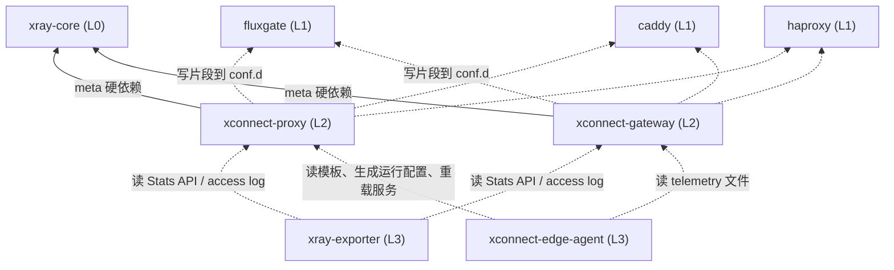

# XConnect 边缘节点 8 个 Role 职责边界、归属矩阵与组合编排规划

> [!NOTE]
> 本文是**规划文档（Planning / Target Architecture）**。第三节"运行态基线"是 2026-11-18 在 `root@ph-xconnect.svc.plus`（`165.154.32.241`，Ubuntu 24.04）上用 `systemctl` / `ss` / `ls` 实际核查的结果；第四节以后是目标设计，**不代表 `ai-workspace-infra/playbooks` 已经全部实现**。各 Role 的当前实现差距见第十节。

---

## 一、目标与范围

### 1.1 目标

把边缘节点上的 Ansible Role 拆成 8 个**单一职责、单向依赖、可自由组合**的单元，使任意节点（经典 Agent Proxy、纯 Zero Gateway、两者混部）都可以只靠 playbook 中的 role 列表组合出来，而不需要在 role 内部写死"谁调用谁"。

### 1.2 范围内的 8 个 Role

| # | 目标 Role 路径 | 层级 |
|---|---|---|
| 1 | `roles/vhosts/xray-core` | L0 底座 |
| 2 | `roles/vhosts/caddy` | L1 入口引擎 |
| 3 | `roles/vhosts/fluxgate` | L1 入口引擎 |
| 4 | `roles/vhosts/haproxy` | L1 入口引擎 |
| 5 | `roles/vhosts/xconnect-proxy` | L2 数据面运行时 |
| 6 | `roles/vhosts/xconnect-gateway` | L2 数据面运行时 |
| 7 | `roles/vhosts/xray-exporter` | L3 观测 |
| 8 | `roles/vhosts/xconnect-edge-agent` | L3 控制面 |

### 1.3 范围外（相邻，但不属于这 8 个 Role）

| 运行单元 | 归属 Role | 说明 |
|---|---|---|
| `vector.service`（`127.0.0.1:8686`） | `roles/vhosts/vector-agent` | 日志/计费快照采集，消费 `xray-exporter` 与 access log |
| `xconnect-host-metrics.service` | `roles/vhosts/process_exporter` / `node_exporter` | 主机级指标 |
| `xconnect-journal-vacuum.timer` | `roles/vhosts/xconnect_node_log_policy` | journald 清理策略 |
| 内核 / qdisc 基线（`apply-fq-qdisc`） | 现位于 `xconnect_proxy/tasks/network_baseline.yml`，建议迁往 `kernel_tuning` | 与协议运行时无关 |

---

## 二、设计原则

1. **One Role, One Job**
   - 入口引擎只管引擎生命周期和 `conf.d/` 容器目录，不包含任何业务 vhost。
   - `xray-core` 只管二进制和 geo 资产，没有常驻进程。
   - 运行时 Role 只管自己的进程、配置模板、Socket 和对外入口片段。
   - 控制面 Role 只管 Agent 二进制、`/etc/agent/` 配置和 Agent 服务。
2. **单向依赖**：上层可以依赖下层的**产物**（文件路径、Socket、端口），下层绝不引用上层变量或路径。
3. **Role 之间不互相 `include_role`**：组合关系只写在 playbook 的 `roles:` 列表里；Role 内只允许 `meta/main.yml` 声明对 L0 的硬依赖（如 `xray-core`）。
4. **入口片段插拔**：业务 Role 把自己的 vhost 片段写入"当前激活的入口引擎"的 `conf.d/`，入口引擎对片段内容无感知。
5. **变量命名空间隔离**：每个 Role 只读写自己前缀的变量，跨 Role 共享的契约变量统一使用 `xconnect_` 前缀（见第六节）。
6. **一个资源只有一个 Owner**：任何文件、systemd 单元、端口只能由一个 Role 创建和修改（见第五节）。
7. **兼容性**：重命名过程中保留旧变量名的映射（`agent_proxy_*` → 新前缀），保证现有 `-e` 覆盖仍然有效；不在 git 中提交任何密钥。

---

## 三、运行态基线：`ph-xconnect.svc.plus`（2026-11-18 核查）

### 3.1 进程与 systemd 单元

| systemd 单元 | 状态 | ExecStart / 关键参数 | 运行用户 | 目标 Owner Role |
|---|---|---|---|---|
| `fluxgate.service` | enabled, running | `fluxgate run --config /etc/fluxgate/Fluxgatefile`（`ExecStartPre` 做 `validate`） | root | `fluxgate` |
| `caddy.service` / `caddy-api.service` | **disabled**（已安装未启用） | — | — | `caddy`（与 fluxgate 互斥） |
| `xray.service` | enabled, running | `xray run -config /usr/local/etc/xray/config.json`（XHTTP） | `xray` | `xconnect-proxy` |
| `xray-tcp.service` | enabled, running | `xray run -config /usr/local/etc/xray/tcp-config.json`（TCP） | `caddy` | `xconnect-proxy` |
| `xconnect-gateway-xray.service` | enabled, running | `xray run -config /var/lib/xconnect-gateway/runtime/xray.json` | root | `xconnect-gateway` |
| `xconnect-gateway-sync.timer` → `.service` | enabled，每分钟触发 | `xconnect-gateway` 签名配置同步 | root | `xconnect-gateway` |
| `xconnect-gateway.service` | alias | — | — | `xconnect-gateway` |
| `xconnect-edge-agent.service` | enabled, running | `agent-proxy -config /etc/agent/account-agent.yaml`（同时加载 `conf.d/*.yaml`） | root | `xconnect-edge-agent` |
| `xray-exporter-xhttp.service` | enabled, running | `xray-exporter -l 127.0.0.1:8080 -e 127.0.0.1:10086 -u -p /var/log/xray/access.log --node-id ph-xconnect.svc.plus-xhttp` | root | `xray-exporter` |
| `xray-exporter-tcp.service` | enabled, running | `xray-exporter -l 127.0.0.1:8081 -e 127.0.0.1:10087 -u -p /var/log/xray/access.log --node-id ph-xconnect.svc.plus-tcp` | root | `xray-exporter` |

### 3.2 监听端口与 Socket

| 监听 | 进程 | 用途 | Owner Role |
|---|---|---|---|
| `0.0.0.0:80`, `[::]:80` | fluxgate | HTTP / ACME | `fluxgate` |
| `0.0.0.0:443`, `[::]:443` | fluxgate | TLS 统一入口，按 Host 分流 | `fluxgate` |
| `127.0.0.1:9102` | fluxgate | 引擎 metrics | `fluxgate` |
| `unix:/dev/shm/xray.sock` | xray (XHTTP) | Agent Proxy XHTTP 后端（`/split`） | `xconnect-proxy` |
| `127.0.0.1:10086` | xray (XHTTP) | Stats / 用户 API | `xconnect-proxy` |
| `*:1443` | xray (TCP) | Agent Proxy TCP 直连入口 | `xconnect-proxy` |
| `127.0.0.1:10087` | xray (TCP) | Stats / 用户 API | `xconnect-proxy` |
| `unix:/run/xconnect-gateway/xray.sock`（`0660`） | xray (Gateway) | Gateway VLESS/XHTTP 后端（`/xconnect`） | `xconnect-gateway` |
| `0.0.0.0:51820/udp`, `[::]:51820/udp` | kernel WireGuard | `xconzero0`（`10.66.0.1/32`） | `xconnect-gateway` |
| `127.0.0.1:8080` / `127.0.0.1:8081` | xray-exporter | XHTTP / TCP 指标 | `xray-exporter` |
| `127.0.0.1:10088`（**规划**） | xray (Gateway) | Gateway Stats API，用于账单区分（第七节） | `xconnect-gateway` |
| `127.0.0.1:8082`（**规划**） | xray-exporter | Gateway 指标 | `xray-exporter` |
| `127.0.0.1:8686` | vector | 范围外（`vector-agent`） | — |

> [!WARNING]
> **端口事实更正**：`README.md` 早期规划中写过"`XConnect-Gateway` Stats `127.0.0.1:10087`"。实际运行态 `10087` 属于 `xray-tcp.service`（Agent Proxy TCP 实例），Gateway 的 Xray 目前**没有**开启 Stats API 端口。若以后给 Gateway 开 Stats，必须分配新端口（建议 `127.0.0.1:10088`），不得复用 `10087`。

### 3.3 文件系统

| 路径 | 内容 | Owner Role |
|---|---|---|
| `/usr/local/bin/xray` | Xray 二进制（三个 Xray 实例共用） | `xray-core` |
| `/usr/local/share/xray/{geoip,geosite}.dat` | 路由资产 | `xray-core` |
| `/usr/local/bin/fluxgate`、`/etc/fluxgate/Fluxgatefile` | 引擎与基础配置（`metrics 127.0.0.1:9102` + `import /etc/fluxgate/conf.d/*.conf`） | `fluxgate` |
| `/etc/fluxgate/tls/` | 证书（目前两个 vhost 共用 `agent-proxy.crt/.key`） | `fluxgate`（目录）；证书内容由证书流程下发 |
| `/etc/fluxgate/conf.d/ph-xconnect.conf` | `ph-xconnect.svc.plus`：`/split` → `/dev/shm/xray.sock`，`/xray-exporter/{xhttp,tcp}/*` → `:8080/:8081` | `xconnect-proxy`（片段） |
| `/etc/fluxgate/conf.d/ph-xconnect-gateway.conf` | `ph-xconnect-gateway-01.svc.plus`：`/xconnect` → `/run/xconnect-gateway/xray.sock`，同样带 exporter 路径 | `xconnect-gateway`（片段） |
| `/usr/local/etc/xray/config.json`、`tcp-config.json` | Agent 根据模板 + 控制面用户生成的运行配置 | 生成者：`xconnect-edge-agent` 进程；模板 Owner：`xconnect-proxy` |
| `/usr/local/etc/xray/templates/xray.{xhttp,tcp}.template.json` | 运行配置模板 | `xconnect-proxy` |
| `/var/log/xray/access.log`（组 `xray-access`，`0660`） | 共享 access log | `xconnect-proxy`（创建）；`xray-exporter` 只读 |
| `/usr/local/bin/xconnect-gateway` | Gateway CLI | `xconnect-gateway` |
| `/var/lib/xconnect-gateway/state.json` | 入网身份（device credential） | `xconnect-gateway`（敏感，禁止进 git / 日志） |
| `/var/lib/xconnect-gateway/runtime/{signed-config.json,xray.json,xconzero0.conf,xray-applied.sha256,overlay-status.json,gateway-telemetry.json}` | 签名配置与运行时状态 | `xconnect-gateway`；`overlay-status.json` / `gateway-telemetry.json` 由 `xconnect-edge-agent` 只读上报 |
| `/usr/local/bin/agent-proxy` | Edge Agent 二进制 | `xconnect-edge-agent` |
| `/etc/agent/account-agent.yaml` | 公共基础配置（Controller URL、Token、超时、Region） | `xconnect-edge-agent`（敏感） |
| `/etc/agent/conf.d/01-agent-proxy.yaml` | Agent Proxy profile（`role: agent-proxy`） | `xconnect-edge-agent` |
| `/etc/agent/conf.d/02-ph-xconnect-gateway.yaml` | Gateway profile（`role: gateway`，`networkId: net-ph-xconnect`） | `xconnect-edge-agent` |

### 3.4 运行态拓扑

```text
                         [ 公网: TCP 80 / 443 / 1443   UDP 51820 ]
                                         │
          ┌──────────────────────────────┼───────────────────────────────┐
          ▼                              ▼                               ▼
 [ fluxgate.service :80/:443 ]    [ xray-tcp :1443 ]          [ xconzero0 :51820/udp ]
   (fluxgate)                       (xconnect-proxy)             (xconnect-gateway)
          │ 按 Host 分流
   ┌──────┴───────────────────────────────┐
   ▼ ph-xconnect.svc.plus                 ▼ ph-xconnect-gateway-01.svc.plus
   conf.d/ph-xconnect.conf                conf.d/ph-xconnect-gateway.conf
   (片段 Owner: xconnect-proxy)            (片段 Owner: xconnect-gateway)
   │ /split                               │ /xconnect
   ▼ h2c over unix                        ▼ h2c over unix
 /dev/shm/xray.sock                     /run/xconnect-gateway/xray.sock
 [ xray.service ]                       [ xconnect-gateway-xray.service ]
   │ Stats :10086                          ▲ 签名配置 apply
   │       (xray-tcp Stats :10087)         │
   ▼                                    [ xconnect-gateway-sync.timer ]
 [ xray-exporter-xhttp :8080 ]
 [ xray-exporter-tcp   :8081 ]  ◀── /var/log/xray/access.log
   (xray-exporter)                    ▲ 两个 vhost 都把 /xray-exporter/* 反代到这里

 ───────────────────────────────────────────────────────────────────────────
 [ xconnect-edge-agent.service ]  (xconnect-edge-agent)
   ├─ /etc/agent/account-agent.yaml           公共: controller / token / region
   ├─ conf.d/01-agent-proxy.yaml       ──▶ 写 /usr/local/etc/xray/*.json，重载 xray / xray-tcp
   └─ conf.d/02-ph-xconnect-gateway.yaml ──▶ 读 overlay-status / gateway-telemetry 上报 accounts
   ↕ HTTPS: https://accounts.svc.plus (/api/agent-server/v1/*)
```

---

## 四、8 个 Role 职责卡片

每张卡片固定包含：**职责**、**拥有的资源**、**输入（依赖的契约）**、**输出（提供给他人的契约）**、**明确禁止**。

### 4.1 `xray-core`（L0）

- **职责**：安装固定版本、校验 sha256 的 Xray 二进制和 geo 路由资产。
- **拥有**：`/usr/local/bin/xray`、`/usr/local/share/xray/`、下载缓存 `/var/cache/xray-core/`。
- **输入**：无（只需 `ansible_architecture`）。
- **输出**：`xray_core_binary_path`、`xray_core_asset_dir`、`xray_core_version`；handler 事件 `xray-core binary changed`（通过 `listen`，由运行时 Role 订阅以重启自己的服务）。
- **禁止**：创建任何 systemd 单元、配置文件、用户组、日志目录；知道 XHTTP / TCP / Gateway 的存在。

### 4.2 `caddy`（L1）

- **职责**：Caddy 引擎安装、基础 `Caddyfile`、`conf.d/` 容器、服务生命周期、可选 metrics。
- **拥有**：`/usr/bin/caddy`、`/etc/caddy/Caddyfile`（`import conf.d/*.caddy` 与 `*.conf`）、`/etc/caddy/conf.d/`、`/etc/caddy/tls/`、`caddy.service`。
- **输入**：`xconnect_ingress_engine == 'caddy'` 时才启用服务。
- **输出**：`caddy_conf_d_dir`、handler `Reload caddy`（`listen: reload ingress`）。
- **禁止**：渲染任何业务 vhost（`agent-proxy.Caddyfile`、`/split`、`/xconnect` 等）。

### 4.3 `fluxgate`（L1）

- **职责**：Fluxgate（Pingora）引擎安装、基础 `Fluxgatefile`、`conf.d/` 容器、`validate` 预检、服务生命周期。
- **拥有**：`/usr/local/bin/fluxgate`、`/etc/fluxgate/Fluxgatefile`、`/etc/fluxgate/conf.d/`、`/etc/fluxgate/tls/`、`fluxgate.service`、`127.0.0.1:9102`。
- **输入**：`xconnect_ingress_engine == 'fluxgate'`。
- **输出**：`fluxgate_conf_d_dir`、handler `Reload fluxgate`（`listen: reload ingress`）。
- **禁止**：默认生成业务 vhost。现有 `fluxgate_vhost_enabled` 仅作为兼容开关，默认 `false`。

### 4.4 `haproxy`（L1）

- **职责**：HAProxy 引擎安装、`haproxy.cfg` 骨架、PEM 组合、stats、服务生命周期。
- **拥有**：`/usr/sbin/haproxy`、`/etc/haproxy/haproxy.cfg`、`/etc/haproxy/conf.d/`、`/etc/haproxy/certs/`、`haproxy.service`、`127.0.0.1:8404`。
- **输入**：`xconnect_ingress_engine == 'haproxy'`。
- **输出**：`haproxy_conf_d_dir`、handler `Reload haproxy`（`listen: reload ingress`）。
- **禁止**：硬编码后端 Socket 或业务域名。
- **注意**：HAProxy 对 h2c-over-unix 的 XHTTP 支持与 Caddy / Fluxgate 不同，业务片段需要单独的 `.cfg` 模板。

### 4.5 `xconnect-proxy`（L2）

- **职责**：经典 Agent Proxy 的 Xray 数据面运行时（XHTTP + TCP 双实例），以及它自己的入口片段。
- **拥有**：
  - `xray.service`（用户 `xray`）、`xray-tcp.service`（当前用户 `caddy`，历史遗留，见第十二节）
  - `/usr/local/etc/xray/templates/xray.{xhttp,tcp}.template.json`
  - 运行用户/组：`xray`、`xray-access`
  - `/var/log/xray/access.log`、`/etc/logrotate.d/xray-access`、journald 保留策略 drop-in
  - 入口片段：`{{ xconnect_ingress_conf_d_dir }}/{{ xconnect_proxy_domain }}.conf`（`/split` → `/dev/shm/xray.sock`）
- **输入**：`xray-core` 的 `xray_core_binary_path`；`xconnect_ingress_engine` / `xconnect_ingress_conf_d_dir`。
- **输出**：`/dev/shm/xray.sock`、`*:1443`、`127.0.0.1:10086`、`127.0.0.1:10087`、`/var/log/xray/access.log`；向 `xray_exporter_instances` 追加 `xhttp` 和 `tcp` 两项（带 `service: xconnect-proxy`、`billing_scope: proxy` 标签）。
- **Xray 配置要求**：XHTTP 和 TCP 的 inbound 必须带固定 tag（`proxy-xhttp-in`、`proxy-tcp-in`），模板里不能省略。
- **禁止**：下载 Xray；安装 `agent-proxy` 二进制；渲染 `/etc/agent/*`；创建 `xconnect-edge-agent.service`；渲染 Gateway profile；向 Controller 发起注册请求。

### 4.6 `xconnect-gateway`（L2）

- **职责**：XConnect Zero 数据面网关：`xconnect-gateway` CLI、入网（join）、签名配置同步、WireGuard 接口、Gateway 专属 Xray 实例和它自己的入口片段。
- **拥有**：
  - `/usr/local/bin/xconnect-gateway`、`/var/lib/xconnect-gateway/`（含 `state.json` 和 `runtime/`）
  - `xconnect-gateway-xray.service`、`xconnect-gateway-sync.{service,timer}`、`xconnect-gateway.service` alias
  - `xconzero0`、`51820/udp` 防火墙放行
  - 入口片段：`{{ xconnect_ingress_conf_d_dir }}/{{ xconnect_gateway_domain }}.conf`（`/xconnect` → `/run/xconnect-gateway/xray.sock`）
- **输入**：`xray-core`；`wireguard-tools`；一次性 join URI（Vault 读取，`no_log: true`）；`xconnect_ingress_*`。
- **输出**：`/run/xconnect-gateway/xray.sock`、`xconzero0`、`overlay-status.json`、`gateway-telemetry.json`；事实变量 `xconnect_gateway_id`、`xconnect_gateway_network_id`、`xconnect_gateway_state_dir`、`xconnect_gateway_domain`；向 `xray_exporter_instances` 追加 `gateway` 一项（带 `service: xconnect-gateway`、`billing_scope: zero`、`gateway_id`、`network_id` 标签）。
- **Xray 配置要求（规划）**：Gateway 的 Xray 需要开启 `stats` / `api`（`127.0.0.1:10088`）、`policy` 中的用户级流量统计，并把 access log 写到独立文件 `/var/log/xray/gateway-access.log`。这份配置由 `xconnect-gateway` 二进制根据签名配置生成，所以需要修改 `xconnect-zero-gateway` 仓库的渲染代码，不能只改 Ansible。
- **禁止**：渲染 `/etc/agent/conf.d/*`（由 `xconnect-edge-agent` 根据它输出的事实变量渲染）；修改 `xray.service`；重复 join（`state.json` 存在即跳过，join token 是一次性的）。

### 4.7 `xray-exporter`（L3 观测）

- **职责**：把 Xray Stats API 和 access log 转成 Prometheus 指标和计费快照，并给每条数据打上**来源标签**，让 `xconnect-proxy` 与 `xconnect-gateway` 的流量和账单可以分开统计（标签规范见第七节）。
- **拥有**：`/usr/local/bin/xray-exporter`、`xray-exporter-<instance>.service`（每个 Xray 实例一个）、`/var/lib/xray-exporter/<instance>-snapshots.json`、`127.0.0.1:8080/8081/8082`。
- **输入**：`xray_exporter_instances` 列表。列表由运行时 Role 各自追加，`xray-exporter` 只负责遍历：
  - `xconnect-proxy` 追加 `xhttp`（API `:10086`）和 `tcp`（API `:10087`）两项；
  - `xconnect-gateway` 追加 `gateway`（API `:10088`，规划中）一项。
- **输出**：每个实例一个本地端口；指标和快照都带有第七节规定的标签。
- **禁止**：修改 Xray 配置；创建 access log；自己猜测某个实例属于 Proxy 还是 Gateway（标签值必须由运行时 Role 在实例描述里显式提供）；自行渲染公开 vhost。`/xray-exporter/*` 公开路径目前写在业务片段里，目标是改为一个独立片段 `00-xray-exporter.snippet`，由 `xray-exporter` 拥有，业务片段 `import`（见第十二节待决项）。

### 4.8 `xconnect-edge-agent`（L3 控制面）

- **职责**：Edge Agent 的二进制、配置（基础文件 + `conf.d/` 多 profile）和服务生命周期，**只有这些**。
- **拥有**：
  - `/usr/local/bin/agent-proxy`（GitHub Release + sha256，禁止目标机 `go build`）
  - `/etc/agent/account-agent.yaml`（`0600`，含 Token）
  - `/etc/agent/conf.d/NN-*.yaml`（按 `xconnect_edge_agent_profiles` 列表渲染）
  - `xconnect-edge-agent.service`；旧单元 `agent-proxy` / `agent-svc-plus` 的停用迁移
  - 部署后向 Controller 的注册探测（`/api/agent-server/v1/status`，`no_log: true`）
- **输入**：
  - Controller URL / Token（Vault）
  - 若组合了 `xconnect-proxy`：模板路径、运行配置输出路径、需要重载的单元名
  - 若组合了 `xconnect-gateway`：`xconnect_gateway_id`、`network_id`、`state_dir` 及两份 telemetry 路径
- **输出**：运行时生成 `/usr/local/etc/xray/config.json` / `tcp-config.json`，并上报 Gateway 遥测。
- **禁止**：`include_role` 其他 Role（当前实现中的 `ingress_exclusivity`、`xconnect_proxy`、`xray-exporter`、`vector-agent` 调用要移到 playbook）；安装 Xray；写入入口片段；停止 k3s（属于节点基线，不属于 Agent）。

---

## 五、资源归属矩阵（Single Owner）

`O` = Owner（创建/修改）；`R` = 只读消费；`G` = 运行时生成（由进程写，不由 Ansible 写）；空 = 无关。

| 资源 | xray-core | caddy | fluxgate | haproxy | xconnect-proxy | xconnect-gateway | xray-exporter | xconnect-edge-agent |
|---|:-:|:-:|:-:|:-:|:-:|:-:|:-:|:-:|
| `/usr/local/bin/xray` | O | | | | R | R | | |
| `/usr/local/share/xray/*.dat` | O | | | | R | R | | |
| 引擎二进制 + 基础配置 + `conf.d/` 目录 | | O | O | O | | | | |
| `conf.d/<proxy-domain>.conf` | | R | R | R | O | | | |
| `conf.d/<gateway-domain>.conf` | | R | R | R | | O | | |
| `xray.service` / `xray-tcp.service` | | | | | O | | | |
| `xray.{xhttp,tcp}.template.json` | | | | | O | | | R |
| `/usr/local/etc/xray/{config,tcp-config}.json` | | | | | R | | | G |
| `/var/log/xray/access.log` + logrotate | | | | | O | | R | |
| `/dev/shm/xray.sock`、`:1443`、`:10086`、`:10087` | | R | R | R | O | | R | |
| `/usr/local/bin/xconnect-gateway` | | | | | | O | | |
| `/var/lib/xconnect-gateway/state.json` | | | | | | O | | |
| `runtime/overlay-status.json`、`gateway-telemetry.json` | | | | | | G | | R |
| `xconnect-gateway-xray.service`、`-sync.timer` | | | | | | O | | |
| `/run/xconnect-gateway/xray.sock` | | R | R | R | | O | | |
| `xconzero0` / `51820/udp` | | | | | | O | | |
| `xray-exporter-*.service`、`:8080/:8081/:8082` | | | | | | | O | |
| `xray_exporter_instances` 中的实例描述与标签值 | | | | | O（xhttp / tcp） | O（gateway） | R | |
| `/var/log/xray/gateway-access.log`（规划） | | | | | | O | R | |
| `/usr/local/bin/agent-proxy` | | | | | | | | O |
| `/etc/agent/account-agent.yaml` | | | | | | | | O |
| `/etc/agent/conf.d/*.yaml` | | | | | | | | O |
| `xconnect-edge-agent.service` | | | | | | | | O |

---

## 六、跨 Role 契约变量

只有下面这些 `xconnect_` 前缀变量允许跨 Role 共享，建议放在 `group_vars/` 或 playbook `vars:`，而不是放在某个 Role 的 `defaults/` 里。

| 变量 | 默认 | 生产者 | 消费者 | 说明 |
|---|---|---|---|---|
| `xconnect_ingress_engine` | `fluxgate` | playbook / inventory | 3 个入口引擎、`xconnect-proxy`、`xconnect-gateway` | 只能是 `fluxgate` / `caddy` / `haproxy` 之一，三者互斥 |
| `xconnect_ingress_conf_d_dir` | 由引擎推导：`/etc/fluxgate/conf.d` / `/etc/caddy/conf.d` / `/etc/haproxy/conf.d` | 入口引擎 Role（`set_fact`） | 业务 Role | 业务片段的落盘目录 |
| `xconnect_ingress_tls_dir` | `/etc/<engine>/tls` | 入口引擎 Role | 业务 Role | 证书路径 |
| `xconnect_proxy_domain` | `inventory_hostname` | inventory | `xconnect-proxy`、`xconnect-edge-agent` | 如 `ph-xconnect.svc.plus` |
| `xray_exporter_instances` | `[]` | `xconnect-proxy`、`xconnect-gateway`（各自追加） | `xray-exporter` | 每项包含 API 地址、监听端口、access log 路径和第七节的标签 |
| `xconnect_gateway_id` | `{{ inventory_hostname_short }}-gateway-01` | inventory | `xconnect-gateway`、`xconnect-edge-agent` | 如 `ph-xconnect-gateway-01` |
| `xconnect_gateway_domain` | — | inventory | `xconnect-gateway`、`xconnect-edge-agent` | 如 `ph-xconnect-gateway-01.svc.plus` |
| `xconnect_gateway_network_id` | — | inventory / join 结果 | `xconnect-gateway`、`xconnect-edge-agent` | 如 `net-ph-xconnect` |
| `xconnect_gateway_state_dir` | `/var/lib/xconnect-gateway` | `xconnect-gateway` | `xconnect-edge-agent` | telemetry 路径的根目录 |
| `xconnect_controller_url` | `https://accounts.svc.plus` | inventory | `xconnect-edge-agent`、`xconnect-gateway` | Controller 根地址 |

各 Role 自有变量前缀：`xray_core_*`、`caddy_*`、`fluxgate_*`、`haproxy_*`、`xconnect_proxy_*`（兼容读取旧 `xray_*` / `agent_proxy_*`）、`xconnect_gateway_*`、`xray_exporter_*`、`xconnect_edge_agent_*`（兼容读取旧 `agent_*` / `agent_proxy_*`）。

---

## 七、xray-exporter 流量与账单标签规范（Proxy / Gateway 区分）

### 7.1 问题：现网数据分不开

2026-11-18 在 `ph-xconnect.svc.plus` 上核查到以下情况，目前 Proxy 和 Gateway 的流量与账单**无法区分**：

| 现象 | 影响 |
|---|---|
| `xray-exporter` 输出的指标（如 `xray_traffic_uplink_bytes_total{dimension,target}`、`xray_unique_users`）**不带任何节点或服务标签** | 抓取后只能靠 `instance` 端口猜测来源 |
| 只有 `xhttp`、`tcp` 两个 exporter 实例，**没有 Gateway 实例** | Gateway 流量完全不进入指标和账单 |
| Gateway 的 Xray（`/var/lib/xconnect-gateway/runtime/xray.json`）**没有开启 `stats` / `api` / `policy`**，只有 `log.loglevel: warning` | 即使加了 exporter 也采不到数据 |
| `xhttp` 和 `tcp` 两个 exporter 都读取同一个 `/var/log/xray/access.log` | 基于 access log 的用户指标会被两个实例重复计算 |
| Agent Proxy 的 XHTTP inbound 没有 tag（Gateway inbound 的 tag 是 `xconnect-vless-in`） | 无法按 inbound 维度过滤 |
| 计费快照只有 `--node-id`（如 `ph-xconnect.svc.plus-xhttp`）区分实例 | 账单侧要靠解析字符串后缀判断来源，不可靠 |

### 7.2 标签字典

每个 exporter 实例的所有指标、计费快照记录、Vector 事件都必须带下列标签。标签值由运行时 Role 在 `xray_exporter_instances` 中写死，`xray-exporter` 原样透传。

| 标签 | 必填 | 取值 | 用途 |
|---|:-:|---|---|
| `service` | ✅ | `xconnect-proxy` \| `xconnect-gateway` | 区分流量来自哪个运行时 Role（主区分维度） |
| `billing_scope` | ✅ | `proxy` \| `zero` | 账单归类：`proxy` 计入 Agent Proxy 订阅流量，`zero` 计入 XConnect Zero 网络流量 |
| `transport` | ✅ | `xhttp` \| `tcp` \| `gateway-xhttp` | 同一服务内的传输方式 |
| `instance` | ✅ | `xhttp` \| `tcp` \| `gateway` | exporter 实例名，与 systemd 单元名 `xray-exporter-<instance>` 一致 |
| `node` | ✅ | `inventory_hostname`，如 `ph-xconnect.svc.plus` | 物理节点 |
| `region` | ✅ | 如 `PH` | 区域报表 |
| `environment` | ✅ | `prod` \| `uat` \| `sit` | 环境隔离（对应 exporter 已有的 `--environment`） |
| `inbound_tag` | ✅ | `proxy-xhttp-in` \| `proxy-tcp-in` \| `xconnect-vless-in` | 与 Xray inbound tag 对齐 |
| `gateway_id` | Gateway 必填 | 如 `ph-xconnect-gateway-01` | Zero 网关维度 |
| `network_id` | Gateway 必填 | 如 `net-ph-xconnect` | Zero 网络（租户）维度，账单按此聚合 |

> [!IMPORTANT]
> - 用户维度（`user` / `email` / 设备 ID）是高基数标签，只出现在 `-u` 用户流量指标和计费快照里，**不能**加到上表的公共标签中。
> - Gateway 的 `-u` 用户维度是 Zero 设备 ID，Proxy 的是订阅用户邮箱；两者靠 `service` / `billing_scope` 区分，账单侧不得合并同名用户。

### 7.3 计费快照 `node_id` 规则

`node_id` 必须在全局唯一，并且能直接看出来源：

| 实例 | `node_id` | 快照文件 |
|---|---|---|
| Proxy XHTTP | `<node>:xconnect-proxy:xhttp`，如 `ph-xconnect.svc.plus:xconnect-proxy:xhttp` | `/var/lib/xray-exporter/xhttp-snapshots.json` |
| Proxy TCP | `ph-xconnect.svc.plus:xconnect-proxy:tcp` | `/var/lib/xray-exporter/tcp-snapshots.json` |
| Gateway | `<node>:xconnect-gateway:<gateway_id>`，如 `ph-xconnect.svc.plus:xconnect-gateway:ph-xconnect-gateway-01` | `/var/lib/xray-exporter/gateway-snapshots.json` |

> [!WARNING]
> 现网 `node_id` 是 `ph-xconnect.svc.plus-xhttp` / `-tcp`。改名会让 `accounts` 侧把它们当成新节点，历史快照不能自动接上。迁移时要么保留旧 `node_id` 并在快照中新增 `service` / `billing_scope` 字段，要么在 `accounts` 中做一次性映射。建议前者：`node_id` 不动，新增字段。

快照记录在现有字段之外新增：`service`、`billing_scope`、`transport`、`gateway_id`、`network_id`。`accounts` 的快照接收接口需要先接受这些字段（未知字段不能导致拒收），再由 exporter 开始发送。

### 7.4 `xray_exporter_instances` 示例（`ph-xconnect.svc.plus`）

```yaml
xray_exporter_common_labels:
  node: "{{ inventory_hostname }}"
  region: "{{ xconnect_region }}"
  environment: "{{ xconnect_environment | default('prod') }}"

# xconnect-proxy 追加
- name: xhttp
  api: 127.0.0.1:10086
  listen: 127.0.0.1:8080
  access_log: /var/log/xray/access.log
  node_id: ph-xconnect.svc.plus-xhttp          # 保留现网值
  labels:
    service: xconnect-proxy
    billing_scope: proxy
    transport: xhttp
    instance: xhttp
    inbound_tag: proxy-xhttp-in

- name: tcp
  api: 127.0.0.1:10087
  listen: 127.0.0.1:8081
  access_log: /var/log/xray/tcp-access.log     # 规划：与 xhttp 分开
  node_id: ph-xconnect.svc.plus-tcp
  labels:
    service: xconnect-proxy
    billing_scope: proxy
    transport: tcp
    instance: tcp
    inbound_tag: proxy-tcp-in

# xconnect-gateway 追加
- name: gateway
  api: 127.0.0.1:10088
  listen: 127.0.0.1:8082
  access_log: /var/log/xray/gateway-access.log
  node_id: "ph-xconnect.svc.plus:xconnect-gateway:ph-xconnect-gateway-01"
  labels:
    service: xconnect-gateway
    billing_scope: zero
    transport: gateway-xhttp
    instance: gateway
    inbound_tag: xconnect-vless-in
    gateway_id: ph-xconnect-gateway-01
    network_id: net-ph-xconnect
```

指标效果示例：

```text
xray_traffic_uplink_bytes_total{service="xconnect-proxy",billing_scope="proxy",transport="xhttp",instance="xhttp",node="ph-xconnect.svc.plus",region="PH",environment="prod",inbound_tag="proxy-xhttp-in",dimension="inbound",target="proxy-xhttp-in"} 1.2e+09
xray_traffic_uplink_bytes_total{service="xconnect-gateway",billing_scope="zero",transport="gateway-xhttp",instance="gateway",gateway_id="ph-xconnect-gateway-01",network_id="net-ph-xconnect",node="ph-xconnect.svc.plus",region="PH",environment="prod",inbound_tag="xconnect-vless-in",dimension="inbound",target="xconnect-vless-in"} 3.4e+08
```

### 7.5 标签在哪一层打

当前 `xray-exporter` 的命令行只有 `--node-id` / `--environment`，**没有**通用的常量标签参数。分两步落地：

| 阶段 | 做法 | 改动位置 |
|---|---|---|
| 过渡 | 在抓取侧打标签：Vector `prometheus_scrape` 源后接 `remap`，按抓取端口（`8080` / `8081` / `8082`）写入 7.2 的标签；Prometheus 抓取则用 `static_configs.labels`。标签映射由 `xray-exporter` Role 根据 `xray_exporter_instances` 渲染，不手写 | `vector-agent` 的 Vector 配置模板、`xray-exporter` Role |
| 目标 | `xray-exporter` 增加 `--const-label key=value`（可重复）和对应环境变量，所有指标与快照内置这些标签；抓取侧不再需要映射 | `xray-exporter` 源码仓库 + `xray-exporter` Role 的 service 模板 |

### 7.6 各 Role 的落地责任

| Role / 仓库 | 需要做的事 |
|---|---|
| `xconnect-proxy` | XHTTP / TCP 模板补 inbound tag `proxy-xhttp-in` / `proxy-tcp-in`；TCP 实例改写独立 access log；向 `xray_exporter_instances` 追加两项 |
| `xconnect-gateway` | 向 `xray_exporter_instances` 追加 `gateway` 项；`51820/udp` 之外不新增公网端口（`10088` / `8082` 只监听 `127.0.0.1`） |
| `xconnect-zero-gateway` 源码 | 渲染 `runtime/xray.json` 时加入 `stats`、`api`（`HandlerService` + `StatsService`，`127.0.0.1:10088`）、`policy`（`statsUserUplink` / `statsUserDownlink` / inbound 统计），`log.access` 指向 `/var/log/xray/gateway-access.log` |
| `xray-exporter` Role | 改为遍历 `xray_exporter_instances` 生成 `xray-exporter-<instance>.service`；渲染抓取侧标签映射（过渡）或 `--const-label`（目标） |
| `xray-exporter` 源码 | 实现 `--const-label`；快照记录增加 `service` / `billing_scope` / `transport` / `gateway_id` / `network_id` |
| `vector-agent` Role | 过渡期按端口打标签；把这些标签带到计费和日志管道 |
| `accounts` | 快照接收接口接受新字段；账单按 `billing_scope` 拆分，Zero 流量按 `network_id` 归属到网络所有者 |
| `xconnect-edge-agent` | Gateway profile 上报遥测时带上 `gateway_id` / `network_id`，与 exporter 标签保持一致，方便控制台对账 |

### 7.7 验收标准

1. `curl -s 127.0.0.1:8080/scrape`、`:8081/scrape`、`:8082/scrape`（或抓取后的 Vector / Prometheus 查询）中，每条 `xray_traffic_*` 指标都有 `service` 和 `billing_scope`，且三个实例的取值分别是 `proxy/proxy/zero`。
2. `sum by (service) (rate(xray_traffic_uplink_bytes_total[5m]))` 能得到 `xconnect-proxy` 和 `xconnect-gateway` 两条序列。
3. 通过 Gateway 隧道发送 100 MB 测试流量后，只有 `billing_scope="zero"` 的计数增加约 100 MB，`proxy` 计数不变；反之亦然。
4. `accounts` 中当天快照可以按 `billing_scope` 和 `network_id` 分组汇总，两组之和等于节点总流量（误差 < 1%）。
5. 用户维度：同一个人同时使用 Proxy 订阅和 Zero 设备时，账单里出现两条记录，分别属于 `proxy` 和 `zero`。

---

## 八、依赖方向与 Handler 约定



- 实线：`meta/main.yml` 中的硬依赖（只允许指向 L0）。
- 虚线：运行时文件/端口契约，**不是** Ansible 依赖；被依赖方不存在时，依赖方的相关 task 通过 `when:` 跳过，而不是去调用对方。
- **Handler 约定**：
  - 入口引擎的 reload handler 都声明 `listen: reload ingress`；业务 Role 写完片段后 `notify: reload ingress`，不需要知道当前是哪个引擎。
  - `xray-core` 的二进制变更 handler 声明 `listen: xray-core binary changed`；`xconnect-proxy` 和 `xconnect-gateway` 各自订阅并只重启自己的单元。
  - 片段写入后先执行引擎的校验命令（`fluxgate validate` / `caddy validate` / `haproxy -c`），再 reload。

---

## 九、组合场景（只在 playbook 层组合）

### 场景 1：经典 Agent Proxy 节点

```yaml
- hosts: xconnect_proxy_nodes
  vars:
    xconnect_ingress_engine: fluxgate      # 或 caddy / haproxy
  roles:
    - roles/vhosts/fluxgate
    - roles/vhosts/xray-core
    - roles/vhosts/xconnect-proxy
    - roles/vhosts/xray-exporter
    - roles/vhosts/xconnect-edge-agent     # profiles: [agent-proxy]
```

### 场景 2：纯 Zero Gateway 节点

```yaml
- hosts: xconnect_gateway_nodes
  vars:
    xconnect_ingress_engine: fluxgate
  roles:
    - roles/vhosts/fluxgate
    - roles/vhosts/xray-core
    - roles/vhosts/xconnect-gateway
    - roles/vhosts/xconnect-edge-agent     # 可选，profiles: [gateway]，负责遥测上报
```

### 场景 3：混部全功能节点（`ph-xconnect.svc.plus` 当前形态）

```yaml
- hosts: ph-xconnect.svc.plus
  vars:
    xconnect_ingress_engine: fluxgate
    xconnect_proxy_domain: ph-xconnect.svc.plus
    xconnect_gateway_id: ph-xconnect-gateway-01
    xconnect_gateway_domain: ph-xconnect-gateway-01.svc.plus
    xconnect_gateway_network_id: net-ph-xconnect
  roles:
    - roles/vhosts/fluxgate
    - roles/vhosts/xray-core
    - roles/vhosts/xconnect-proxy
    - roles/vhosts/xconnect-gateway
    - roles/vhosts/xray-exporter
    - roles/vhosts/xconnect-edge-agent     # profiles: [agent-proxy, gateway]
```

`xconnect-edge-agent` 的 profile 列表示例：

```yaml
xconnect_edge_agent_profiles:
  - file: 01-agent-proxy.yaml
    role: agent-proxy
    agent_id: "{{ xconnect_proxy_domain }}"
  - file: 02-{{ xconnect_gateway_id }}.yaml
    role: gateway
    agent_id: "{{ xconnect_gateway_id }}"
    entry_point: "{{ xconnect_gateway_domain }}"
    network_id: "{{ xconnect_gateway_network_id }}"
```

### 角色组合真值表

| Role | 场景 1 Proxy | 场景 2 Gateway | 场景 3 混部 |
|---|:-:|:-:|:-:|
| fluxgate / caddy / haproxy（三选一） | ✅ | ✅ | ✅ |
| xray-core | ✅ | ✅ | ✅ |
| xconnect-proxy | ✅ | — | ✅ |
| xconnect-gateway | — | ✅ | ✅ |
| xray-exporter | ✅ | — | ✅ |
| xconnect-edge-agent | ✅ | 可选 | ✅ |

---

## 十、当前实现差距（`ai-workspace-infra/playbooks`，2026-11-18 本地工作区）

| 目标 Role | 当前目录 | 现状 | 差距 / 需要做的事 |
|---|---|---|---|
| `xray-core` | **不存在** | 逻辑在 `xconnect_proxy/tasks/install_xray.yml`（缓存目录 `/var/cache/agent-proxy/`） | 新建 Role，迁入下载、校验、安装和 geo 资产 task；变量改为 `xray_core_*` 并保留 `xray_version` 等旧名映射 |
| `caddy` | `roles/vhosts/caddy` | 已拆为 `install` / `configure` / `service` / `metrics`；`Caddyfile.j2` 导入 `*.caddy` 与 `*.conf` | 增加 `listen: reload ingress`；导出 `xconnect_ingress_conf_d_dir` |
| `fluxgate` | `roles/vhosts/fluxgate` | 已拆为 `install` / `configure` / `vhost` / `service`；`fluxgate_vhost_enabled` 控制默认 vhost | 默认关闭业务 vhost；同上导出契约变量和 handler |
| `haproxy` | `roles/vhosts/haproxy`（由 `HAProxy` 改名） | 已拆为 `install` / `configure` / `service` | 增加 `conf.d/` 汇编机制；`setup-HAProxy-vhost.yml` 迁出 Role 目录 |
| `xconnect-proxy` | `roles/vhosts/xconnect_proxy`（由 `agent-proxy` 改名） | 同时负责 Xray 安装、Agent 二进制、`/etc/agent/*`（含 Gateway profile 模板）、Agent 服务和 Controller 注册 | 迁出 Xray 安装 → `xray-core`；迁出 Agent 二进制、配置、服务、注册和三个 agent 模板 → `xconnect-edge-agent`；迁入 `/split` 入口片段（目前在 `xconnect_gateway/templates/agent-proxy.*.j2`） |
| `xconnect-gateway` | `roles/vhosts/xconnect_gateway`（已并入原 `tky-proxy`） | `tasks/main.yml` 分发到 `gateway.yml` 与 `frontend.yml`；`frontend.yml` 渲染的是 **Agent Proxy** 的 Caddy 片段 | 把 `agent-proxy.Caddyfile.j2` / `agent-proxy.conf.j2` 移回 `xconnect-proxy`；本 Role 只保留 `xconnect-gateway-vhost.conf.j2`；片段目标改用 `xconnect_ingress_conf_d_dir` |
| `xray-exporter` | `roles/vhosts/xray-exporter` | 可独立运行；实例列表固定为 `xhttp` / `tcp`，指标不带服务标签，没有 Gateway 实例 | 改为遍历 `xray_exporter_instances`；按第七节输出 `service` / `billing_scope` 等标签；新增 `gateway` 实例；可选拥有 exporter 公开路径片段 |
| `xconnect-edge-agent` | `roles/vhosts/xconnect-edge-agent` | 是一个"总编排 Role"：做硬件评估、停 k3s、`ingress_exclusivity`，并 `include_role` `xconnect_proxy` / `xray-exporter` / `vector-agent` | 去掉所有 `include_role`，编排移到 playbook（第九节）；接收从 `xconnect_proxy` 迁来的 Agent 相关 task 与模板；实现 `xconnect_edge_agent_profiles` 渲染 `conf.d/` |

---

## 十一、迁移步骤

按顺序执行，每一步都可以单独提交并回滚：

1. **建 `xray-core`**：迁入 `install_xray.yml`；`xconnect_proxy/meta/main.yml` 依赖它；在 `ph-xconnect` 上 `--check --diff` 确认二进制版本与 geo 资产零变更。
2. **契约变量与 handler**：3 个入口引擎导出 `xconnect_ingress_conf_d_dir`，handler 增加 `listen: reload ingress`；`ingress_exclusivity.yml` 从 `xconnect-edge-agent` 移到一个 playbook 前置 task（或独立的 `ingress_select` 小 Role）。
3. **归还入口片段**：`/split` 片段回到 `xconnect-proxy`，`/xconnect` 片段留在 `xconnect-gateway`，两者都写入 `xconnect_ingress_conf_d_dir`，文件名与现网一致（`ph-xconnect.conf`、`ph-xconnect-gateway.conf`），保证 diff 为空。
4. **拆出 Agent**：`agent-proxy` 二进制下载、`agent-base-config.yaml.j2`、`agent-proxy-profile.yaml.j2`、`xconnect-gateway-profile.yaml.j2`、`agent-config.yaml.j2`、`agent-proxy.service.j2`、注册探测迁到 `xconnect-edge-agent`；渲染出的 `conf.d` 文件名与现网一致（`01-agent-proxy.yaml`、`02-ph-xconnect-gateway.yaml`）。
5. **去掉编排 Role**：`xconnect-edge-agent/tasks/main.yml` 只保留 Agent 生命周期；`deploy_xray_proxy_server.yml` 按第九节场景改写 `roles:` 列表。
6. **流量标签**：按第七节先在抓取侧打标签（不改现网 `node_id`），再推进 `xconnect-zero-gateway` 开启 Stats、新增 `gateway` exporter 实例，最后切换到 exporter 内置 `--const-label`。
7. **验证**：
   - `ansible-playbook --check --diff -l ph-xconnect.svc.plus`：目标是对现网**零变更**。
   - `ansible-lint roles/vhosts/{xray-core,caddy,fluxgate,haproxy,xconnect_proxy,xconnect_gateway,xray-exporter,xconnect-edge-agent}`。
   - `tests/` 中的契约测试（`test_agent_proxy_*`、`test_xconnect_gateway_*`、`test_fluxgate_vhosts_contract.py`）更新到新路径并通过（需要先在 venv 中安装 `PyYAML`，当前本机缺少 `yaml` 模块导致大量 ImportError）。
   - 现网验收：9 个运行单元保持 `active`；`/split`、`/xconnect` 握手正常；`overlay_devices.last_seen_at` 持续更新。

---

## 十二、待决项

| # | 问题 | 选项 | 建议 |
|---|---|---|---|
| 1 | 目录命名：目标名是连字符（`xconnect-proxy`），现有目录是下划线（`xconnect_proxy`、`xconnect_gateway`），而 `xconnect-edge-agent`、`xray-exporter` 已经是连字符 | A. 统一改为连字符；B. 保持下划线 | A，与本文和其余 Role 一致；改名与 `tests/` 路径更新放在同一个提交 |
| 2 | `/xray-exporter/*` 公开路径的 Owner | A. 由 `xray-exporter` 输出独立片段；B. 保留在每个业务 vhost 片段中 | A，避免两个片段重复 |
| 3 | `xray-tcp.service` 以 `caddy` 用户运行 | A. 改为专用 `xray-tcp` 用户；B. 保持 | A，但需要同步调整证书读取权限，单独排期 |
| 4 | Gateway Xray 是否开 Stats API | — | **已决定开启**：`127.0.0.1:10088`，由 `xray-exporter` 的 `gateway` 实例（`127.0.0.1:8082`）采集，用于 Proxy / Gateway 账单区分，见第七节 |
| 5 | 证书共用：两个 vhost 都使用 `agent-proxy.crt` | A. 每个域名单独证书；B. 继续用 SAN 证书 | 由证书流程决定，不属于这 8 个 Role |

---

## 十三、相关文档

- [README.md](README.md)：XConnect Zero 控制面 / 数据面总体规划
- [01-architecture-and-hybrid-deployment.md](01-architecture-and-hybrid-deployment.md)：Agent Proxy 与 Gateway 混部架构
- [02-wire-contracts-and-apis.md](02-wire-contracts-and-apis.md)：Gateway 本地遥测、Edge Agent 上报契约
- [03-task-breakdown-and-roadmap.md](03-task-breakdown-and-roadmap.md)：跨仓任务拆解
