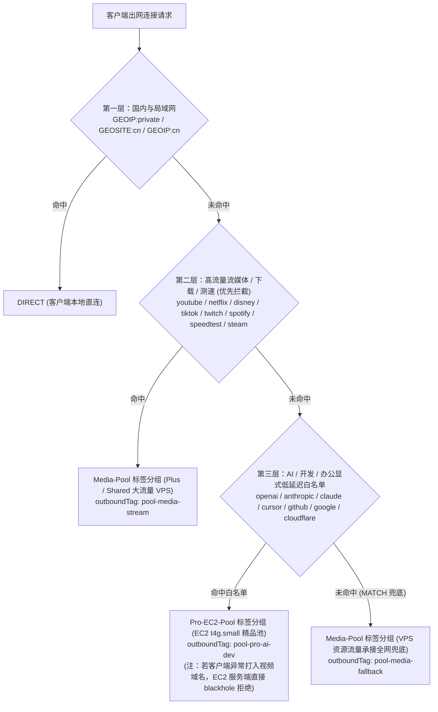

# XConnect 三层智能分流路由、5+1 节点池标签分组与 Grafana 流量调度监控规划

> [!IMPORTANT]
> 本文档定义 XConnect 边缘代理与控制面在 **`ai-workspace-service`**（`accounts`、`portal`）与 **`ai-workspace-xstream`**（`xconnect-edge-agent`、`xray-exporter`、`xconnect-app` / `XConnect-One`）中的**三层智能分流路由落地方案**与**全链路流量类型可观测性设计**。
>
> **四大核心设计铁律**：
> 1. **第一优先级（国内与局域网）→ `DIRECT`（直连）**：`GEOIP,private`、`GEOSITE,cn`、`GEOIP,cn` 本地直出，不消耗任何节点资源；
> 2. **第二优先级 `Media-Pool` 标签分组（`Shared` / `Plus` / `Free` VPS 资源池：优先 & 全网 `MATCH` 兜底，不做限制）**：承载所有高流量流媒体、下载、测速及全网 `MATCH` 兜底流量，**服务端不做任何流量类型限制**（架构上预留后续在 `Media-Pool` 多台 VPS 节点间进一步按 **视频 / 购物 / AI 应用** 细分子标签的能力，当前阶段先不实现）；
> 3. **第三优先级 `Pro-EC2-Pool` 标签分组（`Pro` 公共商业精品池，AWS EC2 `t4g.small` / `c8g` 等：仅限 AI / 开发 / 商务办公低延迟流量，严格限制高流量流媒体与下载）**：仅服务显式匹配的 AI、研发、商务办公低延迟请求（非兜底流量）；同时在 **EC2 服务端 Xray 路由中采用“策略 A（`blackhole` 直接拒绝）”**，严格限制/阻断 `geosite:youtube`、`geosite:netflix`、`geosite:tiktok`、下载及测速等高流量请求，100% 保护 EC2 出站流量成本与算力 SLA（P95 ≤ 800~1500ms）；
> 4. **`Custom` 专属节点（`Custom-Pool`：白名单客户独享，无限制）**：仅对绑定该节点的 Custom 白名单用户下发，**客户端与服务端均不做任何流媒体或流量类型限制**（仅保留私有 IP `geoip:private` 安全防探测与分类流量统计打标）。

---

## 一、规划背景与现有 5+1 节点分组映射基线

在 [可用网关列表 (`console.svc.plus/panel/gateway`)](https://console.svc.plus/panel/gateway) 中，平台按 **`Free`、`Shared`、`Plus`、`Pro`、`Custom`、`Team`（5+1）** 分组集中管理边缘 Agent 节点身份、健康状态、最近心跳与配置同步回执。

结合线上 6 台存量活跃节点与成本/性能压测结论，我们将 `5+1` 业务分组映射为以下**路由调度标签分组（Routing Pool Tag Groups）**：

### 1.1 存量节点盘点与路由池标签映射矩阵

| 节点域名 (`AgentID`) | 现有 `5+1` 类别 | 状态 | 路由池标签分组 (`routingPoolTag`) | 流量承接范围与服务端限制策略 |
| :--- | :---: | :---: | :---: | :--- |
| `jp-xconnect-free-01.svc.plus` | `Shared` | 正常 | **`Media-Pool`（优先 & 兜底，无限制）** | 大流量基础 VPS / Lightsail（3TB 流量包），承接流媒体、下载及全网 `MATCH` 兜底流量，**无限制** |
| `jp-xconnect-01.svc.plus` | `Plus` | 正常 | **`Media-Pool`（优先 & 兜底，无限制）** | 大流量 VPS 节点（HAProxy / Fluxgate），**主力承接流媒体、下载及全网 `MATCH` 兜底流量，无限制** |
| `ph-xconnect.svc.plus` | `Plus` | 正常 | **`Media-Pool`（优先 & 兜底，无限制）** | 东南亚大流量 VPS 节点，承接流媒体、下载与区域 `MATCH` 兜底流量，**无限制** |
| `jp-xconnect-02.svc.plus` | `Pro` | 正常 | **`Pro-EC2-Pool`（仅限低延迟白名单）** | **AWS EC2 `t4g.small` / `c8g` 等精品池节点**（Fluxgate），**仅限 AI/开发/商务办公低延迟流量，服务端严格 `blackhole` 限制高流量流媒体与下载** |
| `us-xconnect-los-angeles-custom-01.svc.plus` | `Custom` | 正常 | **`Custom`（非公共专属节点，无限制）** | **非公共资源节点**：权益严格绑定至 Custom 白名单用户，**绝不进入公共订阅池**，全流量直出不做限制 |
| `us-xconnect.svc.plus` | `Custom` | 正常 | **`Custom`（非公共专属节点，无限制）** | **非公共资源节点**：权益严格绑定至 Custom 白名单用户，**绝不进入公共订阅池**，全流量直出不做限制 |

### 1.2 `Media-Pool` 二级子标签预留设计（架构预留，当前暂不实现）

随着 `Media-Pool` 下辖的多区域 VPS 节点扩容，控制面 `RoutingPolicy` 预留二级业务子标签字段 `subPoolTags: []string`，以便后续在 `Media-Pool` 内部进一步细分调度（**当前阶段仅预留 schema 字段，统一归入 `Media-Pool` 执行**）：
- `media:video`（YouTube / Netflix / Disney+ / TikTok / Twitch 视频流媒体专用 VPS）
- `media:shopping`（Amazon / eBay / Shopee / 跨境电商浏览与图片 CDN 专用 VPS）
- `media:ai-app`（大带宽生成式 AI 多媒体应用、模型权重下载专用 VPS）

---

## 二、三层分流路由逻辑规范（客户端分流 + EC2 服务端 `blackhole` 兜底）



### 2.1 三层分流规则与服务端执行矩阵

| 匹配顺序 | 流量分类层级 | 客户端路由目标 | `Media-Pool` (VPS) 服务端行为 & `outboundTag` | `Pro-EC2-Pool` (EC2) 服务端行为 & `outboundTag` | 设计目的 |
| :---: | :--- | :---: | :---: | :---: | :--- |
| **1** | **国内与局域网**<br>(`geoip:private`, `geosite:cn`, `geoip:cn`) | **`DIRECT`** | 私有 IP 走 `blocked-private` (`blackhole`)；国内走 `direct-cn` (`freedom`) | 私有 IP 走 `blocked-private` (`blackhole`)；国内走 `direct-cn` (`freedom`) | 0 节点流量消耗，防 SSRF 内网探测 |
| **2（优先）** | **高流量流媒体 / 下载 / 测速**<br>(`youtube`, `netflix`, `disney`, `tiktok`, `twitch`, `spotify`, `bilibili`, `speedtest`, `steamcontent` 等) | **`Media-Pool`**<br>*(VPS 流量池优先)* | **正常直出 (`freedom`)**<br>`outboundTag: pool-media-stream` | **策略 A：直接拒绝 (`blackhole`)**<br>`outboundTag: blocked-media-on-pro` | **核心防线**：客户端优先分流至 VPS；若用户切全局强打 EC2，服务端直接 `blackhole` 丢弃，保护 EC2 流量与 CPU 积分 |
| **3-A** | **AI / 开发 / 办公低延迟白名单**<br>(`openai`, `anthropic`, `claude`, `cursor`, `github`, `google`, `cloudflare` 等) | **`Pro-EC2-Pool`**<br>*(非兜底精品池)* | 正常直出 (`freedom`)<br>`outboundTag: pool-pro-ai-dev`<br>*(供无 Pro 权限的普通用户使用)* | **正常直出 (`freedom`)**<br>`outboundTag: pool-pro-ai-dev` | PRO 用户独享 EC2 `t4g.small` 低延迟通道（P95 ≤ 800ms） |
| **3-B** | **全网未知长尾流量 (`MATCH` 兜底)**<br>(所有未命中上述规则的海外长尾流量) | **`Media-Pool`**<br>*(VPS 资源兜底)* | **正常直出 (`freedom`)**<br>`outboundTag: pool-media-fallback` | 仅放行漏网非视频小流量 (`freedom`)<br>`outboundTag: pool-pro-unclassified` | **VPS 资源池承接全网兜底流量**，绝不让未知大流量污染 `Pro-EC2-Pool` |

---

## 三、跨仓库服务端落地方案（`ai-workspace-service` & `ai-workspace-xstream`）

### 3.1 仓库职责拆分总览

| 仓库归属 | 组件 / 目录 | 改造模块与核心职责 |
| :--- | :--- | :--- |
| **`ai-workspace-service/accounts`** | `internal/agentproto/types.go`<br>`internal/agentserver/registry.go`<br>`internal/service/subscription*.go` | 1. 维护 `5+1` 节点类别到 `routingPoolTag`（`Media-Pool` / `Pro-EC2-Pool`）的映射及 `subPoolTags` 预留字段；<br>2. 下发客户端三层分流订阅（`Pro-EC2-Pool` 仅绑定 AI/开发/办公白名单，`Media-Pool` 绑定流媒体与 `MATCH` 兜底）；<br>3. 向 `xconnect-edge-agent` 下发 `RoutingPolicy`（对 `Pro-EC2-Pool` 节点固定下发 `mediaFallbackAction: "blackhole"`）。 |
| **`ai-workspace-service/portal`** | `src/app/panel/gateway/*` | 在 `console.svc.plus/panel/gateway` 节点列表中展示 `路由池标签`（`Media-Pool 优先&兜底` / `Pro-EC2-Pool 白名单`）及 `EC2 流媒体黑洞保护: 已启用` 状态徽章。 |
| **`ai-workspace-xstream/xconnect-edge-agent`** | `internal/xrayconfig/templates.go`<br>`internal/xrayconfig/generator.go` | 1. 开启 Xray `sniffing`（TLS SNI / HTTP Host 嗅探）与 `statsOutboundUplink/Downlink`；<br>2. 按节点 `PoolTag` 渲染差异化 `routing.rules`：`Pro-EC2-Pool` 节点将流媒体/下载规则指向 `blocked-media-on-pro` (`blackhole`)；`Media-Pool` 节点将其指向 `pool-media-stream` (`freedom`)。 |
| **`ai-workspace-xstream/xray-exporter`** | `exporter.go` | 原生采集 `outbound>>>{outboundTag}>>>traffic>>>uplink/downlink`，无需修改二进制即可导出各分类流量的精确字节数与被 `blackhole` 拦截的违例尝试流量。 |

---

### 3.2 `ai-workspace-service` 控制面与订阅下发设计

#### 1. 路由策略契约定义 (`accounts/internal/agentproto/types.go`)

```go
const (
    // 公共资源调度池 (Public Resource Pools)
    RoutingPoolMediaPriority = "Media-Pool"   // Free / Shared / Plus 公共大流量 VPS 池：流媒体优先 + 全网 MATCH 兜底，无限制
    RoutingPoolProEC2        = "Pro-EC2-Pool" // Pro 公共商业 EC2 精品池（t4g.small / c8g）：仅限 AI/开发/商务办公低延迟白名单，服务端 blackhole 限制流媒体与下载

    // 非公共绑定权益池 (Non-Public / Whitelist-Bound Entitlement)
    RoutingPoolCustomDedicated = "Custom-Dedicated" // Custom 专属节点：非公共资源，权益严格绑定至白名单用户，绝不混入公共池，服务端无限制
)

type RoutingPolicy struct {
    Revision            string   `json:"revision"`
    PoolTag             string   `json:"poolTag"`               // "Media-Pool" | "Pro-EC2-Pool" | "Custom-Dedicated"
    PublicResource      bool     `json:"publicResource"`        // true: Media-Pool / Pro-EC2-Pool; false: Custom-Dedicated / Team
    SubPoolTags         []string `json:"subPoolTags,omitempty"` // 预留（暂不实现）：["media:video", "media:shopping", "media:ai-app"]
    MediaOnProAction    string   `json:"mediaOnProAction"`      // Pro-EC2-Pool 固定为 "blackhole"；Media-Pool 与 Custom-Dedicated 为 "allow"（无限制）
}
```

#### 2. 客户端订阅三层分流模板 (`accounts` 订阅中心生成)

- **公共订阅资源边界**：公共 PRO 订阅仅下发公共 `Media-Pool`（`Shared` / `Plus`）与公共 `Pro-EC2-Pool`（`Pro` 节点如 `jp-xconnect-02.svc.plus`）；**`Custom` 专属节点（如 `us-xconnect-los-angeles-custom-01.svc.plus`、`us-xconnect.svc.plus`）属于非公共资源，仅当请求用户命中对应节点的 Custom 白名单时才作为专属无限制策略组（`Custom-Dedicated`）下发**。
- **`Pro-EC2-Pool` 仅出现在 AI / 开发 / 商务办公显式规则中**；
- **`Media-Pool` 既优先拦截流媒体/下载，又作为最后的 `MATCH` 兜底策略组**：

```yaml
proxy-groups:
  - name: "Media-Pool"          # 公共 VPS 大流量池（流媒体优先 + 全网 MATCH 兜底，无限制）
    type: url-test
    url: https://cp.cloudflare.com/generate_204
    interval: 300
    proxies:
      - jp-xconnect-01.svc.plus      # Plus (公共)
      - ph-xconnect.svc.plus         # Plus (公共)
      - jp-xconnect-free-01.svc.plus # Shared (公共)

  - name: "Pro-EC2-Pool"        # 公共 EC2 精品池（t4g.small / c8g：仅限 AI / 开发 / 商务办公低延迟，非兜底）
    type: url-test
    url: https://cp.cloudflare.com/generate_204
    interval: 180
    proxies:
      - jp-xconnect-02.svc.plus      # Pro (公共 AWS EC2 精品池，不包含 Custom 非公共节点)

rules:
  # [第一层] 国内与局域网 -> DIRECT 直连
  - GEOIP,private,DIRECT,no-resolve
  - GEOSITE,cn,DIRECT
  - GEOIP,cn,DIRECT,no-resolve

  # [第二层：Media-Pool 优先] 高流量流媒体 / 下载 / 测速 -> Media-Pool (VPS 资源池)
  - GEOSITE,youtube,Media-Pool
  - GEOSITE,netflix,Media-Pool
  - GEOSITE,disney,Media-Pool
  - GEOSITE,tiktok,Media-Pool
  - GEOSITE,twitch,Media-Pool
  - GEOSITE,spotify,Media-Pool
  - GEOSITE,bilibili,Media-Pool
  - DOMAIN-SUFFIX,speedtest.net,Media-Pool
  - DOMAIN-SUFFIX,fast.com,Media-Pool
  - DOMAIN-SUFFIX,steamcontent.com,Media-Pool
  - DOMAIN-SUFFIX,icloud-content.com,Media-Pool
  - DOMAIN-SUFFIX,mega.nz,Media-Pool

  # [第三层-A：Pro-EC2-Pool 严格白名单] AI / 开发 / 办公低延迟流量 -> Pro-EC2-Pool
  - GEOSITE,openai,Pro-EC2-Pool
  - GEOSITE,anthropic,Pro-EC2-Pool
  - DOMAIN-SUFFIX,claude.ai,Pro-EC2-Pool
  - DOMAIN-SUFFIX,cursor.sh,Pro-EC2-Pool
  - DOMAIN-SUFFIX,cursor.com,Pro-EC2-Pool
  - GEOSITE,github,Pro-EC2-Pool
  - GEOSITE,google,Pro-EC2-Pool
  - GEOSITE,cloudflare,Pro-EC2-Pool

  # [第三层-B：全网兜底] 所有其余未知/长尾海外流量 -> Media-Pool (VPS 资源流量兜底)
  - MATCH,Media-Pool
```

---

### 3.3 `ai-workspace-xstream` 边缘 Xray 服务端配置渲染（含 EC2 策略 A `blackhole` 兜底）

在 `xconnect-edge-agent/internal/xrayconfig/generator.go` 中，根据节点自身所属的 `PoolTag`（`Pro-EC2-Pool` vs `Media-Pool`），渲染对应的服务端 `outbounds` 与 `routing.rules`：

#### 1. `Pro-EC2-Pool` 节点（如 `jp-xconnect-02.svc.plus`）服务端 Xray 配置（策略 A：流媒体直接 `blackhole`）

```json
{
  "policy": {
    "levels": { "0": { "statsUserUplink": true, "statsUserDownlink": true } },
    "system": {
      "statsInboundUplink": true,
      "statsInboundDownlink": true,
      "statsOutboundUplink": true,
      "statsOutboundDownlink": true
    }
  },
  "inbounds": [
    {
      "tag": "xhttp-vless",
      "listen": "/dev/shm/xray.sock,0666",
      "protocol": "vless",
      "settings": { "clients": [], "decryption": "none" },
      "sniffing": {
        "enabled": true,
        "destOverride": ["http", "tls", "quic"],
        "metadataOnly": false
      },
      "streamSettings": {
        "network": "xhttp",
        "xhttpSettings": { "mode": "auto", "path": "/split" }
      }
    }
  ],
  "outbounds": [
    {
      "tag": "pool-pro-ai-dev",
      "protocol": "freedom",
      "settings": { "domainStrategy": "UseIP" }
    },
    {
      "tag": "pool-pro-unclassified",
      "protocol": "freedom",
      "settings": { "domainStrategy": "UseIP" }
    },
    {
      "tag": "direct-cn",
      "protocol": "freedom",
      "settings": { "domainStrategy": "UseIP" }
    },
    {
      "tag": "blocked-media-on-pro",
      "protocol": "blackhole",
      "settings": {}
    },
    {
      "tag": "blocked-private",
      "protocol": "blackhole",
      "settings": {}
    }
  ],
  "routing": {
    "domainStrategy": "IPIfNonMatch",
    "rules": [
      {
        "type": "field",
        "ip": ["geoip:private"],
        "outboundTag": "blocked-private"
      },
      {
        "type": "field",
        "domain": ["geosite:cn"],
        "ip": ["geoip:cn"],
        "outboundTag": "direct-cn"
      },
      {
        "type": "field",
        "domain": [
          "geosite:youtube",
          "geosite:netflix",
          "geosite:disney",
          "geosite:tiktok",
          "geosite:twitch",
          "geosite:spotify",
          "geosite:bilibili",
          "domain:speedtest.net",
          "domain:fast.com",
          "domain:steamcontent.com",
          "domain:icloud-content.com",
          "domain:mega.nz"
        ],
        "outboundTag": "blocked-media-on-pro"
      },
      {
        "type": "field",
        "domain": [
          "geosite:openai",
          "geosite:anthropic",
          "domain:claude.ai",
          "domain:cursor.sh",
          "domain:cursor.com",
          "geosite:github",
          "geosite:google",
          "geosite:cloudflare"
        ],
        "outboundTag": "pool-pro-ai-dev"
      },
      {
        "type": "field",
        "network": "tcp,udp",
        "outboundTag": "pool-pro-unclassified"
      }
    ]
  },
  "stats": {}
}
```

#### 2. `Media-Pool` 节点（如 `jp-xconnect-01.svc.plus`）服务端 Xray 配置（承接流媒体优先 + 全网兜底）

在 `Media-Pool` 节点上，将上述第 3 条流媒体规则的 `outboundTag` 设为 `"pool-media-stream"`（指向 `"protocol": "freedom"`），将最后一条兜底规则的 `outboundTag` 设为 `"pool-media-fallback"`（指向 `"protocol": "freedom"`）。如此即可在不影响转发性能的前提下，精准区分 **`Media-Pool` 上的流媒体流量 (`pool-media-stream`)** 与 **`Media-Pool` 上的全网兜底流量 (`pool-media-fallback`)**！

---

## 四、流量类型可观测性与 Grafana 监控调度面板设计

### 4.1 统一流量分类 `target` (`outboundTag`) 指标字典

`xray-exporter` 自动采集 `xray_traffic_downlink_bytes_total{dimension="outbound", target="<outboundTag>"}` 与 `xray_traffic_uplink_bytes_total`，经 Vector 注入 `routing_pool`（`Media-Pool` / `Pro-EC2-Pool`）与 `pricing_group`（`5+1` 分组）后写入 `observability.svc.plus`：

| `target` (`outboundTag`) | 所属节点池 (`routing_pool`) | 流量类型含义 | 正常预期表现 |
| :--- | :---: | :--- | :--- |
| `pool-media-stream` | `Media-Pool` | **高流量流媒体 / 下载 / 测速**（优先匹配） | 占 `Media-Pool` 带宽大头（主力消耗 Lightsail/VPS 3TB 免费流量包） |
| `pool-media-fallback` | `Media-Pool` | **全网 `MATCH` 兜底长尾流量**（VPS 资源兜底） | 承接所有非白名单的普通网页、长尾应用流量 |
| `pool-pro-ai-dev` | `Pro-EC2-Pool` (& `Media-Pool`) | **AI / 开发 / 办公低延迟白名单流量** | `Pro-EC2-Pool` 节点上的**绝对主力流量（占比应 >= 90%）**，小包高频低带宽 |
| `blocked-media-on-pro` | `Pro-EC2-Pool` | **EC2 节点被 `blackhole` 拒绝的流媒体违例请求** | 下行字节恒为 `0`，仅产生极小上行握手字节，用于监控有哪些客户端切了全局试图刷视频 |
| `pool-pro-unclassified` | `Pro-EC2-Pool` | 漏入 EC2 节点的未分类非视频小流量 | 占比极低；若持续偏高说明某个新 AI/开发域名需补充进 `pool-pro-ai-dev` 或下沉至 `Media-Pool` |
| `direct-cn` / `blocked-private` | 全部节点 | 国内误入流量 / 私有地址黑洞拦截 | 接近 `0`（验证客户端第一层 `DIRECT` 规则生效） |

---

### 4.2 Grafana 监控调度面板设计（`xconnect-traffic-split-scheduling-overview`）

#### Panel 1：三层分流全局实时吞吐分布（按流量类型 `target` 堆叠图）
```promql
sum by (target) (
  rate(xray_traffic_downlink_bytes_total{dimension="outbound", routing_pool=~"$routing_pool", instance=~"$instance"}[5m])
  +
  rate(xray_traffic_uplink_bytes_total{dimension="outbound", routing_pool=~"$routing_pool", instance=~"$instance"}[5m])
) * 8
```

#### Panel 2：`Pro-EC2-Pool` 白名单纯净度与 `blackhole` 拦截监控（核心成本护栏）
- **图 A：`Pro-EC2-Pool` 白名单流量纯净度（目标 `>= 95%`）**：
  ```promql
  sum(rate(xray_traffic_downlink_bytes_total{dimension="outbound", routing_pool="Pro-EC2-Pool", target="pool-pro-ai-dev"}[5m]))
  /
  clamp_min(sum(rate(xray_traffic_downlink_bytes_total{dimension="outbound", routing_pool="Pro-EC2-Pool"}[5m])), 1)
  * 100
  ```
- **图 B：`Pro-EC2-Pool` 流媒体 `blackhole` 拦截活跃度（监测违例切全局的客户端请求）**：
  ```promql
  sum by (instance) (
    rate(xray_traffic_uplink_bytes_total{dimension="outbound", routing_pool="Pro-EC2-Pool", target="blocked-media-on-pro"}[5m])
  ) * 8
  ```

#### Panel 3：`Media-Pool`（流媒体优先 + 全网兜底）vs `Pro-EC2-Pool`（仅白名单）24h 流量与 EC2 成本看板
```promql
# 各池各类型 24h 累计流量 (GB)
sum by (routing_pool, pricing_group, instance, target) (
  increase(xray_traffic_downlink_bytes_total{dimension="outbound"}[24h])
  +
  increase(xray_traffic_uplink_bytes_total{dimension="outbound"}[24h])
) / 1024 / 1024 / 1024
```

#### Panel 4：`Pro-EC2-Pool` (`t4g.small`) CPU 积分安全线（≤20%~25% Baseline）与网关内存监控
```promql
# EC2 节点 CPU 使用率（剥离视频 + 兜底流量后应长期稳定在 <= 25% Baseline 内）
100 - (avg by (instance) (rate(node_cpu_seconds_total{mode="idle", routing_pool="Pro-EC2-Pool"}[5m])) * 100)
```

---

## 五、分阶段落地上线计划（Rollout Plan）

1. **Phase 1（边缘 Xray 分类 Outbound 与 EC2 `blackhole` 策略上线）**：
   - 在 `ai-workspace-xstream/xconnect-edge-agent` 中合入 `Pro-EC2-Pool`（含 `blocked-media-on-pro` `blackhole` 规则）与 `Media-Pool`（含 `pool-media-stream` + `pool-media-fallback`）双模板；
   - 在 Vector Agent 中注入 `routing_pool` 与 `pricing_group` 标签并上线 Grafana `xconnect-traffic-split-scheduling-overview` 面板。
2. **Phase 2（`accounts` 订阅中心三层分流规则切换）**：
   - 更新 `ai-workspace-service/accounts` 订阅下发模板，确保 `Pro-EC2-Pool` 仅绑定 AI/开发/办公白名单，而流媒体与 `MATCH` 兜底统一指向 `Media-Pool`；
   - 在 `RoutingPolicy` 中预留 `subPoolTags` 字段（暂不启用子池拆分）。
3. **Phase 3（控制台 `/panel/gateway` 状态对齐与容量巡检）**：
   - 在 `console.svc.plus/panel/gateway` 节点列表中展示 `Media-Pool (优先&兜底)` 与 `Pro-EC2-Pool (AI/研发白名单)` 标签，结合 `k6-performance` 定期巡检 `Pro-EC2-Pool` 节点 P95 延迟（`<= 800~1500ms`）。
