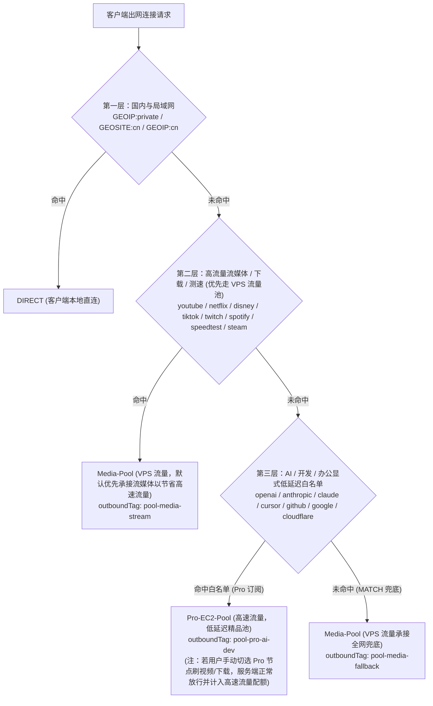

# XConnect 三层智能分流路由、5+1 节点池标签分组与 Grafana 流量调度监控规划

> [!IMPORTANT]
> 本文档定义 XConnect 边缘代理与控制面在 **`ai-workspace-service`**（`accounts`、`portal`）、**`ai-workspace-infra/gitops`**（`topology/xconnect/routing-policy.yaml`）与 **`ai-workspace-xstream`**（`xconnect-edge-agent`、`xray-exporter`、`xconnect-app` / `XConnect-One`）中的**简化三层智能分流路由落地方案**、**订阅可见性与配额模型**以及**全链路流量类型可观测性设计**。
>
> **核心设计原则与订阅边界**：
> 1. **第一优先级（国内与局域网）→ `DIRECT`（直连）**：`GEOIP,private`、`GEOSITE,cn`、`GEOIP,cn` 本地直出，不消耗任何节点流量；
> 2. **第二优先级 `Media-Pool` 标签分组（`Free` / `Shared` / `Plus` VPS 资源池：VPS 流量、优先流媒体与 `MATCH` 兜底，无限制）**：承载普通日常流量、流媒体、下载、测速及全网 `MATCH` 兜底流量，**客户端与服务端均不做任何流量类型限制**（架构上预留后续在 `Media-Pool` 多台 VPS 节点间按 **视频 / 购物 / AI 应用** 细分子标签的能力，当前阶段统一归入 `Media-Pool`）；
> 3. **第三优先级 `Pro-EC2-Pool` 标签分组（`Pro` 公共商业精品池，AWS EC2 `t4g.small` / `c8g` 等：定义为「高速流量」，不再限制流媒体与下载，移除客户端流媒体提醒）**：`Pro-EC2-Pool` 为高 SLA 低延迟高速流量池，在自动分流下优先承接 AI、开发与商务办公白名单流量；同时**取消服务端 `blackhole` 阻断与客户端流媒体提醒弹窗/横幅**，若用户手动切选 `Pro` 节点或切全局使用视频/下载等请求，服务端统一通过 `freedom` 正常放行并计入高速流量配额管控（`mediaOnProAction: "allow"`）；
> 4. **订阅权限与节点可见性矩阵**：
>    - **`Pro` 订阅**：可同时使用 **`Media-Pool` 与 `Pro-EC2-Pool`** 全部公共资源（例如 **50 元套餐：30GB 高速流量（`Pro-EC2-Pool`） + 50GB VPS 流量（`Media-Pool`）**）；
>    - **`Plus` 订阅（及 `Free` / `Shared`）**：**仅能使用 `Media-Pool` 的资源，保持 `Pro` 专属资源节点不可见**（订阅下发与节点发现接口自动过滤 `Pro-EC2-Pool` 节点）；
>    - **`Custom` 专属节点（`Custom-Dedicated`：白名单客户独享，无限制）**：非公共资源，仅对绑定该节点的 Custom 白名单用户下发，绝不混入公共订阅池，客户端与服务端均不做限制。

---

## 一、规划背景与现有 5+1 节点分组映射基线

在 [可用网关列表 (`console.svc.plus/panel/gateway`)](https://console.svc.plus/panel/gateway) 中，平台按 **`Free`、`Shared`、`Plus`、`Pro`、`Custom`、`Team`（5+1）** 分组集中管理边缘 Agent 节点身份、健康状态、最近心跳与配置同步回执。

结合线上活跃节点定位与套餐配额设计，我们将 `5+1` 业务分组映射为以下**路由调度标签分组（Routing Pool Tag Groups）**：

### 1.1 存量节点盘点与路由池标签映射矩阵

| 节点域名 (`AgentID`) | 现有 `5+1` 类别 | 状态 | 路由池标签分组 (`routingPoolTag`) | 流量承接定位与可见性/配额策略 |
| :--- | :---: | :---: | :---: | :--- |
| `jp-xconnect-free-01.svc.plus` | `Shared` | 正常 | **`Media-Pool`（VPS 流量池，无限制）** | 大流量基础 VPS / Lightsail（3TB 流量包），承接流媒体、下载及全网 `MATCH` 兜底流量，**无限制** |
| `jp-xconnect-01.svc.plus` | `Plus` | 正常 | **`Media-Pool`（VPS 流量池，无限制）** | 大流量 VPS 节点（HAProxy / Fluxgate），**主力承接 Plus/Pro 用户的 VPS 流量、流媒体与 `MATCH` 兜底，无限制** |
| `ph-xconnect.svc.plus` | `Plus` | 正常 | **`Media-Pool`（VPS 流量池，无限制）** | 东南亚大流量 VPS 节点，承接区域 VPS 流量、流媒体与 `MATCH` 兜底，**无限制** |
| `jp-xconnect-02.svc.plus` | `Pro` | 正常 | **`Pro-EC2-Pool`（高速流量池，无限制）** | **AWS EC2 `t4g.small` / `c8g` 等精品节点**（Fluxgate），定义为**高速流量**；**仅对 `Pro` 订阅可见**（`Plus`/`Free`/`Shared` 不可见），**不做流媒体与下载限制**，统一按高速流量配额（如 30GB）计量管控 |
| `us-xconnect-los-angeles-custom-01.svc.plus` | `Custom` | 正常 | **`Custom-Dedicated`（非公共专属节点，无限制）** | **非公共资源节点**：权益严格绑定至 Custom 白名单用户，**绝不进入公共订阅池**，全流量直出不做限制 |
| `us-xconnect.svc.plus` | `Custom` | 正常 | **`Custom-Dedicated`（非公共专属节点，无限制）** | **非公共资源节点**：权益严格绑定至 Custom 白名单用户，**绝不进入公共订阅池**，全流量直出不做限制 |

### 1.2 订阅套餐资源可见性与配额示例

| 订阅等级 | 可见资源池 | 配额结构示例 | 不可见/隔离范围 |
| :--- | :--- | :--- | :--- |
| **`Pro` 订阅** | `Media-Pool` + `Pro-EC2-Pool` | 如 **50 元套餐**：`30GB` 高速流量（`Pro-EC2-Pool`）+ `50GB` VPS 流量（`Media-Pool`） | `Custom-Dedicated`（除非同时命中白名单） |
| **`Plus` 订阅** | 仅 **`Media-Pool`** | 对应套餐 VPS 流量配额 | **`Pro-EC2-Pool` 节点对 Plus 用户不可见**；`Custom-Dedicated` 不可见 |
| **`Free` / `Shared`** | 仅 **`Media-Pool`**（`Shared` / `Free` 节点） | 基础/试用 VPS 流量配额 | `Pro-EC2-Pool`、`Custom-Dedicated` 均不可见 |

### 1.3 `Media-Pool` 二级子标签预留设计（架构预留，当前暂不实现）

随着 `Media-Pool` 下辖的多区域 VPS 节点扩容，控制面 `RoutingPolicy` 预留二级业务子标签字段 `subPoolTags: []string`，以便后续在 `Media-Pool` 内部进一步细分调度（**当前阶段仅预留 schema 字段，统一归入 `Media-Pool` 执行**）：
- `media:video`（YouTube / Netflix / Disney+ / TikTok / Twitch 视频流媒体专用 VPS）
- `media:shopping`（Amazon / eBay / Shopee / 跨境电商浏览与图片 CDN 专用 VPS）
- `media:ai-app`（大带宽生成式 AI 多媒体应用、模型权重下载专用 VPS）

---

## 二、简化三层分流路由逻辑规范（客户端智能分流 + 服务端配额管控，取消流媒体限制）



### 2.1 三层分流规则与服务端执行矩阵

| 匹配顺序 | 流量分类层级 | 客户端默认分流目标 | `Media-Pool` (VPS) 服务端行为 & `outboundTag` | `Pro-EC2-Pool` (高速流量 EC2) 服务端行为 & `outboundTag` | 设计目的 |
| :---: | :--- | :---: | :---: | :---: | :--- |
| **1** | **国内与局域网**<br>(`geoip:private`, `geosite:cn`, `geoip:cn`) | **`DIRECT`** | 私有 IP 走 `blocked-private` (`blackhole`)；国内走 `direct-cn` (`freedom`) | 私有 IP 走 `blocked-private` (`blackhole`)；国内走 `direct-cn` (`freedom`) | 0 节点流量消耗，防 SSRF 内网探测 |
| **2（优先）** | **高流量流媒体 / 下载 / 测速**<br>(`youtube`, `netflix`, `disney`, `tiktok`, `twitch`, `spotify`, `bilibili`, `speedtest`, `steamcontent` 等) | **`Media-Pool`**<br>*(默认走 VPS 流量池)* | **正常直出 (`freedom`)**<br>`outboundTag: pool-media-stream` | **正常直出 (`freedom`)**<br>`outboundTag: pool-pro-unclassified`<br>*(不再拦截或弹窗提醒，按高速流量配额计量)* | 自动分流模式下为 Pro 用户节省 30GB 高速流量；手动直连 Pro 节点时保证视频/下载可用 |
| **3-A** | **AI / 开发 / 办公低延迟白名单**<br>(`openai`, `anthropic`, `claude`, `cursor`, `github`, `google`, `cloudflare` 等) | **`Pro-EC2-Pool`** *(仅 Pro 订阅可见)*<br>**`Media-Pool`** *(Plus/Shared)* | **正常直出 (`freedom`)**<br>`outboundTag: pool-pro-ai-dev` | **正常直出 (`freedom`)**<br>`outboundTag: pool-pro-ai-dev` | Pro 用户 AI/研发/办公自动享 EC2 高速低延迟通道；Plus 用户走 VPS 通道 |
| **3-B** | **全网未知长尾流量 (`MATCH` 兜底)**<br>(所有未命中上述规则的海外长尾流量) | **`Media-Pool`**<br>*(VPS 流量兜底)* | **正常直出 (`freedom`)**<br>`outboundTag: pool-media-fallback` | **正常直出 (`freedom`)**<br>`outboundTag: pool-pro-unclassified` | 默认由 50GB VPS 流量承接长尾请求，避免无谓消耗 30GB 高速流量 |

---

## 三、跨仓库服务端与客户端落地方案（`gitops` / `ai-workspace-service` / `ai-workspace-xstream`）

### 3.1 仓库职责拆分总览

| 仓库归属 | 组件 / 目录 | 模块与核心职责 |
| :--- | :--- | :--- |
| **`ai-workspace-infra/gitops`** | `topology/xconnect/routing-policy.yaml` | 唯一事实来源（SSOT）：定义 `Media-Pool`、`Pro-EC2-Pool`、`Custom-Dedicated` 池策略；`Pro-EC2-Pool` 设置 `media_on_pro_action: "allow"`，`server_outbound_tag_on_pro_pool: "pool-pro-unclassified"`。 |
| **`ai-workspace-service/accounts`** | `internal/routingpolicy/policy.go`<br>`internal/agentserver/registry.go`<br>`internal/subscription/*.go`<br>`api/regional_pools*.go` | 1. 维护 `5+1` 节点类别到 `routingPoolTag`（`Media-Pool` / `Pro-EC2-Pool` / `Custom-Dedicated`）映射；<br>2. **可见性隔离**：`Plus` / `Free` / `Shared` 订阅与节点列表**仅返回 `Media-Pool` 节点，保持 `Pro-EC2-Pool` 节点不可见**；`Pro` 订阅同时返回 `Media-Pool` 与 `Pro-EC2-Pool`；<br>3. 向 `xconnect-edge-agent` 下发 `RoutingPolicy`（默认 `MediaOnProAction: "allow"`）。 |
| **`ai-workspace-service/portal`** | `src/modules/extensions/builtin/user-center/*`<br>`src/app/api/panel/gateway/routing-policy/*` | 在 `console.svc.plus/panel/gateway` 展示路由策略与节点池标签，编辑提交直连 GitOps `topology/xconnect/routing-policy.yaml`。 |
| **`ai-workspace-xstream/xconnect-edge-agent`** | `internal/xrayconfig/templates.go`<br>`internal/xrayconfig/generator.go` | 1. 开启 Xray `sniffing` 与 `statsOutboundUplink/Downlink`；<br>2. 对 `Pro-EC2-Pool` 默认将流媒体规则指向 `pool-pro-unclassified`（`freedom` 放行，不再使用 `blackhole`）；`Media-Pool` 指向 `pool-media-stream` / `pool-media-fallback`。 |
| **`ai-workspace-xstream/xconnect-app`** | `lib/screens/home_screen.dart`<br>`lib/l10n/app_localizations.dart` | **移除客户端 Pro 节点流媒体提醒逻辑与提示文案**（`Pro` 节点定义为高速流量，按套餐配额消费，不再向用户弹出流媒体/下载限制提醒）。 |
| **`ai-workspace-xstream/xray-exporter`** | `exporter.go` | 采集 `outbound>>>{outboundTag}>>>traffic>>>uplink/downlink`，按 `pool-media-stream`、`pool-media-fallback`、`pool-pro-ai-dev`、`pool-pro-unclassified` 导出分类流量字节数，用于 Grafana 监控与配额核算。 |

---

### 3.2 `ai-workspace-service` 控制面与订阅下发设计

#### 1. 路由策略契约定义 (`accounts/internal/routingpolicy/policy.go`)

```go
const (
    // 公共资源调度池 (Public Resource Pools)
    RoutingPoolMediaPriority = "Media-Pool"   // Free / Shared / Plus 公共 VPS 流量池：流媒体优先 + 全网 MATCH 兜底，无限制
    RoutingPoolProEC2        = "Pro-EC2-Pool" // Pro 公共高速流量池（EC2 t4g.small / c8g）：AI/开发/办公低延迟优先；不再限制流媒体与下载（allow）

    // 非公共绑定权益池 (Non-Public / Whitelist-Bound Entitlement)
    RoutingPoolCustomDedicated = "Custom-Dedicated" // Custom 专属节点：非公共资源，权益严格绑定至白名单用户，绝不混入公共池，无限制
)

type RoutingPolicy struct {
    Revision            string   `json:"revision"`
    PoolTag             string   `json:"poolTag"`               // "Media-Pool" | "Pro-EC2-Pool" | "Custom-Dedicated"
    PublicResource      bool     `json:"publicResource"`        // true: Media-Pool / Pro-EC2-Pool; false: Custom-Dedicated / Team
    SubPoolTags         []string `json:"subPoolTags,omitempty"` // 预留（暂不实现）：["media:video", "media:shopping", "media:ai-app"]
    MediaOnProAction    string   `json:"mediaOnProAction"`      // 统一默认 "allow"（不再限制流媒体与下载，依赖高速流量配额管控）
}
```

#### 2. 客户端订阅分流与权限边界 (`accounts` 订阅中心生成)

- **Pro 订阅资源范围**：可同时获得公共 `Media-Pool`（如 `jp-xconnect-01.svc.plus`、`ph-xconnect.svc.plus`、`jp-xconnect-free-01.svc.plus`，计入 VPS 流量配额）与公共 `Pro-EC2-Pool`（如 `jp-xconnect-02.svc.plus`，计入高速流量配额，例如 50 元套餐 = `30GB` 高速流量 + `50GB` VPS 流量）；
- **Plus / Free / Shared 订阅资源范围**：**仅下发 `Media-Pool` 节点，`Pro-EC2-Pool` 专属资源节点保持完全不可见**；
- **`Custom` 专属节点**：仅当用户命中对应白名单时作为 `Custom-Dedicated` 策略组下发；
- **智能分流模板（Pro 订阅示例）**：

```yaml
proxy-groups:
  - name: "Media-Pool"          # 公共 VPS 流量池（流媒体优先 + 全网 MATCH 兜底，无限制）
    type: url-test
    url: https://cp.cloudflare.com/generate_204
    interval: 300
    proxies:
      - jp-xconnect-01.svc.plus      # Plus (公共)
      - ph-xconnect.svc.plus         # Plus (公共)
      - jp-xconnect-free-01.svc.plus # Shared (公共)

  - name: "Pro-EC2-Pool"        # 公共高速流量池（EC2 低延迟精品池，仅 Pro 订阅可见，不限制流媒体与下载）
    type: url-test
    url: https://cp.cloudflare.com/generate_204
    interval: 180
    proxies:
      - jp-xconnect-02.svc.plus      # Pro (公共 AWS EC2 高速节点，Plus 不可见)

rules:
  # [第一层] 国内与局域网 -> DIRECT 直连
  - GEOIP,private,DIRECT,no-resolve
  - GEOSITE,cn,DIRECT
  - GEOIP,cn,DIRECT,no-resolve

  # [第二层：Media-Pool 优先] 高流量流媒体 / 下载 / 测速 -> Media-Pool (优先消耗 VPS 流量)
  - GEOSITE,youtube,Media-Pool
  - GEOSITE,netflix,Media-Pool
  - GEOSITE,disney,Media-Pool
  - GEOSITE,tiktok,Media-Pool
  - GEOSITE,twitch,Media-Pool
  - GEOSITE,spotify,Media-Pool
  - GEOSITE,bilibili,Media-Pool
  - DOMAIN-SUFFIX,speedtest.net,Media-Pool
  - DOMAIN-SUFFIX,fast.com,Media-Pool
  - DOMAIN-SUFFIX,steamcontent.com,Media-Pool
  - DOMAIN-SUFFIX,icloud-content.com,Media-Pool
  - DOMAIN-SUFFIX,mega.nz,Media-Pool

  # [第三层-A：Pro-EC2-Pool] AI / 开发 / 办公低延迟流量 -> Pro-EC2-Pool (消耗高速流量)
  - GEOSITE,openai,Pro-EC2-Pool
  - GEOSITE,anthropic,Pro-EC2-Pool
  - DOMAIN-SUFFIX,claude.ai,Pro-EC2-Pool
  - DOMAIN-SUFFIX,cursor.sh,Pro-EC2-Pool
  - DOMAIN-SUFFIX,cursor.com,Pro-EC2-Pool
  - GEOSITE,github,Pro-EC2-Pool
  - GEOSITE,google,Pro-EC2-Pool
  - GEOSITE,cloudflare,Pro-EC2-Pool

  # [第三层-B：全网兜底] 所有其余未知/长尾海外流量 -> Media-Pool (消耗 VPS 流量)
  - MATCH,Media-Pool
```

---

### 3.3 `ai-workspace-xstream` 边缘 Xray 服务端配置渲染（`Pro-EC2-Pool` 全放行计量）

在 `xconnect-edge-agent/internal/xrayconfig/generator.go` 中，根据节点所属的 `PoolTag`（`Pro-EC2-Pool` vs `Media-Pool`）渲染服务端 `outbounds` 与 `routing.rules`：

#### 1. `Pro-EC2-Pool` 节点（如 `jp-xconnect-02.svc.plus`）服务端 Xray 配置（高速流量，无流媒体限制）

```json
{
  "policy": {
    "levels": { "0": { "statsUserUplink": true, "statsUserDownlink": true } },
    "system": {
      "statsInboundUplink": true,
      "statsInboundDownlink": true,
      "statsOutboundUplink": true,
      "statsOutboundDownlink": true
    }
  },
  "inbounds": [
    {
      "tag": "xhttp-vless",
      "listen": "/dev/shm/xray.sock,0666",
      "protocol": "vless",
      "settings": { "clients": [], "decryption": "none" },
      "sniffing": {
        "enabled": true,
        "destOverride": ["http", "tls", "quic"],
        "metadataOnly": false
      },
      "streamSettings": {
        "network": "xhttp",
        "xhttpSettings": { "mode": "auto", "path": "/split" }
      }
    }
  ],
  "outbounds": [
    {
      "tag": "pool-pro-ai-dev",
      "protocol": "freedom",
      "settings": { "domainStrategy": "UseIP" }
    },
    {
      "tag": "pool-pro-unclassified",
      "protocol": "freedom",
      "settings": { "domainStrategy": "UseIP" }
    },
    {
      "tag": "direct-cn",
      "protocol": "freedom",
      "settings": { "domainStrategy": "UseIP" }
    },
    {
      "tag": "blocked-private",
      "protocol": "blackhole",
      "settings": {}
    }
  ],
  "routing": {
    "domainStrategy": "IPIfNonMatch",
    "rules": [
      {
        "type": "field",
        "ip": ["geoip:private"],
        "outboundTag": "blocked-private"
      },
      {
        "type": "field",
        "domain": ["geosite:cn"],
        "ip": ["geoip:cn"],
        "outboundTag": "direct-cn"
      },
      {
        "type": "field",
        "domain": [
          "geosite:youtube",
          "geosite:netflix",
          "geosite:disney",
          "geosite:tiktok",
          "geosite:twitch",
          "geosite:spotify",
          "geosite:bilibili",
          "domain:speedtest.net",
          "domain:fast.com",
          "domain:steamcontent.com",
          "domain:icloud-content.com",
          "domain:mega.nz"
        ],
        "outboundTag": "pool-pro-unclassified"
      },
      {
        "type": "field",
        "domain": [
          "geosite:openai",
          "geosite:anthropic",
          "domain:claude.ai",
          "domain:cursor.sh",
          "domain:cursor.com",
          "geosite:github",
          "geosite:google",
          "geosite:cloudflare"
        ],
        "outboundTag": "pool-pro-ai-dev"
      },
      {
        "type": "field",
        "network": "tcp,udp",
        "outboundTag": "pool-pro-unclassified"
      }
    ]
  },
  "stats": {}
}
```

#### 2. `Media-Pool` 节点（如 `jp-xconnect-01.svc.plus`）服务端 Xray 配置（承接流媒体优先 + 全网兜底）

在 `Media-Pool` 节点上，第 3 条流媒体规则的 `outboundTag` 设为 `"pool-media-stream"`（`"protocol": "freedom"`），最后一条兜底规则的 `outboundTag` 设为 `"pool-media-fallback"`（`"protocol": "freedom"`），精准区分 **`Media-Pool` 上的流媒体流量 (`pool-media-stream`)** 与 **`Media-Pool` 上的全网兜底流量 (`pool-media-fallback`)**。

---

## 四、流量类型可观测性与 Grafana 监控调度面板设计

### 4.1 统一流量分类 `target` (`outboundTag`) 指标字典

`xray-exporter` 自动采集 `xray_traffic_downlink_bytes_total{dimension="outbound", target="<outboundTag>"}` 与 `xray_traffic_uplink_bytes_total`，经 Vector 注入 `routing_pool`（`Media-Pool` / `Pro-EC2-Pool`）与 `pricing_group`（`5+1` 分组）后写入 `observability.svc.plus`：

| `target` (`outboundTag`) | 所属节点池 (`routing_pool`) | 流量类型含义 | 正常预期表现 |
| :--- | :---: | :--- | :--- |
| `pool-media-stream` | `Media-Pool` | **高流量流媒体 / 下载 / 测速**（VPS 优先匹配） | 占 `Media-Pool` 带宽大头，主力消耗 VPS 流量包 |
| `pool-media-fallback` | `Media-Pool` | **全网 `MATCH` 兜底长尾流量**（VPS 资源兜底） | 承接普通网页与长尾应用流量 |
| `pool-pro-ai-dev` | `Pro-EC2-Pool` (& `Media-Pool`) | **AI / 开发 / 办公低延迟高速流量** | `Pro-EC2-Pool` 核心高质量流量 |
| `pool-pro-unclassified` | `Pro-EC2-Pool` | **高速流量池上的通用/流媒体/未分类放行流量** | 用户手动直连 Pro 节点或全局代理时正常放行并计入高速流量配额（不阻断） |
| `direct-cn` / `blocked-private` | 全部节点 | 国内直出 / 私有地址防探测拦截 | `blocked-private` 拦截内网探测 |

---

### 4.2 Grafana 监控调度面板设计（`xconnect-traffic-split-scheduling-overview`）

#### Panel 1：三层分流全局实时吞吐分布（按流量类型 `target` 堆叠图）
```promql
sum by (target) (
  rate(xray_traffic_downlink_bytes_total{dimension="outbound", routing_pool=~"$routing_pool", instance=~"$instance"}[5m])
  +
  rate(xray_traffic_uplink_bytes_total{dimension="outbound", routing_pool=~"$routing_pool", instance=~"$instance"}[5m])
) * 8
```

#### Panel 2：`Pro-EC2-Pool` 高速流量占比结构（AI/开发白名单 vs 通用直出）
```promql
# AI / 开发 / 办公白名单流量在 Pro-EC2-Pool 中的占比 (%)
sum(rate(xray_traffic_downlink_bytes_total{dimension="outbound", routing_pool="Pro-EC2-Pool", target="pool-pro-ai-dev"}[5m]))
/
clamp_min(sum(rate(xray_traffic_downlink_bytes_total{dimension="outbound", routing_pool="Pro-EC2-Pool"}[5m])), 1)
* 100
```

#### Panel 3：`Media-Pool`（VPS 流量）vs `Pro-EC2-Pool`（高速流量）24h 累计消耗 (GB)
```promql
# 各池各类型 24h 累计流量 (GB)
sum by (routing_pool, pricing_group, instance, target) (
  increase(xray_traffic_downlink_bytes_total{dimension="outbound"}[24h])
  +
  increase(xray_traffic_uplink_bytes_total{dimension="outbound"}[24h])
) / 1024 / 1024 / 1024
```

#### Panel 4：`Pro-EC2-Pool` (`t4g.small`) CPU 积分安全线（≤20%~25% Baseline）与网关内存监控
```promql
# EC2 节点 CPU 使用率
100 - (avg by (instance) (rate(node_cpu_seconds_total{mode="idle", routing_pool="Pro-EC2-Pool"}[5m])) * 100)
```

---

## 五、分阶段落地上线计划（Rollout Plan）

1. **Phase 1（GitOps 策略落地 & 边缘 Xray 高速流量放行上线）**：
   - 将路由策略统一收敛至 `ai-workspace-infra/gitops/topology/xconnect/routing-policy.yaml`，`Pro-EC2-Pool` 默认 `media_on_pro_action: "allow"`；
   - 在 `ai-workspace-xstream/xconnect-edge-agent` 中将 `Pro-EC2-Pool` 通用与流媒体流量统一指向 `pool-pro-unclassified`（`freedom` 放行，取消 `blackhole` 限制），`Media-Pool` 维持 `pool-media-stream` + `pool-media-fallback`。
2. **Phase 2（`accounts` 订阅中心分流与套餐可见性对齐 & 客户端简化）**：
   - `ai-workspace-service/accounts` 保持 `Pro` 订阅同时可访问 `Media-Pool` 与 `Pro-EC2-Pool`（例如 50 元套餐：`30GB` 高速流量 + `50GB` VPS 流量），`Plus` / `Free` / `Shared` 订阅仅返回 `Media-Pool` 且保持 `Pro` 专属节点不可见；
   - `ai-workspace-xstream/xconnect-app` 移除 Pro 节点流媒体提示横幅/Toast，统一依赖服务端套餐流量配额管控。
3. **Phase 3（控制台 `/panel/gateway` 状态对齐与容量巡检）**：
   - 在 `console.svc.plus/panel/gateway` 展示 `Media-Pool` 与 `Pro-EC2-Pool` 策略配置并支持 GitOps 同步，结合 `k6-performance` 与 Grafana 看板巡检 `Pro-EC2-Pool` 节点 P95 延迟与配额消耗。
