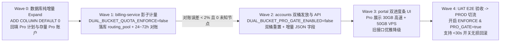

# XConnect 双桶配额（高速流量 + VPS 流量）分池计费采集与平滑升级工程规划

> [!IMPORTANT]
> 本文档承接 [05-three-tier-traffic-split-routing-and-observability.md](05-three-tier-traffic-split-routing-and-observability.md) 第 3.4 节，提供从数据库 DDL、计费分池扣减、控制面独立准入到控制台展示的**安全、渐进、可随时回滚的工程任务单与平滑升级步骤**。
>
> **五大工程安全红线**：
> 1. **纯增量向后兼容 DDL（Expand-Only）**：仅新增带默认值的列，**不修改 `traffic_minute_buckets` 现有复合主键 `(bucket_start, node_id, account_uuid, region, line_code)`**，不删改旧列，确保旧版 `accounts` 与 `billing-service` 在滚动窗口内 100% 兼容；
> 2. **双开关影子计量先行（Shadow Before Enforce）**：通过 `DUAL_BUCKET_QUOTA_ENFORCE`（`billing-service`）与 `DUAL_BUCKET_PRO_GATE_ENABLED`（`accounts`）两个独立环境变量开关（默认 `false`），先上线分池标记与影子对账，校验误差 `< 2%` 后再开启真实扣减与准入门禁；异常时 `< 30s` 关闭开关即可无损回滚；
> 3. **边缘零强制升级依赖**：现有 `xray-exporter` 推送的 `Snapshot`（含 `node_id`、`env`、`samples`）与本机 Vector（`127.0.0.1:8686` + 512MiB 磁盘缓冲）保持原契约不变，由 `billing-service` 侧通过共享 PostgreSQL 维表解析 `node_id -> routing_pool`（60s TTL 缓存，未知节点安全降级为 `Media-Pool`）；
> 4. **三大权益不变式（Invariants）**：
>    - **`Pro` 订阅**（如 50 元 `PRO-MONTHLY-V2`）：`30 GiB` 高速流量（`Pro-EC2-Pool`）+ `50 GiB` VPS 流量（`Media-Pool`），高速流量耗尽时**仅停用 `Pro-EC2-Pool`，保留 `Media-Pool` 可用**；
>    - **`Plus` / `Free` / `Shared` 订阅**：`high_speed_quota_bytes = 0`，**保持 `Pro-EC2-Pool` 节点完全不可见**，仅消费 `Media-Pool` VPS 流量；
>    - **`Custom` 专属节点（`Custom-Dedicated`）**：**白名单绑定机制，没有使用限制**，仅写 `traffic_minute_buckets`（`rating_status = 'exempt'`）供审计，豁免配额扣减与 `quotaExhausted` 停机；
> 5. **严守多环境晋级秩序**：`Feature SIT -> UAT Current -> UAT Verified -> 不可变 Release Manifest (固定 Digest) -> PROD (prod-k3s-v6)`，严禁在生产直接使用 `latest` 镜像或未经影子对账开启强制门禁。

---

## 一、现网基线核查（代码与表结构事实）

基于对 `ai-workspace-service/accounts`、`ai-workspace-service/billing-service`、`ai-workspace-xstream/xray-exporter` 与 `ai-workspace-service/portal` 的源码核查：

| 组件 / 表 | 现状基线 | 双桶演进定位 |
| :--- | :--- | :--- |
| **`public.billing_plans`** (`accounts/sql/migrations/2026101901_v3_billing_catalog.up.sql`) | `PRO-MONTHLY-V2` 已存在：¥50/月（`5000 CNY`），`included_quota_bytes = 53687091200`（50 GiB），`package_name = 'pro'`；`PLUS` 为 ¥20/月 | 保留 `included_quota_bytes` 作为 **VPS/基础流量配额**（Pro = 50 GiB），新增 **`high_speed_quota_bytes`**（`PRO-MONTHLY-V2` = `32212254720` = 30 GiB，`PRO-YEARLY-V2` = 无限制，`PLUS`/`FREE` = `0`） |
| **`public.account_billing_profiles`** (`accounts/internal/store/store.go`) | 存有 `included_quota_bytes`、`package_name`、`pricing_rule_version` | 新增 **`high_speed_quota_bytes BIGINT NOT NULL DEFAULT 0`** |
| **`public.account_quota_states`** (`accounts/internal/store/store.go`) | 存有 `remaining_included_quota`、`period_start`、`period_end`、`proxy_access_state`、`suspend_state` | 新增 **`remaining_high_speed_quota BIGINT NOT NULL DEFAULT 0`** |
| **`public.traffic_minute_buckets`** (`billing-service/sql/billing-service-schema.sql`) | 主键 `(bucket_start, node_id, account_uuid, region, line_code)`；`node_id` 形态为 `<env>:<agent_id>`（如 `prod:jp-xconnect-pro-01.svc.plus`） | 新增非主键列 **`routing_pool TEXT NOT NULL DEFAULT ''`**，保留现有主键与幂等 `UpsertMinuteBucket` 不变 |
| **`public.agents` / `public.node_health_snapshots`** | 已存储 `node_id`、`groups`（`resource:pro` / `resource:plus` / `resource:shared` / `resource:custom`）与 `pricing_group` | 作为 `billing-service` 解析 `node_id -> routing_pool` 的权威 DB 维表（加 60s TTL 内存缓存，避免热点查询） |
| **`accounts/api/free_quota.go`** | `quotaExhaustedForAgentScope(ctx, user, scope, groups)` 已接收 `scope.ResourceClass` 与 `groups`，且对 `custom`/`team` 固定返回 `false` | 按 `scope.ResourceClass == agentResourcePro` 独立校验 `remaining_high_speed_quota <= 0`（受开关控制） |
| **`accounts/api/accounting.go`** | `GET /api/account/usage/summary` 返回 `includedQuotaBytes`、`remainingIncludedQuota`、`usedBytes`、`quotaExhausted` | 100% 保留原有字段，增量返回 `highSpeed*`、`vps*` 与 `poolUsageBreakdown` |

---

## 二、分波次平滑升级路线（Wave 0 $\rightarrow$ Wave 4）



### 升级前后新旧版本兼容性矩阵

| 滚动瞬间组合 | 行为表现 | 是否安全 |
| :--- | :--- | :---: |
| **新 Schema + 旧 `billing-service` + 旧 `accounts`** | 新列均有 `DEFAULT 0 / ''`，旧 SQL 的 `INSERT/SELECT` 明确列名，不受影响 | 安全 |
| **新 Schema + 新 `billing-service` (Shadow) + 旧 `accounts`** | `billing-service` 写入 `traffic_minute_buckets.routing_pool` 并仅影子记录高速流量，沿用现有 `remaining_included_quota` 逻辑，零业务变化 | 安全 |
| **新 Schema + 新 `billing-service` (Shadow) + 新 `accounts` (Gate OFF)** | `accounts` 同步维护双桶配额并发放增量 JSON 字段；`Pro` 节点准入沿用旧逻辑，等待 UI 与对账完成 | 安全 |
| **新 `portal` + 旧 `accounts`** | `portal` 对新增字段判空，缺省时退回单进度条显示 | 安全 |
| **紧急回滚（任意时刻）** | 将 `DUAL_BUCKET_PRO_GATE_ENABLED=false`、`DUAL_BUCKET_QUOTA_ENFORCE=false`，Pod 滚动生效（`< 30s`），**无需回滚数据库迁移，已采集的 `traffic_minute_buckets` 数据 100% 保留** | 安全 |

---

## 三、分仓库可执行工程任务拆解（Task List）

### 阶段 A：数据库纯增量迁移（`ai-workspace-service/accounts`）

| Task ID | 目标文件 | 具体改动内容 | 验收标准与验证命令 |
| :---: | :--- | :--- | :--- |
| **DB-1** | `accounts/sql/migrations/2026112101_dual_bucket_high_speed_quota.up.sql` *(新建)*<br>`accounts/sql/migrations/2026112101_dual_bucket_high_speed_quota.down.sql` *(新建)*<br>`accounts/sql/init/accounts-native.sql`<br>`billing-service/sql/billing-service-schema.sql` | 1. 单事务幂等迁移，新增 4 个带默认值的列：<br>   - `billing_plans.high_speed_quota_bytes BIGINT NOT NULL DEFAULT 0`<br>   - `account_billing_profiles.high_speed_quota_bytes BIGINT NOT NULL DEFAULT 0`<br>   - `account_quota_states.remaining_high_speed_quota BIGINT NOT NULL DEFAULT 0`<br>   - `traffic_minute_buckets.routing_pool TEXT NOT NULL DEFAULT ''`<br>2. 仅对 `billing_plans` 中 `PRO-MONTHLY-V2` 设置 `high_speed_quota_bytes = 32212254720`（30 GiB，保持 `included_quota_bytes = 53687091200` 为 50 GiB VPS 配额），`PRO-YEARLY-V2` 保持无限；`PLUS` / `FREE` 保持 `0`；<br>3. 幂等回填存量活跃 `Pro` 用户（仅当 `lower(package_name) = 'pro' AND high_speed_quota_bytes = 0` 时写入 30 GiB，**绝不覆盖已消耗或手动调整的 `remaining_included_quota`**）；<br>4. 补充非破坏性迁移测试（禁止 `DROP` / `TRUNCATE` / 改主键）。 | `go test ./internal/billingcatalog/... ./internal/store/...`；<br>在空库与历史快照库上均能重复执行迁移两次保持幂等。 |

> [!TIP]
> **SQL 迁移示例骨架（`2026112101_dual_bucket_high_speed_quota.up.sql`）**：
> ```sql
> BEGIN;
>
> ALTER TABLE public.billing_plans
>   ADD COLUMN IF NOT EXISTS high_speed_quota_bytes BIGINT NOT NULL DEFAULT 0;
>
> ALTER TABLE public.account_billing_profiles
>   ADD COLUMN IF NOT EXISTS high_speed_quota_bytes BIGINT NOT NULL DEFAULT 0;
>
> ALTER TABLE public.account_quota_states
>   ADD COLUMN IF NOT EXISTS remaining_high_speed_quota BIGINT NOT NULL DEFAULT 0;
>
> ALTER TABLE public.traffic_minute_buckets
>   ADD COLUMN IF NOT EXISTS routing_pool TEXT NOT NULL DEFAULT '';
>
> -- 50 元 Pro 月付：30 GiB 高速流量 (Pro-EC2-Pool) + 50 GiB VPS 流量 (Media-Pool)
> UPDATE public.billing_plans
> SET high_speed_quota_bytes = 32212254720,
>     updated_at = now()
> WHERE plan_id = 'PRO-MONTHLY-V2'
>   AND high_speed_quota_bytes = 0;
>
> UPDATE public.billing_plans
> SET high_speed_quota_bytes = 9223372036854775807,
>     updated_at = now()
> WHERE plan_id = 'PRO-YEARLY-V2'
>   AND high_speed_quota_bytes = 0;
>
> -- 幂等回填存量 Pro 用户当前周期的高速流量配置（不动 VPS 配额余额）
> UPDATE public.account_billing_profiles
> SET high_speed_quota_bytes = 32212254720,
>     updated_at = now()
> WHERE lower(package_name) = 'pro'
>   AND high_speed_quota_bytes = 0;
>
> UPDATE public.account_quota_states q
> SET remaining_high_speed_quota = p.high_speed_quota_bytes,
>     updated_at = now()
> FROM public.account_billing_profiles p
> WHERE q.account_uuid = p.account_uuid
>   AND p.high_speed_quota_bytes > 0
>   AND q.remaining_high_speed_quota = 0;
>
> COMMIT;
> ```

---

### 阶段 B：分池计费采集与影子/正式双桶扣减（`ai-workspace-service/billing-service`）

> [!NOTE]
> 开发前需先基于 `ai-workspace-service/billing-service` 的最新 `origin/main` 拉出干净工作分支（避免基于本地滞后分支开发）。

| Task ID | 目标文件与符号点 | 具体改动内容 | 验收标准与验证命令 |
| :---: | :--- | :--- | :--- |
| **B-1** | `internal/model/types.go`<br>`internal/repository/postgres.go`<br>`internal/service/pool_resolver.go` *(新建)* | 1. 扩展模型字段：`MinuteBucket.RoutingPool`、`BillingProfile.HighSpeedQuotaBytes`、`QuotaState.RemainingHighSpeedQuota`（`Snapshot` 可选接收 `RoutingPool` 保持老 exporter 兼容）；<br>2. 新增 `NodePoolResolver`（60s TTL 内存缓存）：去除 `storageNodeID` 的 `<env>:` 前缀后，优先查询 `public.agents.groups` 与 `public.node_health_snapshots.pricing_group` 映射为 `Pro-EC2-Pool` / `Media-Pool` / `Custom-Dedicated`；未命中时默认降级为 **`Media-Pool`** 并打 WARN 日志与 Prometheus Counter（`billing_unknown_node_pool_total`），绝不误扣稀缺的高速流量桶。 | `go test ./internal/repository/... ./internal/service/...`；<br>单测覆盖 `prod:jp-xconnect-pro-01.svc.plus -> Pro-EC2-Pool`、`prod:jp-xconnect-01.svc.plus -> Media-Pool`、`prod:us-xconnect.svc.plus -> Custom-Dedicated`、未知节点降级 `Media-Pool`。 |
| **B-2** | `internal/service/service.go` (`processSampleLocked`)<br>`internal/config/config.go` | 1. 新增配置项 `DUAL_BUCKET_QUOTA_ENFORCE`（默认 `false`）；<br>2. 始终将解析到的 `routingPool` 写入 `traffic_minute_buckets.routing_pool`；<br>3. 在事务锁 `WithAccountTransaction` + 账本幂等保护 `!ledgerExisted` 内分池处理：<br>   - **`Custom-Dedicated`**：写入分钟桶（`rating_status = 'exempt'`），**不扣减任何配额桶、不产生扣费**；<br>   - **`Pro-EC2-Pool`**：<br>     - `ENFORCE=false`（影子模式）：记录 `shadow_high_speed_bytes` 指标并对比扣减结果，保留原扣减路径；<br>     - `ENFORCE=true`（正式模式）：扣减 `quota.RemainingHighSpeedQuota`（不扣减 `RemainingIncludedQuota`），超额按套餐策略决定计费或留待控制面准入拦截；<br>   - **`Media-Pool`**：扣减 `quota.RemainingIncludedQuota`（VPS 流量桶），保持原行为不变；<br>4. 延续现有 `quota.PeriodStart` 迟到包保护：早于 `PeriodStart` 的历史延迟快照不扣减新周期双桶。 | `go test -race ./...`；<br>覆盖单测：重放相同分钟快照不重复扣减双桶；`Custom` 零扣减；`Pro-EC2-Pool` 仅扣 `RemainingHighSpeedQuota` 不动 `RemainingIncludedQuota`；`Media-Pool` 仅扣 `RemainingIncludedQuota`。 |

---

### 阶段 C：双桶发放、独立 `Pro` 准入与兼容 API（`ai-workspace-service/accounts`）

| Task ID | 目标文件与符号点 | 具体改动内容 | 验收标准与验证命令 |
| :---: | :--- | :--- | :--- |
| **A-1** | `internal/store/store.go`<br>`internal/store/accounting_postgres.go`<br>`internal/store/accounting_memory.go`<br>`internal/store/free_quota.go`<br>`internal/billingcatalog/` | 1. 为 `BillingPlan`、`AccountBillingProfile`、`AccountQuotaState`、`TrafficMinuteBucket` 补齐 `HighSpeedQuotaBytes` / `RemainingHighSpeedQuota` / `RoutingPool` 读写支持；<br>2. 在订阅开通、Stripe 续费、自然月重置、Admin 套餐变更（preview/apply）与赠送/升级路径中，**同一事务原子重置两个配额桶**（`Pro` 刷新 `30 GiB 高速 + 50 GiB VPS`；`Plus` / `Free` 刷新 VPS 桶且 `high_speed = 0`；升级保留已用统计逻辑兼容双桶）。 | `go test ./internal/store/... ./internal/billingcatalog/...`；<br>验证自然月重复重置幂等、升级不丢失已用流量、降级（Pro -> Plus）立即将 `high_speed_quota_bytes` 归零。 |
| **A-2** | `api/free_quota.go` (`quotaExhaustedForAgentScope`)<br>`api/agent_server.go` (`authorizedAgentClients`)<br>`api/user_agents.go`<br>`api/regional_pools.go` | 1. 新增开关 `DUAL_BUCKET_PRO_GATE_ENABLED`（默认 `false`）；<br>2. 完善 `quotaExhaustedForAgentScope(ctx, user, scope, groups)`：<br>   - `Custom` / `Team` (`agentResourceCustom` / `agentResourceTeam`)：**始终返回 `false`（白名单绑定无限制）**；<br>   - `Pro` (`scope.ResourceClass == agentResourcePro`)：当 `DUAL_BUCKET_PRO_GATE_ENABLED=true` 且用户非无限/临时覆盖时，检查 `profile.HighSpeedQuotaBytes > 0 && quota.RemainingHighSpeedQuota <= 0` -> 返回 `true`（仅将该用户从 `Pro-EC2-Pool` 节点的 `authorizedAgentClients` 中移除，**不影响其继续使用 `Media-Pool` 节点**）；<br>   - `Plus` / `Shared` / `Free` (`Media-Pool`)：继续检查 `quota.RemainingIncludedQuota <= 0`；<br>3. 在 `getSubscription` 与 `listAgentNodes` 中，当 `Pro` 用户高速流量耗尽且开关开启时，将 `AllowPro` 置为 `false`（并在节点/用量响应标注 `highSpeedQuotaExhausted: true`），令客户端无缝回落至 `Media-Pool` 50 GiB VPS 节点。 | `go test ./api -run "TestAgent\|TestQuota\|TestRegionalPools\|TestPublicTier"`；<br>矩阵测试验证：<br>- Pro 高速=0 & VPS=40GB -> `Pro-EC2-Pool` 剔除、`Media-Pool` 保留；<br>- Pro 高速=10GB & VPS=0 -> `Pro-EC2-Pool` 保留、`Media-Pool` 剔除；<br>- Plus 无论余额多少均不可见 `Pro-EC2-Pool`；<br>- Custom 白名单用户双桶均为 0 仍可在专属节点放行。 |
| **A-3** | `api/accounting.go` (`accountUsageSummary`) | 在 `GET /api/account/usage/summary` 中保持全部旧字段不变，新增向后兼容字段：<br>- `highSpeedQuotaBytes`, `remainingHighSpeedQuota`, `highSpeedUsedBytes`, `highSpeedUsagePercent`, `highSpeedQuotaExhausted`<br>- `vpsQuotaBytes`, `remainingVpsQuota`, `vpsUsedBytes`, `vpsUsagePercent`, `vpsQuotaExhausted`<br>- `poolUsageBreakdown`（按 `traffic_minute_buckets.routing_pool` 聚合展示本期各池实测流量） | `go test ./api -run "TestAccountUsage\|TestAccounting"`；<br>验证旧客户端契约测试 100% 通过且新字段数值准确。 |

---

### 阶段 D：控制台双进度条 UI（`ai-workspace-service/portal`）

| Task ID | 目标文件与符号点 | 具体改动内容 | 验收标准与验证命令 |
| :---: | :--- | :--- | :--- |
| **P-1** | `src/modules/extensions/builtin/user-center/lib/fetchAccountUsage.ts`<br>`src/modules/extensions/builtin/user-center/components/xds/AccountPanels.tsx`<br>`src/modules/extensions/builtin/user-center/routes/subscription.tsx` | 1. 在 `AccountUsageSummary` 类型中新增可选字段 `highSpeedQuotaBytes` / `remainingHighSpeedQuota` / `highSpeedUsedBytes` / `highSpeedQuotaExhausted` 与 `vpsQuotaBytes` / `remainingVpsQuota` / `vpsUsedBytes`；<br>2. `Pro` 套餐用户（`highSpeedQuotaBytes > 0`）并排展示两条独立进度条：**「高速流量（Pro-EC2-Pool）：已用 / 30 GB」**与**「VPS 流量（Media-Pool）：已用 / 50 GB」**；当高速流量耗尽时明确提示“高速流量已用尽，VPS 流量仍可继续使用”；<br>3. `Plus` / `Free` 用户仅展示 VPS 流量进度条；若后端尚未返回新字段则自动降级为原单条进度条。 | `npx vitest run --config tests/unit/vitest.config.ts src/modules/extensions/builtin/user-center/`；<br>`yarn typecheck && yarn lint`。 |

---

### 阶段 E：GitOps 发布编排与灰度开关（`ai-workspace-infra/gitops`）

| Task ID | 目标文件与符号点 | 具体改动内容 | 验收标准与验证命令 |
| :---: | :--- | :--- | :--- |
| **G-1** | `services/prod-k3s-v6/web-saas-prod/helmrelease.yaml`（及对应 UAT 配置） | 1. 遵循不可变 Digest 晋级规范，先在 UAT 锁定经验证的 `accounts`、`billing-service`、`portal` 镜像 Digest；<br>2. 第一批发布设置 `DUAL_BUCKET_QUOTA_ENFORCE: "false"`、`DUAL_BUCKET_PRO_GATE_ENABLED: "false"` 进入影子对账期；<br>3. 对账达标后，通过独立 PR 将上述两个开关切换为 `"true"`，Flux 滚动更新生效；保留开关作为 `< 30s` 紧急回滚熔断器。 | `ruby -ryaml` 校验通过；Flux `Kustomization` 与 `HelmRelease` 均为 `Ready: True`。 |

---

## 四、影子期对账门禁与上线验收清单（Go / No-Go Criteria）

在 Wave 1–Wave 2 影子观察期（建议 UAT 完整回归 + PROD 观察 24~72 小时）内，必须满足以下全部确定性门禁，方可开启 Wave 4 正式门禁：

### 1. 数据一致性对账（PostgreSQL vs VictoriaMetrics）
- **PostgreSQL 分池汇总（24h）**：
  ```sql
  SELECT routing_pool,
         count(DISTINCT account_uuid) AS active_users,
         round(sum(total_bytes)::numeric / 1024 / 1024 / 1024, 3) AS total_gib
  FROM public.traffic_minute_buckets
  WHERE bucket_start >= now() - interval '24 hours'
  GROUP BY routing_pool
  ORDER BY routing_pool;
  ```
- **VictoriaMetrics 边缘出口汇总（24h）**：
  ```promql
  sum by (routing_pool) (
    increase(xray_traffic_downlink_bytes_total{dimension="outbound"}[24h])
    +
    increase(xray_traffic_uplink_bytes_total{dimension="outbound"}[24h])
  ) / 1024 / 1024 / 1024
  ```
- **放行阈值**：
  - `routing_pool = ''`（未识别池）行数为 `0`；
  - `Pro-EC2-Pool` 与 `Media-Pool` 两侧 24h 字节总量偏差 `< 2%`；
  - `billing_unknown_node_pool_total` 增量为 `0`。

### 2. UAT 端到端功能与边界验收用例
1. **Pro 套餐双桶独立耗尽测试**：
   - 使用 50 元 Pro 测试账号（30 GiB 高速 + 50 GiB VPS），模拟 `jp-xconnect-pro-01.svc.plus` 消耗 30 GiB；
   - 预期：`remaining_high_speed_quota = 0`，`remaining_included_quota = 50 GiB` 未被动用；`jp-xconnect-pro-01.svc.plus` 同步剔除该 UUID，而 `jp-xconnect-free-01.svc.plus` / `ph-xconnect.svc.plus` 继续正常转发。
2. **Plus 隔离测试**：
   - Plus 账号调用 `/api/agent-server/v1/nodes`、`/api/agent-server/v1/regional-pools` 及 5 种订阅格式（Clash / Sing-box / Xray / One / VLESS），`jp-xconnect-pro-01.svc.plus` 与 `Pro-EC2-Pool` 全程不可见。
3. **Custom 白名单无限制测试**：
   - 将白名单用户的 `remaining_included_quota` 与 `remaining_high_speed_quota` 均置为 `0`，验证其在 `Custom-Dedicated` 专属节点上依然放行且不产生计费扣款。
4. **回滚演练**：
   - 在 UAT 将 `DUAL_BUCKET_PRO_GATE_ENABLED` 与 `DUAL_BUCKET_QUOTA_ENFORCE` 从 `"true"` 改回 `"false"`，验证 `< 30s` 滚动完成且 `Pro` 节点立即恢复下发、零报错重启。
