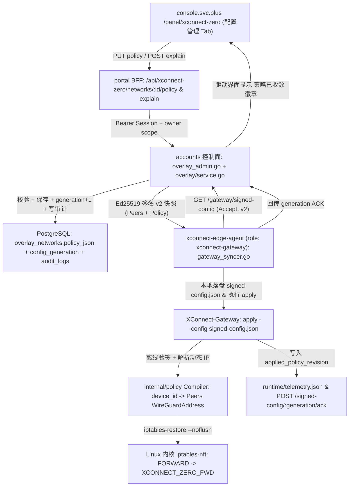

# XConnect Zero Gateway 节点间转发策略执行器与控制台自助管控架构规划

> [!IMPORTANT]
> 本文档承接 [01-architecture-and-hybrid-deployment.md](01-architecture-and-hybrid-deployment.md) 与 [02-wire-contracts-and-apis.md](02-wire-contracts-and-apis.md)，用于将当前试点节点（如 `ph-xconnect.svc.plus`）手工注入的粗粒度放行规则 `-A FORWARD -i xconzero0 -o xconzero0 -j ACCEPT`，升级为由控制面统一签名下发、Gateway 本地原子执行、并在 `https://console.svc.plus/panel/xconnect-zero` 自助编排与审计的 **Zero Trust 节点间转发策略闭环**。
>
> **五大工程安全红线**：
> 1. **动态 IP 解析零硬编码**：策略存储、API 契约与签名摘要仅绑定 `device_id`（或通配符 `"*"`），Gateway 在本地编译防火墙规则时，必须基于当前已签名 `Peers` 列表动态解析各设备的 `WireGuardAddress`，**严禁**在任何规则中硬编码 `10.66.0.x` 或静态点对点 IP；
> 2. **向后兼容滚动升级（`DisallowUnknownFields` 保护）**：旧版 `XConnect-Gateway` 的 HTTP 客户端启用了 `decoder.DisallowUnknownFields()`（见 `internal/gateway/client.go`），控制面 `GET /api/overlay/v1/gateway/signed-config` **必须**通过 `Accept: application/vnd.xconnect.gateway-config.v2+json` 协商响应内嵌 `policy` 与 `connection_mode` 的 `SchemaVersion: 2` 签名快照，面对未携带 v2 头部的旧版客户端维持 `SchemaVersion: 1` 原样响应，确保零中断滚动升级；
> 3. **纯数据面解耦与原子一致性**：延续 PR `#28`（`8ada08c`）数据面解耦架构，`PolicyArtifact` 与 `Peers` 同属单份 Ed25519 签名快照 `runtime/signed-config.json`；`xconnect-gateway apply --config ...` 在本地离线完成结构校验、签名验签、规则编译与原子应用，不发起额外 HTTP 拉取，彻底消除 Peers 与 Policy 代次错位（generation skew）；
> 4. **宿主防火墙严格隔离（独立链 `XCONNECT_ZERO_FWD`）**：只在内核 `FORWARD` 链首部挂载一条按接口严格限定的跳转规则 `-i <iface> -o <iface> -j XCONNECT_ZERO_FWD`，并通过 `iptables-restore --noflush` 原子替换 `XCONNECT_ZERO_FWD` 内部规则集；**严禁** `flush` 宿主 `FORWARD`、`INPUT` 或碰触 `f2b-table` / SSH / Docker 等宿主安全规则；`xconnect-gateway down` 时必须精准清理跳转规则并删除自建链；
> 5. **三权分立与最小权限 + 保留既有 UI 布局**：策略读写、更新审计与仿真严格受 `accounts` `requireXConnectZeroAccess` 的 `owner_user_id` 租户归属保护并写入不可抵赖审计日志；`portal` 保留 `Zero 概览` / `节点管理` / `配置管理` 三栏 Tab 与卡片布局，将自助访问控制面板集成于 `配置管理` Tab。

---

## 一、跨仓库现状基线核查（2026-11-22）

经过对 5 个关联仓库源码及生产环境配置的核查，各端现状、已具备基础与关键缺口如下表所示：

| 仓库 | 本地工作区与基线提交 | 已有基础 | 核心缺口与注意事项 |
| :--- | :--- | :--- | :--- |
| `XConnect-Gateway` | `ai-workspace-xstream/XConnect-Gateway`<br>(`origin/main` `9b27194`，注：本地 `main` 落后 2 个提交，需先 fast-forward 合入 `#28`/`#29`) | PR `#28` (`8ada08c`) 已实现纯数据面 `apply`、`signed-config.json` 验签、`connection_mode` 枚举、`GatewayTelemetry` 本地遥测与 `Dockerfile`（已内置 `iproute2`、`iptables`、`wireguard-tools`）；`scripts/setup-xconnect-gateway.sh` 已启用 `net.ipv4.ip_forward=1` | `Config` (`SchemaVersion == 1`) 无 `Policy` 字段；`client.go` 含 `DisallowUnknownFields()`；`applyCmd` / `applyRuntime` 无任何 `iptables`/`nftables` 转发策略编译与隔离链清理逻辑 |
| `xconnect-edge-agent` | `ai-workspace-xstream/xconnect-edge-agent`<br>(`main` `bd23d41`) | `internal/agentmode/gateway_syncer.go` 已周期性拉取 `/api/overlay/v1/gateway/signed-config`、完成 Ed25519 验签、写入 `runtime/signed-config.json` 并调用 `xconnect-gateway apply --state-dir ... --config ...`，随后向 `/ack` 上报生效代次 | `gatewaySignedConfig` 未声明 `Policy`；HTTP 请求头固定为 `Accept: application/json`，升级时需协商 `v2` 媒体类型并保持校验覆盖完整性 |
| `accounts` | `ai-workspace-services/accounts`<br>(`origin/main` `72007a37`；本地开发分支 `feat/overlay-runtime-observations` `c942db5e`) | `domain.go` 已定义 `PolicyArtifact` / `PolicyRule`；`service.go` 已提供 `AdminPolicy` / `AdminUpdatePolicy`（持久化 `overlay_networks.policy_json` 并递增 `config_generation`）及 `PolicyArtifact` 端点；`api/overlay_admin.go` 已暴露 `GET`/`PUT /api/overlay/v1/admin/networks/:networkID/policy` | `GatewaySignedConfig` 尚未内嵌 `Policy`（也不支持 `v2` 协商与 `ConnectionMode` 透传）；`AdminUpdatePolicy` 缺少规则语义校验与审计日志写入；缺少策略干跑仿真 `/policy/explain` 接口 |
| `portal` | `ai-workspace-service/portal`<br>(`main` `9933f0a`) | `src/app/api/xconnect-zero/[...segments]/route.ts`（第 75–81 行）已代理 `GET`/`PUT /networks/:networkID/policy` -> `/admin/networks/:networkID/policy`；`xconnect-zero-node-management.tsx` 已具备 `configuration`（配置管理）Tab | `route.ts` 缺少 `/networks/:networkID/policy/explain`；`src/lib/xconnectZero.ts` 无 Policy TypeScript 类型；`配置管理` Tab 尚无默认隔离模式开关、规则编辑器与仿真器 |
| `knowledge` | `ai-workspace-service/knowledge`<br>(`main` `4caf841`) | `docs/reference/xconnect-zero-control-data-plane/` 已沉淀 `01`–`07` 规划白皮书 | 需补齐 Gateway 转发策略执行器与控制台自助管控专题规划（本文档） |

> [!WARNING]
> **P0 前置基础设施风险（生产签名密钥持久化）**：
> 在 `prod-k3s-v6`（`152.32.131.48`）上，若 `web-saas-accounts-primary` 未从 Secret `web-saas-secrets-primary` 持久化注入环境变量 `XCONNECT_OVERLAY_SIGNING_PRIVATE_KEY`，Pod 每次重启都会重新生成内存级 Ed25519 密钥对（`zero-signing-current`），导致边缘 `XConnect-Gateway` 持续出现 `gateway config signature is not trusted` 验签失败（需重新 `join`）。**Step 1 生产放量前必须优先固化该密钥。**

---

## 二、端到端目标架构与数据流



### 关键交互设计说明

1. **为什么 `GatewaySignedConfig` v2 采用“内嵌 `Policy`”而非参考 `One` 客户端分离拉取 `/policy-artifacts`？**
   - Gateway 在内核态执行的是 **源/目的 WireGuard IP 级** 转发过滤；若 `Peers` 列表与 `PolicyArtifact` 通过两次独立 HTTP 请求获取，在频繁增删节点或编辑策略时极易出现“策略引用了新 `device_id` 但 `Peers` 尚未刷新”的时间窗口错位；
   - 将 `Policy` 与 `Peers` 共同编入单份 `GatewaySignedConfig`（v2）并统一由 Ed25519 签名，使 `xconnect-edge-agent` -> `xconnect-gateway apply` 保持 **单文件、零网络 IO、原子验签、严格同代（Single-Generation Consistency）** 的纯数据面边界。
2. **为什么默认 `DefaultAction = "deny"`（零信任微隔离）？**
   - 多用户共享或同一租户下同时挂载个人终端（macOS）与自动运维容器（如 Grok Bot）时，默认全互联会放大横向移动风险；
   - `accounts` 的 `defaultPolicyArtifact()` 已内置 `DefaultAction: "deny"`，仅当用户显式开启“全互联模式”或在规则表中放行特定 `device_id -> device_id` 协议端口时才在 `XCONNECT_ZERO_FWD` 中生成 `ACCEPT` 规则。

---

## 三、核心契约与防火墙执行器精确设计

### 3.1 网关签名配置 v2 契约（`GatewaySignedConfig` v2）

在 `accounts`、`xconnect-edge-agent` 与 `XConnect-Gateway` 中同步新增媒体类型常量与 `SchemaVersion: 2` 签名规则：

- **协商头（Content Negotiation）**：
  - `GatewaySignedConfigV2MediaType = "application/vnd.xconnect.gateway-config.v2+json"`
  - 当请求头 `Accept` 包含上述 v2 媒体类型时，`accounts` 返回 `schema_version: 2`，携带 `connection_mode` 与内嵌 `policy`；
  - 当旧版 Gateway / Agent 仅发送 `Accept: application/json` 时，`accounts` 返回 `schema_version: 1` 且严格省略新增字段（`Policy == nil`），保证旧版 `decoder.DisallowUnknownFields()` 100% 通过。

```json
{
  "schema_version": 2,
  "role": "gateway",
  "config_id": "net_prod_01:gw_ph_01:42",
  "network_id": "net_prod_01",
  "gateway_id": "gw_ph_01",
  "generation": 42,
  "issued_at": "2026-11-22T06:30:00Z",
  "expires_at": "2026-11-22T07:00:00Z",
  "connection_mode": "wg_vless_l3",
  "interface_name": "xconzero0",
  "address": "10.66.0.1/32",
  "listen_port": 51820,
  "mtu": 1420,
  "peers": [
    {
      "device_id": "macbook-pro",
      "wireguard_public_key": "...",
      "wireguard_address": "10.66.0.2/32",
      "allowed_ips": "10.66.0.2/32"
    },
    {
      "device_id": "grok-bot",
      "wireguard_public_key": "...",
      "wireguard_address": "10.66.0.4/32",
      "allowed_ips": "10.66.0.4/32"
    }
  ],
  "transport": { "...": "..." },
  "mesh": null,
  "policy": {
    "schema_version": 1,
    "compiler_version": "xconnect-policy-v1",
    "network_id": "net_prod_01",
    "revision": 42,
    "default_action": "deny",
    "protected_flows": [
      "control:controller-session",
      "control:gateway-apply-result",
      "control:gateway-heartbeat",
      "control:gateway-policy-artifact",
      "control:gateway-snapshot"
    ],
    "rules": [
      {
        "id": "allow-mac-to-grok-ssh-icmp",
        "action": "allow",
        "source_devices": ["macbook-pro"],
        "destination_devices": ["grok-bot"],
        "protocols": ["icmp", "tcp"],
        "ports": [22, 8080]
      }
    ]
  },
  "signature": {
    "algorithm": "Ed25519",
    "key_id": "zero-signing-current",
    "value": "..."
  }
}
```

#### Ed25519 签名向后兼容约束

- **`SchemaVersion == 1`**：签名原文结构体与现有 `accounts/internal/overlay/service.go` `gatewaySigningBytes` 保持一致（`SchemaVersion`, `Role`, `ConfigID`, `NetworkID`, `GatewayID`, `Generation`, `IssuedAt`, `ExpiresAt`, `InterfaceName`, `Address`, `ListenPort`, `MTU`, `Peers`, `Transport`, `Mesh`），并兼容 `ConnectionMode` 非空校验；
- **`SchemaVersion == 2`**：签名原文额外覆盖 `ConnectionMode` 与完整 `Policy` 对象；Gateway 与 Agent 的 `Verify()` 先按 `SchemaVersion == 2` 验签，若缺失 `Policy` 或版本号不允许降级攻击（如 `Policy != nil` 时强制 `SchemaVersion == 2`）。

---

### 3.2 `PolicyArtifact` / `PolicyRule` 校验与求值语义

| 字段 / 属性 | 允许取值与校验约束 | 求值语义 |
| :--- | :--- | :--- |
| `default_action` | `"deny"`（默认）或 `"allow"` | 当所有显式 `rules` 均未命中时执行的默认动作 |
| `rules` | 最多 **200** 条；顺序敏感；单条规则 `id` 非空且在网络内唯一（`^[a-zA-Z0-9][a-zA-Z0-9._:-]{0,63}$`） | **First-Match-Wins**（自顶向下逐条匹配，命中即返回） |
| `action` | `"allow"` 或 `"deny"` | 动作枚举 |
| `source_devices` / `destination_devices` | 至少包含 1 项；每项为 `"*"`、本网络内已注册 `device_id` 或预留自身网关 `gateway_id`；若某离线/已吊销设备暂时不在 `Peers` 中，**控制面允许保留规则（或提示告警），Gateway 编译器安全跳过未解析设备，绝不整链报错阻塞其余规则** | 集合笛卡尔积匹配：任意 `src in source_devices` 且 `dst in destination_devices` |
| `protocols` | 空切片等价 `["all"]`；可选值 `"all"`、`"tcp"`、`"udp"`、`"icmp"` | `"all"` 匹配所有 L3/L4 协议（含 ICMP） |
| `ports` | `1..65535` 整型切片；仅当 `protocols` 含 `"tcp"`、`"udp"` 或 `"all"` 时允许非空；**纯 `"icmp"` 规则禁止携带 `ports`** | 若 `protocols` 含 `"all"` 且 `ports` 非空，编译器自动拆分为 `tcp` + `udp`（`iptables` 语法要求 `--dport` 必须指定 `-p tcp` 或 `-p udp`）；每条 `iptables` 规则最多承载 15 个端口（自动分片 `-m multiport --dports`） |
| `protected_flows` | 服务端持久化保留（若前端传入为空则自动补全 `defaultPolicyArtifact` 的 5 条控制流标签） | 控制面平面自身走控制隧道直通，不阻断心跳/ACK |

---

### 3.3 `XConnect-Gateway` 策略编译器与 `iptables` 原子执行器设计

#### 为什么选用 `iptables` + `iptables-restore --noflush`？

1. 已验证 `XConnect-Gateway/Dockerfile` 基于 `debian:bookworm-slim` 并已预装 `iptables`（未安装 `nftables` 用户态 CLI）；
2. 在 Bookworm / Ubuntu 22.04+ 宿主（如 `ph-xconnect.svc.plus`）上，`iptables` 默认即 `iptables-nft` 后端，可零冲突融入现有 `nftables` 内核表，容器内无需新增任何系统包；
3. `iptables-restore --noflush` 在单个进程调用中对自定义链执行整链替换，天然避免逐条 `iptables -A` 产生半截规则闪烁。

#### 包布局设计（`XConnect-Gateway/internal/policy/`）

```text
XConnect-Gateway/internal/policy/
├── compiler.go        # 纯函数规则编译器 Compile(iface string, peers []gateway.Peer, policy *gateway.PolicyArtifact)
├── compiler_test.go   # 单元测试：default deny/allow、通配符 *、IPv4/IPv6、15 端口分片、未解析设备跳过、确定性 digest
├── enforcer_linux.go  # Linux 执行器：写 ip_forward=1、iptables-restore --noflush、FORWARD 首部挂载、Teardown 卸载
└── enforcer_stub.go   # 非 Linux（如 macOS 本地研发）编译桩，保证跨平台 go test ./... 通过
```

#### 编译生成的 `XCONNECT_ZERO_FWD` 原子规则模板

```text
*filter
:XCONNECT_ZERO_FWD - [0:0]
-F XCONNECT_ZERO_FWD
# 1. 有状态回包优先放行（保证单向放行 A -> B 时 B -> A 的应答包无需重复配置双向规则）
-A XCONNECT_ZERO_FWD -m conntrack --ctstate ESTABLISHED,RELATED -j ACCEPT
-A XCONNECT_ZERO_FWD -m conntrack --ctstate INVALID -j DROP
# 2. 按顺序编译用户规则（以 device_id 动态解析出的 10.66.0.x/32，带规则追溯注释）
-A XCONNECT_ZERO_FWD -s 10.66.0.2/32 -d 10.66.0.4/32 -p icmp -m comment --comment "xcz:rev=42:rule=allow-mac-to-grok-ssh-icmp" -j ACCEPT
-A XCONNECT_ZERO_FWD -s 10.66.0.2/32 -d 10.66.0.4/32 -p tcp -m multiport --dports 22,8080 -m comment --comment "xcz:rev=42:rule=allow-mac-to-grok-ssh-icmp" -j ACCEPT
# 3. 兜底动作：policy.default_action == "allow" 则 -j ACCEPT，否则 fail-closed 为 -j DROP
-A XCONNECT_ZERO_FWD -m comment --comment "xcz:rev=42:default=deny" -j DROP
COMMIT
```

#### 宿主安全挂载与卸载规则

- **挂载校验（每次 `apply` 幂等确保）**：
  1. 开启宿主 IPv4 转发：读取 `/proc/sys/net/ipv4/ip_forward`，若非 `"1"` 则写入 `"1"`（并可同步执行 `sysctl -w net.ipv4.ip_forward=1`）；
  2. 执行 `iptables-restore --noflush` 原子更新 `XCONNECT_ZERO_FWD` 链内容；
  3. 检查 `iptables -C FORWARD -i <iface> -o <iface> -j XCONNECT_ZERO_FWD`：若不存在，执行 `iptables -I FORWARD 1 -i <iface> -o <iface> -j XCONNECT_ZERO_FWD`；若存在但不在第 1 条（防止手工残留规则 `-A FORWARD -i xconzero0 -o xconzero0 -j ACCEPT` 抢先放行），执行删除后重新插入位置 `1`；
  4. 按编译摘要 `runtime/policy-applied.sha256` 判断变更，实现幂等跳过与增量遥测同步。
- **Fail-Closed 降级处理**：
  - 若 `cfg.Policy == nil`（例如仍接入旧版 `SchemaVersion == 1` 控制面），Gateway **主动编译为默认隔离策略**（仅 `ESTABLISHED,RELATED` 放行，其余 `-j DROP`），杜绝节点间默认裸奔互通；同时可在过渡期通过运维手动开关或先升级控制面再开启策略执行器避免断网（见第五章上线顺序）。
- **干净卸载（`xconnect-gateway down`）**：
  - 循环清理所有 `-D FORWARD -i <iface> -o <iface> -j XCONNECT_ZERO_FWD`，随后 `-F XCONNECT_ZERO_FWD` 并 `-X XCONNECT_ZERO_FWD`，宿主环境无规则残留。
- **状态与遥测扩展（`internal/gateway/state.go` & `telemetry.go`）**：
  - `State` 新增 `AppliedPolicyRevision uint64`、`AppliedPolicyDigest string`；
  - `GatewayTelemetry` 新增 `PolicyRevision uint64`、`PolicyDefaultAction string`、`PolicyRuleCount int`、`PolicyDigest string`，随 `xconnect-edge-agent` 回传至控制面与控制台 UI。

---

### 3.4 `accounts` Policy Explain Dry-Run 接口契约

新增 `POST /api/overlay/v1/admin/networks/:networkID/policy/explain`，供控制台在“保存前/保存后”毫秒级验证任意两个节点间特定协议与端口将被哪条规则命中：

- **Request Body**：
  ```json
  {
    "source_device_id": "macbook-pro",
    "destination_device_id": "grok-bot",
    "protocol": "tcp",
    "port": 8080,
    "policy": { "...可选：传入前端未保存的草稿 PolicyArtifact 做试算..." }
  }
  ```
- **Response Body (`200 OK`)**：
  ```json
  {
    "decision": "allow",
    "matched_rule_id": "allow-mac-to-grok-ssh-icmp",
    "reason": "matched_rule",
    "source_ip": "10.66.0.2/32",
    "destination_ip": "10.66.0.4/32",
    "policy_revision": 42
  }
  ```

---

### 3.5 `portal` BFF 与 `/panel/xconnect-zero` UI 集成方案

- **BFF 路由复用与扩展**（`src/app/api/xconnect-zero/[...segments]/route.ts`）：
  - `GET /networks/:networkID/policy` 与 `PUT /networks/:networkID/policy` 在现有代码中**已就位**（第 75–81 行）；
  - 新增 `POST /networks/:networkID/policy/explain` 分支映射至 `/admin/networks/${encodeURIComponent(segments[1])}/policy/explain`，沿用 `permissionXConnectZeroRead`（Dry-Run 仿真只读）或 `permissionXConnectZeroManage`（写策略）鉴权门禁；
  - 在 `PUT /networks/:networkID/policy` 遇到上游 404 时透传错误而非统一吞为 `control_plane_unavailable`。
- **控制台 UI（`xconnect-zero-node-management.tsx` -> `page === "configuration"` Tab）**：
  在现有 `Gateway / One 互联网络模式` 与 `账号授权绑定` 两个 `<Frame>` 之间，增加第三组无侵入卡片 **`节点间访问控制策略（Zero Trust ACL）`**：
  1. **全局默认策略模式开关（两态单选卡）**：
     - **零信任节点隔离（`default_action: "deny"`，推荐）**：仅显式规则允许的设备/端口可互通，其余节点间互访默认丢弃；
     - **全节点信任互通（`default_action: "allow"`）**：类似 Tailscale 默认 Full-Mesh，所有同网已入网设备默认互通，可通过 `deny` 规则做黑名单限制；
     - 卡片头部展示 **策略收敛状态徽章**：对比 `network.config_generation` 与 Gateway 设备的 `applied_generation`，显示 `已收敛 (Rev 42)` 或 `下发同步中...`（点击可手动刷新）。
  2. **精细访问控制规则列表（First-Match-Wins）**：
     - 源设备 / 目标设备下拉多选器：UI 友好的显示 **`设备名 · 10.66.0.x`** 或 **`全部设备 (*)`**，但提交 Payload **仅存储稳定标识 `device_id` 或 `"*"`**；
     - 支持快捷模板按钮（如“仅放行 Ping (ICMP)”、“允许运维端访问全部节点端口”）与单条规则的**上移 / 下移（优先级调整）**、**协议（ALL / TCP / UDP / ICMP）**、**端口列表（逗号分隔 `22,80,8080`）**、**启用动作（允许 / 拒绝）**；
     - 底部保留“放弃更改 / 保存并下发至 Gateway”操作栏，保存后提示 `config_generation` 已递增并预计 60s 内下发至边缘网关。
  3. **策略连通性仿真器（Policy Explain）**：
     - 选择 `[源设备] -> [目标设备] + [协议] + [端口]`，一键调用 `POST /api/xconnect-zero/networks/:id/policy/explain`，即时高亮命中的规则 ID 与实时决策原因，辅助排障（如快速区分“控制面策略拒绝” vs “边缘节点本机未放行/未上线”）。

---

## 四、分阶段可执行任务拆解

| 阶段 | 任务 ID | 目标仓库 | 建议分支 | 核心修改文件与符号 | 机器可判定验收标准 |
| :--- | :--- | :--- | :--- | :--- | :--- |
| **P0** | `Task P0-K1` | `gitops` / 生产集群 | `ops/persist-overlay-signing-key` | `prod-k3s-v6` Secret `web-saas-secrets-primary` 注入 `XCONNECT_OVERLAY_SIGNING_PRIVATE_KEY` | 重启 `web-saas-accounts-primary` 后 `/api/overlay/v1/signing-keys` 公钥指纹保持不变 |
| **Step 1** | `Task S1-G1` | `XConnect-Gateway` | `feat/gateway-policy-enforcer` | `internal/gateway/contract.go`, `client.go`, `contract_test.go`, `client_test.go` | 先 pull 合入 `#28`/`#29`；`Config` 支持 `SchemaVersion: 1|2`、`Policy *PolicyArtifact`；`Client.Config` 发送 `Accept: application/vnd.xconnect.gateway-config.v2+json, application/json`；`go test ./internal/gateway` 全过 |
| **Step 1** | `Task S1-G2` | `XConnect-Gateway` | `feat/gateway-policy-enforcer` | `internal/policy/compiler.go`, `compiler_test.go`, `enforcer_linux.go`, `enforcer_stub.go` | 覆盖规则编译测试（动态 IP、通配符 `*`、15 端口分片、ICMP 拒端口、未解析 Peer 跳过、v1 fail-closed deny）；生成合规 `iptables-restore --noflush` 脚本且不触碰宿主其余链 |
| **Step 1** | `Task S1-G3` | `XConnect-Gateway` | `feat/gateway-policy-enforcer` | `cmd/xconnect-gateway/main.go`, `cmd/xconnect-gateway/apply_test.go`, `internal/gateway/state.go`, `telemetry.go` | `applyCmd` 编译并原子生效 `XCONNECT_ZERO_FWD`，记录 `AppliedPolicyRevision` / `Digest` 与 `GatewayTelemetry`；`down` 清理跳转与自建链；`CGO_ENABLED=0 GOARCH=amd64 GOOS=linux go build ./cmd/xconnect-gateway` 与全量单元测试通过 |
| **Step 1** | `Task S1-A1` | `accounts` | `feat/gateway-policy-v2` | `internal/overlay/domain.go`, `service.go`, `http.go`, `http_test.go` | `GatewaySignedConfig` 新增 `ConnectionMode` 与 `Policy *PolicyArtifact`；`GatewayConfig` 与 `gatewaySigningBytes` 按 `Accept` 头协商 v1/v2；单测覆盖旧网关（v1 无多余字段）与新网关（v2 Ed25519 验签） |
| **Step 1** | `Task S1-E1` | `xconnect-edge-agent` | `feat/gateway-policy-sync` | `internal/agentmode/gateway_syncer.go`, `gateway_syncer_test.go` | `gatewaySignedConfig` 支持 `SchemaVersion: 2` + `Policy` 验签；请求头升级 `Accept` v2；将含策略的 `signed-config.json` 原样透传至 `xconnect-gateway apply`；`go test ./internal/agentmode/...` 全过 |
| **Step 2** | `Task S2-A2` | `accounts` | `feat/overlay-policy-explain` | `internal/overlay/service.go`, `api/overlay_admin.go`, `internal/store/store.go` | `AdminUpdatePolicy` 强化规则长度/ID 唯一性/设备归属/ICMP 端口校验，保留 `ProtectedFlows`，写入审计动作 `overlay.network.policy_update` |
| **Step 2** | `Task S2-A3` | `accounts` | `feat/overlay-policy-explain` | `internal/overlay/policy_explain.go`, `api/overlay_admin.go`, `overlay_test` | 新增 `POST /api/overlay/v1/admin/networks/:networkID/policy/explain`，复用统一规则求值器并返回命中规则 ID 与动态解析 IP |
| **Step 2** | `Task S2-P1` | `portal` | `feat/xzero-policy-ui` | `src/app/api/xconnect-zero/[...segments]/route.ts`, `route.test.ts`, `src/lib/xconnectZero.ts` | 注册 `POST /networks/:networkID/policy/explain` BFF 代理与 `XConnectZeroPolicy*` TypeScript 类型，Jest/Vitest 路由单测通过 |
| **Step 3** | `Task S3-P2` | `portal` | `feat/xzero-policy-ui` | `src/modules/extensions/builtin/xconnect-zero/routes/xconnect-zero-node-management.tsx` | `配置管理` Tab 接入默认策略模式切换 card 与代次收敛状态徽章（保持既有 UI 布局） |
| **Step 3** | `Task S3-P3` | `portal` | `feat/xzero-policy-ui` | 同上 | 接入可视化规则编辑器（按 `device_id` 选择节点、协议/端口校验、上下移排序、保存/重置） |
| **Step 3** | `Task S3-P4` | `portal` | `feat/xzero-policy-ui` | 同上及关联 `.test.tsx` | 接入策略 Dry-Run 仿真器表单与结果高亮卡片，补充组件交互单测 |

---

## 五、试点验收矩阵（`ph-xconnect.svc.plus`）与零停机上线顺序

### 5.1 严格滚动升级顺序（防中断与 `DisallowUnknownFields` 踩踏）

1. **Step 0 (`Task P0-K1`)**：在 `prod-k3s-v6` 持久化 `XCONNECT_OVERLAY_SIGNING_PRIVATE_KEY`（消除 Pod 重启签名失信）；
2. **Step 1A (`Task S1-A1`)**：先发布 `accounts`（支持 `Accept` 协商 v1/v2）。此时线上旧版 Gateway/Agent 仍请求 `v1`，100% 零影响；
3. **Step 1B (`Task S1-G1..G3` + `Task S1-E1`)**：构造新版本 `XConnect-Gateway` 与 `xconnect-edge-agent` 二进制/镜像，优先部署到试点节点 `ph-xconnect.svc.plus`；
4. **Step 1C（清理临时手工规则 & 试点闭环验收）**：确认 Gateway 在 `FORWARD` 第 1 条已插入 `-i xconzero0 -o xconzero0 -j XCONNECT_ZERO_FWD` 且执行符合预期后，删去临时手工注入的 `-A FORWARD -i xconzero0 -o xconzero0 -j ACCEPT`，避免双规冲突；
5. **Step 2 & Step 3（`accounts` Explain + `portal` 控制台上线）**：开启前端 `配置管理` Tab 自助管控。

### 5.2 `ph-xconnect.svc.plus` 实网验收矩阵

以线上实网动态分配的 `macbook-pro`（`10.66.0.2`）、`gw_ph_01`（`10.66.0.1`）、`grok-bot`（`10.66.0.4`）为例（所有 IP 由 Peers 列表动态注入，不绑定固定地址）：

| 用例编号 | 下发策略配置 | `mac (10.66.0.2)` -> `gw (10.66.0.1)` | `mac (10.66.0.2)` -> `bot (10.66.0.4)` | `bot (10.66.0.4)` -> `mac (10.66.0.2)` | 验证焦点 |
| :--- | :--- | :--- | :--- | :--- | :--- |
| **T1** | `default_action: "deny"`，空 `rules` | `ping` 通（网关本机 INPUT） | `ping` 超时、`TCP 8080` 拒绝 | `ping` 超时 | 验证默认微隔离 fail-closed 与直连网关控制面不受影响 |
| **T2** | `default: "deny"` + Rule1 `allow mac -> bot [icmp]` | 通 | **`ping` 通**，`TCP 8080` 仍丢弃 | 仅回包通，Bot 主动 `ping mac` 超时（单向规则 + `conntrack ESTABLISHED`） | 验证协议隔离与有状态回包机制 |
| **T3** | `default: "deny"` + Rule2 `allow mac -> bot [tcp:8080]` | 通 | `TCP 8080` 通，`TCP 22` 仍丢弃 | 回包通 | 验证多端口与精确端口放行 |
| **T4** | 切为 `default_action: "allow"` + Rule1 `deny bot -> mac [all]` | 通 | 若未拦截回包则双向/单向按规则命中 | 主动发包被阻断 | 验证 First-Match-Wins 优先级与黑名单语义 |
| **T5** | 切为 `default_action: "allow"`，空 `rules` | 通 | 全协议互通 | 全协议互通 | 验证 Full-Mesh 快捷模式 |
| **T6** | 执行 `xconnect-gateway down` + 宿主机检查 | — | `FORWARD` 链跳转移除、`XCONNECT_ZERO_FWD` 删除、`f2b-table` / SSH 规则 0 变更 | — | 验证安全回滚与宿主隔离零污染 |

### 5.3 紧急回滚预案（< 30 秒）

- 若某节点因异常策略导致业务突发中断：
  1. **控制面回滚**：通过控制台一键将网络 `default_action` 切回 `"allow"` 并保存（`generation + 1`，约 30–60 秒内由 `xconnect-edge-agent` 自动同步收敛）；
  2. **边缘秒级应急逃生**：在 Gateway 宿主机删除跳转规则并恢复临时放行：
     ```bash
     iptables -D FORWARD -i xconzero0 -o xconzero0 -j XCONNECT_ZERO_FWD
     iptables -I FORWARD 1 -i xconzero0 -o xconzero0 -j ACCEPT
     ```
