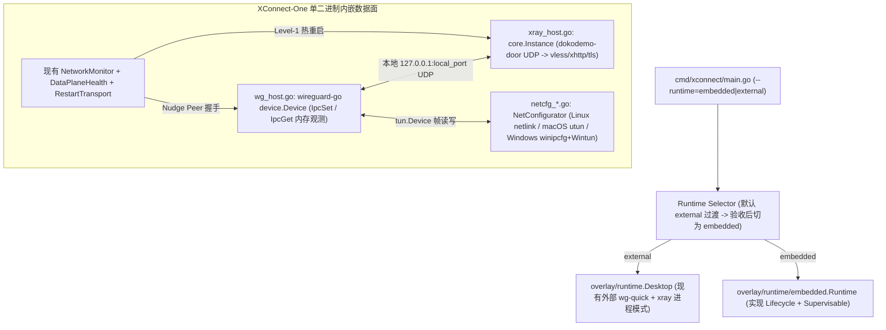

# XConnect-One Phase 1 内嵌运行时（精简 xray-core / libXray + wireguard-go + 跨平台 netConfigurator）架构规划

> [!IMPORTANT]
> 本文档定义 `XConnect-One` **Phase 1 单二进制内嵌数据面运行时（Embedded Runtime）** 的目标架构与跨平台工程规范：通过内嵌精简版 `xray-core`（及与 `xconnect-app/libXray` 对齐方案）、内嵌 `wireguard-go`（UAPI 进程内控制）及原生 `netConfigurator`（替代外部 `wg-quick` / `wg` / `xray` CLI），实现 **Linux（systemd 宿主机 + Grok Bot 无 systemd 容器）/ macOS / Windows 四类运行形态单二进制全覆盖**，彻底根除外部依赖冲突、进程身份校验脆性以及容器/桌面端网卡与路由残留。
>
> **五大工程红线**：
> 1. **双运行时平稳切换（`--runtime=embedded|external`）**：在既有 `overlay/runtime.Lifecycle`（`Apply` / `Status` / `Diagnose` / `Down` / `Cleanup`）与 `RestartTransport` / `DataPlaneHealth` 接口之上新增 `overlay/runtime/embedded` 实现，保留 `--runtime=external` 兼容开关（灰度和回滚窗口内一键切换，稳定验证后默认切换为 `embedded`）；
> 2. **静态体积与零额外外部进程**：内嵌传输引擎**仅注册最小协议集合**（`dokodemo-door` Inbound、`vless` + `freedom` Outbound、`xhttp` + `tls`/`xtls` Transport），**默认不打包约 29 MB 的 `geoip.dat` / `geosite.dat` 资产**（设为可选 build tag `-tags embed_geo`）；进程内直接启停 `core.Instance` 并读取 `wireguard-go` UAPI 统计，不再依赖外部 `xray` / `wg` / `wg-quick` / Homebrew `bash 4+` / `/bin/ps` / `/proc` / `lsof`；
> 3. **文件描述符绑定（fd-scoped）自动清理，根除僵尸网卡**：无论在 macOS（`utun`）、Linux 无 systemd 容器（如 Grok Bot），还是 Windows（Wintun 驱动），TUN 句柄均由 `xconnect-one` 进程直接持有，进程优雅退出或意外崩溃被内核回收 fd 时，TUN 网卡及接口关联路由随句柄关闭自动销毁；
> 4. **毫秒级 Level-1 传输热重启**：当 `NetworkMonitor` 检测到网络切换或睡眠唤醒跳变时，`RestartTransport()` 仅关闭并重建 `xray-core` `core.Instance`，**全程保留 TUN 网卡、动态分配的 `10.66.0.x` IP 与系统路由不断流**，随后调用 `device.IpcSet(...)` 触发 WireGuard 立即重新握手；
> 5. **动态 IP 与零 CGO 默认构建**：`10.66.0.x` 地址、`AllowedIPs` 与 `LocalPort` 严格来自控制面签名配置 `model.Config`；标准 CLI / Daemon 产物保持 `CGO_ENABLED=0` 静态或纯 Go 交叉编译，Windows 端按架构按需内嵌/加载签名 `wintun.dll`。

---

## 一、现状痛点与仓库基线核查（2026-11-22）

| 组件 / 仓库 | 当前基线 | 外部依赖模式下仍存在的历史痛点 | Phase 1 内嵌目标 |
| :--- | :--- | :--- | :--- |
| `XConnect-One` | `main` `f9aba0a`（`build 26`，`go 1.26.4`），当前 `go.mod` 仅依赖 `golang.org/x/sys` 与 `golang.org/x/term` | `overlay/runtime/desktop.go` 需调用外部 `xray`、`wg`、`wg-quick`、`ip`/`route`、`pgrep`/`ps`/`/proc`、`lsof`；macOS 下依赖 Homebrew `bash 4+` 与 `libexec/xray` wrapper 解包（`desktop_os_darwin.go`）；无 `systemd` 容器异常强杀时易遗留 `xconone0` 虚拟网卡与进程 | 新增 `overlay/runtime/embedded`，单二进制直跑 `linux/amd64`、`linux/arm64`、`darwin/arm64`、`darwin/amd64`、`windows/amd64`；保持 `Lifecycle`、`DataPlaneHealth`、`RestartTransport` 与 `cmd/xconnect/main.go` 主流程 100% 接口一致 |
| `xconnect-app/libXray` | `ai-workspace-xstream/xconnect-app/libXray`（`go 1.26.3`，`github.com/xtls/xray-core v1.260327.1-0.20260728075948-5ca6f4b7d4dc`） | `xray/xray.go` 第 11 行直接空导入 `_ "github.com/xtls/xray-core/main/distro/all"`（全量协议+路由组件），且以包级全局单例 `coreServer *core.Instance` + `coreServerMu` 管理生命周期，多实例/并发热重启或按需裁剪不便 | 提供轻量可裁剪构建标签（`-tags xconnect_minimal`）与多实例封装思路，使移动端/桌面端共享同一套极简传输与内存回收策略（`memory.InitForceFree`） |

---

## 二、总体架构与 `--runtime=embedded|external` 分层



---

## 三、三大核心模块精确设计

### 3.1 模块一：精简 `xray-core` 注册与 `libXray` 深度集成方案

#### 3.1.1 最小化协议注册清单（替代 `main/distro/all`）

在 `overlay/runtime/embedded/xray_register.go`（与未来 `libXray` 裁剪构建标签）中，**拒绝导入 `github.com/xtls/xray-core/main/distro/all`**，仅显式空白导入（`_ "..."`）XConnect Zero 隧道所需的最小子集：

| 层次 | 必需注册包（来自 `github.com/xtls/xray-core`） | 用途（对应现有 `desktop.go:1066 renderXrayConfig`） | 明确排除项（降体积与攻击面） |
| :--- | :--- | :--- | :--- |
| **Core & JSON 加载** | `app/dispatcher`, `app/proxyman/inbound`, `app/proxyman/outbound`, `main/json`（仅当直接复用 `renderXrayConfig` JSON 时；纯 protobuf 构造 `core.Config` 时连 JSON parser 亦可省去） | 构建与运行 `core.New(pbConfig)` / `serial.ToTypedMessage(...)` | `router`（GeoIP/Geosite 匹配器）、`stats`（客户端侧 WG 已有统计）、`api`、`dns`、`fakedns`、`observatory` |
| **Inbound** | `proxy/dokodemo` | `dokodemo-door` 监听 `127.0.0.1:<local_port>` UDP（以及启用 `Mesh != nil` 时的 `127.0.0.1:51821` TCP Peer Relay） | `vmess`, `trojan`, `shadowsocks`, `socks`, `http`, `wireguard`(xray 内置), `tun` |
| **Outbound** | `proxy/vless/outbound`, `proxy/freedom`, `proxy/blackhole` | `vless`（连接 Gateway `Transport.Server:Port`）+ `freedom`（出站拨号 `sockopt`） | 其他代理出站协议全部移除 |
| **Transport & Security** | `transport/internet/splithttp`（XHTTP）, `transport/internet/tls`, `transport/internet/tcp`, `transport/internet/udp` | `xhttp`（`path` / `mode` / `host`）+ `tls`（`serverName` / `fingerprint: "chrome"` / `XTLS` 相关依赖）+ `sockopt`（`tcpKeepAliveIdle: 30`, `tcpKeepAliveInterval: 15`） | `ws`, `grpc`, `kcp`, `httpupgrade`, `reality`（若节点暂未启用 Reality 可按需条件编译） |
| **Geo 资产（~29 MB）** | 默认不导入，提供构建开关 `//go:build embed_geo` | XConnect Zero 隧道分流已由 TUN 接口层 `AllowedIPs` 完成，Xray 层只做纯 `dokodemo-door -> vless` 封装转发 | 默认节省 **25–30 MB** 二进制体积与加载期内存尖峰 |

#### 3.1.2 生命周期与 `renderXrayConfig` 复用策略

- **构造与启停**：
  1. 复用现有 `overlay/runtime/desktop.go` 中的 `renderXrayConfig(config model.Config)` 生成等效配置，**优先直接构造 `*core.Config` Protobuf**（使用 `conf/serial` 一次校验或直接组装 `serial.ToTypedMessage(&core.Config{Inbound: ..., Outbound: ...})`），彻底摆脱临时磁盘文件 `xray.json`；
  2. 调用 `instance, err := core.New(pbConfig)` 与 `instance.Start()` 启动，停止时调用 `instance.Close()`（毫秒级释放监听端口 `127.0.0.1:<local_port>`）；
  3. 接入 `libXray/memory` 同款按需内存归还策略：启动完成后与 `RestartTransport` 关闭旧实例后触发 `debug.FreeOSMemory()`（移动端/低内存容器尤为关键）。
- **消除的三类脆弱校验**：不再需要落盘或探测外部 `xray` 二进制、不再需要读取 `/bin/ps` 或 `/proc` 校验进程身份、不再需要调用 `lsof` 探测本地端口占用。

#### 3.1.3 `XConnect-One` 直接集成 vs `xconnect-app/libXray` 深度协同对比

| 维度 | 方案 A：`XConnect-One` 直接裁剪注册 `xray-core` | 方案 B：改造并复用 `xconnect-app/libXray` | 综合架构决策（协同方案） |
| :--- | :--- | :--- | :--- |
| **实例隔离** | 原生支持独立多 `core.Instance`，无全局锁冲突，非常适合 Level-1 `RestartTransport()` | 当前 `libXray/xray/xray.go` 持有全局 `coreServer` 单例与 `coreServerMu`，不利于并行双实例平滑切换或测试 | **`XConnect-One`（CLI/容器/桌面守护进程）优先采用原生 `core.Instance` 托管 + 极简注册清单**；同时向 `xconnect-app/libXray` 提交向后兼容重构（新增 `xconnect_minimal` build tag 与 `InstanceHandle` 非单例封装），供 iOS `PacketTunnel` / Android `VpnService` 共用最小体积内核 |
| **依赖纯净度** | `XConnect-One` `go.mod` 直接锁定 `github.com/xtls/xray-core`，无需引入 `cgo_bridge` / `android_wrapper` 等移动端胶水层 | `libXray` 引入 Apple/Android 桥接、Clash Meta 解析、Geo 下载与 Ping 批测代码 | 职责边界清晰：CLI/Daemon 保持零移动端依赖包；Flutter App 通过 `libXray` FFI 复用同一裁剪内核 |
| **二进制增量（预期需实测验证）** | 仅最小协议 + 无 Geo：显著小于完整 `xray` | 导入 `main/distro/all` 时明显偏大 | 按最小注册编译后对比 `ls -lh` 与 `go tool nm` 裁剪无用符号 |

---

### 3.2 模块二：内嵌 `wireguard-go` 与 UAPI 控制（`overlay/runtime/embedded/wg_host.go`）

引入标准上游纯 Go WireGuard 库：`golang.zx2c4.com/wireguard/device`、`golang.zx2c4.com/wireguard/conn`、`golang.zx2c4.com/wireguard/tun`。

1. **进程内初始化与配置下发（替代 `wg` 命令）**：
   - 使用 `conn.NewDefaultBind()` 与 `NetConfigurator.CreateTUN(...)` 创建的 `tun.Device` 初始化 `*device.Device`；
   - 将 Base64 WireGuard 私钥与 Gateway 公钥转换为 WireGuard UAPI 所需的 **lowercase hex** 编码；
   - 调用 `wgDevice.IpcSet(uapiConfig)` 一次性写入配置：
     ```text
     private_key=<hex_private_key>
     replace_peers=true
     public_key=<hex_gateway_pubkey>
     endpoint=127.0.0.1:<local_port>
     persistent_keepalive_interval=25
     allowed_ip=10.66.0.0/24
     ```
   - 启动设备协议状态机：`wgDevice.Up()`。
2. **进程内无锁/零派生遥测观测（替代 `wg show <iface> dump`）**：
   - `wgHost.Stats()` 调用 `wgDevice.IpcGet()`（内存中读取，零子进程 `fork/exec`），解析 `last_handshake_time_sec`、`rx_bytes`、`tx_bytes`；
   - 直接驱动现有 `DataPlaneHealth(ctx)`（与 `wg_stats.go` 结构对齐），使容器环境即便没有 `wg` 二进制也能准确感知握手超时并触发自动恢复。
3. **毫秒级 Level-1 热重启（`RestartTransport(ctx)`）**：
   - 场景：笔记本地 Wi-Fi/蜂窝切换、macOS 休眠唤醒、或 `DataPlaneHealth` 连续探测异常但本地 TUN 仍健康；
   - 执行序列（全程仅耗时数毫秒至数十毫秒）：
     1. 保持 `tun.Device`、内核分配的 `10.66.0.x` 地址与全部 `AllowedIPs` 路由 **原封不动**（应用层 TCP 连接不断、无感知）；
     2. 关闭旧 `xrayHost.Close()`，立即新建并 `Start()` 新 `xray` `core.Instance`（重新向远端 Gateway 建立干净 XHTTP/TLS 连接池）；
     3. 立即对在运行的 `wgDevice` 执行一次增量 `IpcSet`（无需 `replace_peers=true`）：
        ```text
        public_key=<hex_gateway_pubkey>
        endpoint=127.0.0.1:<local_port>
        ```
        迫使 `wireguard-go` 立刻丢弃陈旧 UDP 发送计时并向新建好的本地 `dokodemo-door` 端口发送首包触发新 WireGuard 握手。

---

### 3.3 模块三：跨平台 `NetConfigurator` 抽象与三端精确实现（替代 `wg-quick`）

统一接口定义（位于 `overlay/runtime/embedded/netcfg.go`）：

```go
type NetConfigurator interface {
	// CreateTUN 创建（或打开）TUN 虚拟网卡，返回设备实例与真实内核接口名（macOS 下由内核分配为 utunN）
	CreateTUN(desiredName string, mtu int) (tun.Device, string, error)
	// Configure 配置接口 IPv4/IPv6 CIDR、MTU、Up 状态及静态 AllowedIPs 路由
	Configure(ctx context.Context, ifaceName string, localAddr netip.Prefix, mtu int, allowedIPs []netip.Prefix) error
	// Teardown 删除宿主附加路由并清理接口资源（具体设备销毁通常随 tun.Device.Close() 由内核同步完成）
	Teardown(ctx context.Context, ifaceName string) error
}
```

#### 三端实现规格对比

| 平台 | `CreateTUN` 策略 | IP / MTU / 接口 Up 实现 | 路由下发（`AllowedIPs`） | 僵尸网卡防泄漏与 `Teardown` | 宿主特权要求 |
| :--- | :--- | :--- | :--- | :--- | :--- |
| **Linux** (`netcfg_linux.go`)<br>覆盖 systemd 与 Grok Bot 等无 systemd 容器 | `tun.CreateTUN(desiredName, mtu)`，直开 `/dev/net/tun` 创建 `xconone0` | 纯 Go **`github.com/vishvananda/netlink`**：`netlink.LinkByName` -> `LinkSetMTU` -> `AddrReplace` -> `LinkSetUp`（零外部 `ip` / `wg-quick` / `bash` 依赖） | `netlink.RouteReplace(&netlink.Route{LinkIndex: idx, Dst: dstNet})`；跳过自身 `localAddr` 重叠网段处理冲突 | `/dev/net/tun` fd 由本进程排他持有；进程退出或被 SIGKILL 时，内核同步自动销毁虚拟网卡与关联路由！启动时可用 `netlink.LinkByName` 清理极少数历史外部模式残留 `xconone0` | `root` 或 Docker `--cap-add=NET_ADMIN --device=/dev/net/tun` |
| **macOS** (`netcfg_darwin.go`) | `tun.CreateTUN("utun", mtu)` 由内核动态分配空闲 `utunN`（读取 `dev.Name()`），不再受限名碰撞 | `ifconfig <utunN> inet <ip> <ip> netmask <mask> mtu <mtu> up`（或封装 BSD `SIOCAIFADDR` `ioctl`；保留 Homebrew 无关的系统原生 `/sbin/ifconfig`） | `/sbin/route -n add -net <cidr> -interface <utunN>`（或 `replace` 语义）；通过 `.state/runtime-state.json` 记录本次分配的 `utunN` 与公钥指纹 | 关闭 `tun.Device` fd 后 macOS 内核立即回收 `utunN`；`Teardown` 删除已记录路由并关闭 fd；LaunchDaemon 模式配合 `up --foreground --no-sudo` | `root`（`sudo` 或 LaunchDaemon） |
| **Windows** (`netcfg_windows.go`) | `tun.CreateTUN(desiredName, mtu)` 基于嵌入/同级目录签名 `wintun.dll` 创建 Wintun 适配器 | 使用原生 **`golang.zx2c4.com/wireguard/windows/tunnel/winipcfg`**（`LUID` 调用 `SetIPAddressesForFamily` + `SetIPInterface` 设定 `NLMTU`），绕开 `netsh` 多语言输出与编码陷阱 | 通过 `winipcfg.LUID.SetRoutesForFamily(...)` 直接写入 NDIS/IP 栈路由（保留 `route` / `netsh` 仅作只读诊断） | `Teardown()` 清理接口路由并调用 `wintun` Adapter `Close()` 释放句柄 | Administrator / Windows Service (`LocalSystem`) |

---

## 四、建议代码结构、编译选项与体积基线

### 4.1 `XConnect-One` 新增目录结构

```text
XConnect-One/
└── overlay/
    └── runtime/
        ├── embedded/
        │   ├── runtime.go          # 对外实现 runtime.Lifecycle + DataPlaneHealth + RestartTransport
        │   ├── xray_register.go    # 默认最小化注册（dokodemo-door/vless/freedom/xhttp/tls）
        │   ├── xray_register_geo.go# //go:build embed_geo 可选加载 geoip/geosite 资产（默认关闭）
        │   ├── xray_host.go        # core.New(pbConfig) / instance.Start() / Close() + FreeOSMemory
        │   ├── wg_host.go          # wireguard-go device + UAPI IpcSet / IpcGet + Level-1 NudgePeer
        │   ├── netcfg.go           # NetConfigurator 接口定义与公共 CIDR/Route 计算辅助函数
        │   ├── netcfg_linux.go     # vishvananda/netlink TUN IP/MTU/Route 管理
        │   ├── netcfg_darwin.go    # utun 分配与 BSD inet/route 配置
        │   ├── netcfg_windows.go   # wintun.dll + winipcfg 原生 LUID IP/MTU/Route 管理
        │   ├── wintun_windows.go   # //go:embed 按架构封装 wintun.dll 验证加载（仅 Windows 打包）
        │   └── runtime_test.go     # 内存回环 mock 单元测试（UAPI hex 编码、配置转换、热重启状态机）
        └── runtime.go              # 现有接口保持不变
```

### 4.2 `go.mod` 与构建策略

- **Core Go 依赖增量**：`github.com/xtls/xray-core`、`golang.zx2c4.com/wireguard`、`github.com/vishvananda/netlink`（Linux）、`golang.zx2c4.com/wireguard/windows`（Windows build tag）；
- **跨平台交叉编译命令矩阵（保持 `CGO_ENABLED=0`）**：
  - `GOOS=linux GOARCH=amd64 CGO_ENABLED=0 go build -trimpath ./cmd/xconnect`（覆盖 systemd 与 Grok Bot Alpine/Debian/Distroless 容器）
  - `GOOS=linux GOARCH=arm64 CGO_ENABLED=0 go build -trimpath ./cmd/xconnect`
  - `GOOS=darwin GOARCH=arm64 CGO_ENABLED=0 go build -trimpath ./cmd/xconnect`
  - `GOOS=windows GOARCH=amd64 CGO_ENABLED=0 go build -trimpath ./cmd/xconnect`
  - *注：以上交叉编译均在构建 CI 验证；实际二进制体积待首轮编译完后实测录入本白皮书，重点对照剔除 `geoip/geosite`（~29 MB）与非必需协议后的瘦身效果。*

---

## 五、分阶段任务拆解与验收矩阵（Phase 1A – 1E）

| 任务 ID | 所属阶段 | 目标文件 / 仓库 | 核心交付内容 | 验收标准 |
| :--- | :--- | :--- | :--- | :--- |
| **`Task E1-1`** | Phase 1A | `XConnect-One/overlay/runtime/embedded/` (`xray_register.go`, `xray_host.go`, `xray_register_geo.go`) | 最小化协议注册表 + 从 `model.Config` 构造 `core.Instance` + `embed_geo` 可选开关 | 单元测试：可在纯内存启动 `dokodemo-door (127.0.0.1:0) -> vless/xhttp/tls` 实例，毫秒级 `Start()`/`Close()` 且端口准确释放，无 `xray` 二进制依赖 |
| **`Task E1-2`** | Phase 1B | `XConnect-One/overlay/runtime/embedded/` (`wg_host.go`) | 引入 `wireguard-go` (`device`/`conn`/`tun`)，实现 `IpcSet`（含 Base64->Hex 私钥/公钥转换）、`IpcGet` 内存采样对接 `DataPlaneHealth`，以及 `RestartTransport()` Level-1 热重启 | 单测（可基于 `tun/tuntest.NewChannelTUN` 内存 TUN）：验证 `IpcSet` / `IpcGet` 输出、重放 Peers 无中断、调用 `RestartTransport()` 不重建 TUN 即可触发 Peer 握手 |
| **`Task E1-3`** | Phase 1C | `XConnect-One/overlay/runtime/embedded/` (`netcfg.go`, `netcfg_linux.go`, `netcfg_darwin.go`, `netcfg_windows.go`) | 三端 `NetConfigurator` 实现与集成 | 1. Linux 无 `wg-quick`/`ip` 的最小化镜像内成功创建 `xconone0` 并配置 `10.66.0.x/32` 与 `/24` 路由，kill 进程后网卡 0 残留；<br>2. macOS 分配 `utunN` 并双向 `ping 10.66.0.1`，`Ctrl+C` 后 `utunN` 自动消失；<br>3. Windows 通过 Wintun + `winipcfg` 创建网卡与路由且无乱码报错 |
| **`Task E1-4`** | Phase 1D | `XConnect-One/cmd/xconnect/main.go` + CI workflow + 安装脚本 | 新增全局/子命令标志 `--runtime=embedded|external`（或环境变量 `XCONNECT_ONE_RUNTIME`）；接入既有 `NetworkMonitor` 与 `RestartTransport`；更新四端发版产物（单一可执行文件） | Mac（`10.66.0.2`）与 Grok Bot（Linux 容器 `10.66.0.4`，容器内删除 `wg`/`wg-quick`/`xray`）均用单二进制连入 `ph-xconnect.svc.plus (10.66.0.1)`；切网/重启 `RestartTransport()` 全程 TUN IP 不掉线 |
| **`Task E1-5`** | Phase 1E (可选协同) | `ai-workspace-xstream/xconnect-app/libXray` | 为 `libXray` 引入 `//go:build xconnect_minimal` 与多实例句柄 API，使 Flutter 移动/桌面客户端与 `XConnect-One` 统一共用精简 Xray 内核能力 | `xconnect-app` 在开启 `xconnect_minimal` 时正常构建 iOS/Android FFI 产物且体积显著下降 |

---

## 六、与 Gateway 转发策略（`08` 文档）的联合演进路径

1. **端边分离，各自最优**：
   - 边缘客户端侧（**本规划 `09`**）：通过 `embedded` 运行时将 **Mac / Windows / Linux systemd / Grok Bot 容器** 收敛为一个零外部依赖的 `xconnect-one` 单二进制；
   - 网关控制面与转发侧（**前置规划 `08`**）：`XConnect-Gateway` 运行在 Linux 网关宿主/特权容器（如 `ph-xconnect.svc.plus`），通过 `XCONNECT_ZERO_FWD` 链强制执行来自 `console.svc.plus/panel/xconnect-zero` 的节点间策略；
2. **推荐交付节奏**：
   - 先交付 **`08` 文档 Step 1（`XConnect-Gateway` 策略执行器）** —— 直接解决当前 `ph-xconnect.svc.plus` 手工放行规则的控制台自动化收敛闭环；
   - 随后无缝推进 **`09` 文档 Phase 1A–1D（`XConnect-One` `embedded` 运行时）** —— 单二进制覆盖 Mac 与 Grok Bot 容器，彻底根除外部依赖与重启残留问题。
