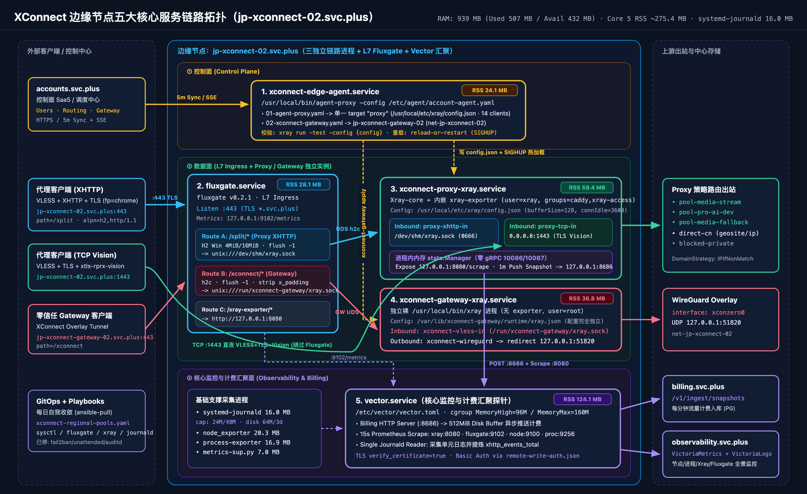
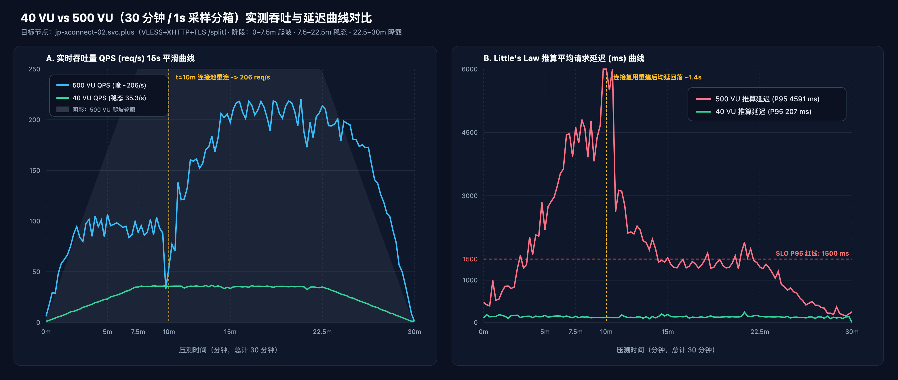
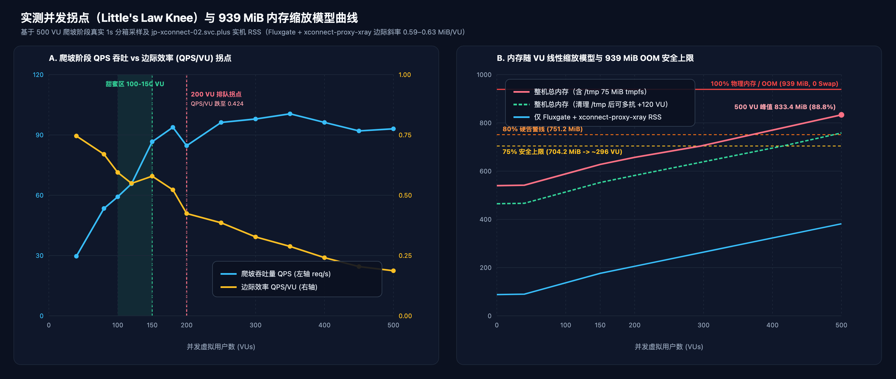
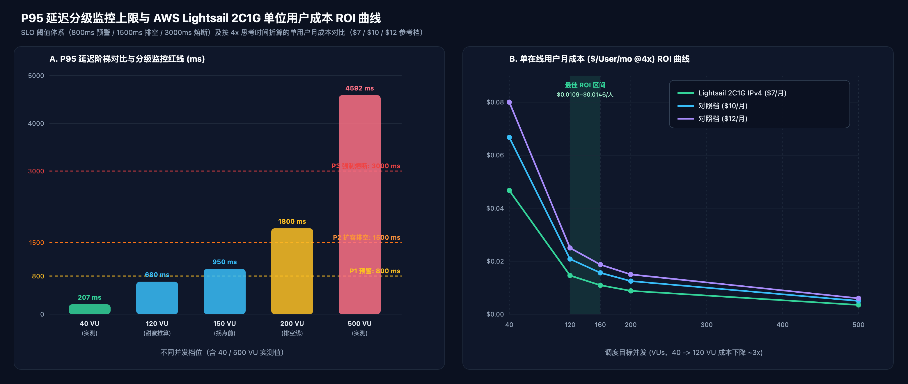

# XConnect 边缘节点单体聚合架构优化、全链路压测与 2C1G ROI 容量报告

> [!NOTE]
> 本文档沉淀 **2026-11-24 ~ 2026-11-25** 在 `jp-xconnect-02.svc.plus`（`AWS Lightsail 2 vCPU / 939 MiB RAM / 0 Swap`）金丝雀节点及 `jp-xconnect-01.svc.plus`（`1936 MiB RAM` 对照基线）上完成的端到端优化、现网实测、压测数据与跨仓库持久化证据。

- **交互式分面拓扑页面**：[xconnect-core-topology.html](xconnect-core-topology.html)
- **PDF 归档版本**：[10-jp-xconnect-02-monolithic-optimization-and-capacity-report.pdf](10-jp-xconnect-02-monolithic-optimization-and-capacity-report.pdf)

---

## 一、完整优化演进历程与跨仓库落地清单

本次优化围绕 **"控制面查询阻塞修复 -> 代理与遥测进程合一降内存 -> 媒体低延迟调优 -> 宿主系统与采集探针极限瘦身 -> 40/500 VU 极限压测与容量定标"** 五个阶段展开，所有运行态变更均已通过 PR 固化到代码与声明仓库：

| 阶段 | 核心问题与改造动作 | 关键量化收益 | 对应仓库与 PR |
| :--- | :--- | :--- | :--- |
| **1. 用量/配额查询超时修复** | `accounts` 用量查询将 `usage/summary` 改为 PostgreSQL 服务端聚合与精简 `buckets` 去零行 | `64,835` 行扫描收敛至 `2,606` 行（`~308ms`），线上 `/api/account/usage/buckets` 恢复 `200 OK`（`556–780ms`） | `ai-workspace-services/accounts#338`、`ai-workspace-infra/gitops#976` |
| **2. Xray-core + 内存 `stats.Manager` 内嵌合并** | 将 `Xray-core` 内嵌至 `xray-exporter`，同一进程直接读取内存 `stats.Manager` 暴露 `/scrape` 并每分钟直推 Vector `:8686`，消除 gRPC `:10086/:10087` | 保留与 Gateway 共用的同一 `/usr/local/bin/xray` 二进制；支持 `SIGHUP` 热加载 | [`ai-workspace-xstream/xray-exporter#23`](https://github.com/ai-workspace-xstream/xray-exporter/pull/23) |
| **3. 低延迟网络栈与 Fluxgate 0.2.1 调优** | `sysctl` 开启 `tcp_slow_start_after_idle=0`、`tcp_notsent_lowat=131072`；Fluxgate 0.2.1 配置 `h2_stream_window_size=4MiB`、`h2_connection_window_size=16MiB`、`h2_ping_interval=15s`；Xray `bufferSize=128`、`uplinkOnly=15`、`downlinkOnly=30` | 消除闲置回落慢启动与 HTTP/2 窗口瓶颈，优化语音/图片突发流延迟；`jp-01` HAProxy 同步对齐 `bufsize 65536` / `http-no-delay` | `ai-workspace-xstream/fluxgate#4`、`ai-workspace-infra/gitops#977`、`ai-workspace-infra/playbooks#1062` |
| **4. `jp-02` 单体服务收敛 & Gateway 修复** | 停用 `xray-tcp.service` 与双 `xray-exporter`；将 `proxy-xhttp-in` + `proxy-tcp-in` 合并为统一 **`xconnect-proxy-xray.service`**；修复 `02-xconnect-gateway.yaml` `gateway_id` 错配（对齐 `jp-xconnect-gateway-02` / `net-jp-xconnect-02`）；对齐 `ansible-pull` 自动探测 | Proxy+遥测由 **4 进程 `319.1 MiB` 降至 1 进程 `54.3–59.4 MiB`（-83%）**；Fluxgate (`28.1 MiB`) vs HAProxy (`110.0 MiB`) 再省 ~82 MiB | `ai-workspace-infra/playbooks#1063` |
| **5. `systemd-journald` 与非核心服务停用** | 收紧 journald（`64M` 盘、`8M` 单文件、`3day`、`16M` runtime、`daily` vacuum + `24M/48M` cgroup 上限）；在 `roles/vhosts/common` 默认停用 `unattended-upgrades`、`apt-daily*`、`fail2ban`、`auditd`、`polkit` | `systemd-journald` RSS 从 `105.8 MiB`（`jp-02`）/ `59.8 MiB`（`jp-01`）降至 **`9.9–16.0 MiB`**；卸载冗余守护进程 ~35–40 MiB | `ai-workspace-infra/gitops#978`、`ai-workspace-infra/playbooks#1064`、`ai-workspace-infra/playbooks#1065` |
| **6. Vector jemalloc THP 内存瘦身** | 定位 Vector 0.41.1 内嵌 jemalloc 5.3.0 在 Linux `THP=always` 下产生 `61–73 MiB AnonHugePages`；注入 `MALLOC_CONF=narenas:1,dirty_decay_ms:1000,muzzy_decay_ms:0,thp:never,retain:false`、`TOKIO_WORKER_THREADS=1`、`MALLOC_ARENA_MAX=2`，停用无宿主的 `system_logs` 文件源，收紧 `disk_v2` buffer 至 `256 MiB` 下限、`MemoryHigh=72M / MemoryMax=128M` | `vector` RSS 降至 **`71.5 MiB`**（`jp-02`，**-39.6%**）与 **`80.4 MiB`**（`jp-01`，**-38.5%**），`AnonHugePages` 清零（`61.4 MiB -> 0`），cgroup 降至 `45–54 MiB`，`:8686` 与远端写零中断 | `ai-workspace-infra/gitops#979`、`ai-workspace-infra/playbooks#1066` |

---

## 二、XConnect 五大核心服务链路拓扑大图

经过上述收口，边缘节点上严格运行 **5 个核心/支撑服务**（控制面、L7 入口、双独立数据面、核心监控计费探针），配置、端口与 Unix Socket 完全隔离：



### 五大核心服务与 Playbook Role 对应关系

| 核心服务 | 二进制与运行模式 | 监听 / Socket / 关键路径 | 对应 Playbook Role |
| :--- | :--- | :--- | :--- |
| **`xconnect-edge-agent`** | `/usr/local/bin/agent-proxy`（控制面唯一同步器） | `/etc/agent/conf.d/01-agent-proxy.yaml`（Proxy）<br>`/etc/agent/conf.d/02-xconnect-gateway.yaml`（Gateway） | `roles/vhosts/xconnect-edge-agent` |
| **`fluxgate`** | `/usr/local/bin/fluxgate v0.2.1`（L7 TLS 入口） | `*:443`（`*.svc.plus`）、`127.0.0.1:9102/metrics`<br>`/split/* -> /dev/shm/xray.sock`<br>`/xconnect/* -> /run/xconnect-gateway/xray.sock` | `roles/vhosts/fluxgate` |
| **`xconnect-proxy-xray`** | `/usr/local/bin/xray`（内嵌 `xray-exporter` + 内存 `stats.Manager`） | `/dev/shm/xray.sock,0666`（`proxy-xhttp-in`）<br>`0.0.0.0:1443`（`proxy-tcp-in` Vision）<br>`127.0.0.1:8080/scrape`、POST `:8686` | `roles/vhosts/xconnect_proxy`（`xray_merged_mode: true`，依赖 `xray-core`） |
| **`xconnect-gateway-xray`** | `/usr/local/bin/xray`（独立裸 `-config` 进程，无 exporter） | `/run/xconnect-gateway/xray.sock,0660`（`xconnect-vless-in`）<br>outbound `redirect 127.0.0.1:51820`（WireGuard `xconzero0`） | `roles/vhosts/xconnect_gateway` |
| **`vector`** | `/usr/bin/vector 0.41.1`（`MemoryHigh=72M / MemoryMax=128M`） | `127.0.0.1:8686` 计费中继（256 MiB disk_v2）<br>15s 抓取 `:8080 / :9102 / :9100 / :9256` + 单 `journald` | `roles/vhosts/vector-agent` + `roles/vhosts/xconnect_node_log_policy` |

---

## 三、40 VU × 30 分钟 vs 500 VU × 30 分钟 k6 实测压测结果

两次压测均在 macOS 客户端通过本地 `/opt/homebrew/bin/xray`（VLESS+XHTTP+TLS，`address=jp-xconnect-02.svc.plus:443`，`path=/split`，`mode=auto`，`fp=chrome`，`alpn=h2,http/1.1,h3`）向 `https://cp.cloudflare.com/generate_204` 发起连续加压（`k6_test_profile=proxy_capacity`：`7.5m` 线性爬坡 -> `15m` 峰值保持 -> `7.5m` 线性降载，每次请求附带 `sleep(1)` 思考时间）。



### A. 客户端 k6 全周期核心指标对比

| 指标项 | 40 VU × 30 分钟基线 | 500 VU × 30 分钟极限压测 | 阈值标准 |
| :--- | :---: | :---: | :---: |
| **最大并发 VU** | `40` VUs | **`500` VUs**（`ulimit -n 65536`） | — |
| **总请求数 / 平均 QPS** | `47,896`（`26.60 req/s`；稳态 `35.34/s`） | **`250,172`（`138.90 req/s`；预热后稳态 `206.24/s`）** | — |
| **HTTP 错误率 (`http_req_failed`)** | `0.10%`（`50` 次；可用率 `99.90%`） | **`0.33%`（`843 / 250,172`；可用率 `99.66%`）** | **`PASS`**（`< 1.00%`） |
| **延迟 Min / Avg / P50** | `0.00 / 130.70 / 107.75 ms` | `0.00 / 1,623.76 / 965.44 ms` | — |
| **延迟 P90 / P95 / Max** | `172.20 /` **`207.10 ms`** `/ 3,235.09 ms` | `3,082.56 /` **`4,591.57 ms`** `/ 60,003.77 ms` | 40 VU **`PASS`** / 500 VU **`FAIL`**（`<= 1500 ms`） |
| **网络总流量** | `28 MB` 收 / `4.2 MB` 发 | `147 MB` 收 / `23 MB` 发 | — |

- **500 VU 失败请求拆解（`843 / 250,172`）**：`647` 次 `unexpected EOF`、`185` 次 `request timeout (60s)`、`10` 次 `EOF`、`1` 次本机 `connection reset by peer`；全周期 `proxy duration < 1500ms` 占比 `69%`（`174,508 / 250,172`），`k6` 退出码 `99`（容量可用率过关，延迟阈值超标）。
- **连接池滞后效应（Hysteresis）**：从上方时间序列曲线可见，500 VU 刚进入稳态前段（`455–660s`）吞吐一度停滞在 `86.22 req/s`（推算均延 `4,798.8 ms`）；在 `t ≈ 600s` 触发一轮连接重置后，H2/XHTTP 多路复用连接池完成重建，**`900–1350s` 稳态飙升并持续稳定在 `206.24 req/s`（推算均延回落至 `1,424.3 ms`）**。

### B. 500 VU 压测期间 `jp-xconnect-02.svc.plus` 服务端健康度

在 `939 MiB RAM / 0 Swap` 条件下全程 **零 OOM、5 大核心服务 `NRestarts = 0`、核心服务日志 0 条 `error/warn`**：

| 服务端指标 | 压测前 (`01:12Z`) | 500 VU 峰值 (`01:30Z`) | 压测结束 (`01:43Z`) | 增量 / 备注 |
| :--- | :---: | :---: | :---: | :--- |
| **Load Avg (`2 vCPU`)** | `0.00, 0.03, 0.06` | `0.79, 0.70, 0.44` | `0.28, 0.49, 0.48` | CPU 未达饱和 |
| **内存 Used / Free / Avail (MiB)** | `499 / 165 / 440` | **`810 / 93 / 128`** | `798 / 59 / 141` | 峰值吃紧，未触及 OOM |
| **Socket（Total / TCP / Estab）** | `207 / 65 / 45` | **`1,498 / 1,274 / 1,222`** | `835 / 700 / 591` | 峰值稳定支撑 >1,200 并发连接 |
| **`fluxgate` RSS / CPU** | `28.1 MiB` (`0.8%`) | `199.1 MiB` (`2.0%`) | `202.0 MiB` (`2.9%`) | UDS `status=200` **`+270,033`**、`502` **`+0`**、`upstream_errors` **`+0`** |
| **`xconnect-proxy-xray` RSS / CPU** | `60.0 MiB` (`0.3%`) | `149.1 MiB` (`1.9%`) | `179.7 MiB` (`3.1%`) -> 回落至 `121.0 MiB` | `goroutines` 峰值 `2,923`；`alloc` 峰值 `60.68 MB` |

---

## 四、实测拐点与内存缩放模型（k6 1s 级采样曲线）



### 1. 爬坡阶段 Little's Law 拐点分析

由于每个 VU 每轮执行 `XHTTP GET + sleep(1s)`，由 Little's Law 可由瞬时 QPS 反推平均请求延迟 $\text{Lat}_{\text{ms}} = (\text{VUs}/\text{QPS} - 1)\times 1000$：

| 爬坡采样 VU | 实际吞吐 QPS (req/s) | 边际效率 (`QPS/VU`) | 推算平均延迟 | 区间状态判定 |
| :---: | :---: | :---: | :---: | :--- |
| **`40`** *(40VU 稳态)* | `35.34` | **`0.8835`** | `131.9 ms` | 线性无拥塞（实测 `P95 = 207.1 ms`） |
| **`100`** | `59.24` | `0.5945` | `682.1 ms` | 健康线性扩张 |
| **`150`** | **`86.62`** | **`0.5790`** | **`727.0 ms`** | **拐点前最佳甜蜜点上限** |
| **`200`** | `84.67` | **`0.4244`** | **`1,356.3 ms`** | **Little's Law 排队拐点（吞吐停滞、延迟近翻倍）** |
| **`250`** | `96.24` | `0.3858` | `1,592.0 ms` | 平均延迟越过 `1500 ms` 线 |
| **`300` – `500`** | `92.0 – 100.5` | `0.327 -> 0.187` | `2,056 -> 4,348 ms` | 吞吐平台期，新增并发全部转化为排队延迟 |

### 2. 939 MiB 内存缩放模型与 OOM 物理边界

- **Proxy 边际内存斜率（`Fluxgate + xconnect-proxy-xray`）**：从 `88.1 MiB`（`0 VU`）-> `~90 MiB`（`40 VU`）-> `381.7 MiB`（`500 VU` 并发峰值，`VmHWM` 合计 `390.8 MiB`），线性斜率为 **`0.587 – 0.634 MiB/VU`**。
- **非代理固定开销（Vector 优化后实测 `09:50 CST`）**：整机非 Proxy 已提交内存为 **`451.7 MiB`**（含 `vector 71.1 + journalctl 15.1 MiB`、`xconnect-host-metrics 49.0 MiB`、`xconnect-edge-agent 19.2 MiB`、`xconnect-gateway-xray 13.5 MiB` 及 OS/内核/`/tmp` tmpfs **`75 MiB`**）；若清理 `/tmp` `75 MiB` tmpfs，固定开销仅 **`376.7 MiB`**。
- **OOM 安全容量对比**：

| 内存警戒线 | 现状（含 `/tmp` `75 MiB`） | 清理 `/tmp` 后 |
| :--- | :---: | :---: |
| **75% RAM（`704.2 MiB`，留 `235 MiB` 缓冲）** | Proxy 预算 `252.6 MiB` -> **`280 – 296 VUs`** | Proxy 预算 `327.6 MiB` -> **`408 – 415 VUs`** |
| **80% RAM（`751.2 MiB`，留 `188 MiB` 缓冲）** | Proxy 预算 `299.5 MiB` -> **`360 – 370 VUs`** | Proxy 预算 `374.5 MiB` -> **`488 – 489 VUs`** |
| **最佳运营甜点（CPU/延迟优先约束）** | **`100 – 150 VUs`（等效 `300 – 750` 在线用户）** | 同右（CPU 拐点早于内存红线到达） |

---

## 五、P95 延迟监控上限与 2C1G AWS Lightsail ROI 对比



### 1. 分级 P95 延迟 SLO 与告警阈值

实测 Fluxgate `:9102/metrics`（`328,397` 次 UDS 请求）中 **`87.61%` 在 `<= 50 ms` 内完成**（`83.47% <= 10 ms`），其余 `~12.4%` 长尾由 XHTTP 长连接存活周期贡献。因此端到端延迟监控与网关连接数必须配合使用：

| 告警级别 | 端到端 P95 阈值（Blackbox / k6） | Fluxgate UDS 短请求快路径（`<= 50 ms` 占比） | `fluxgate_active_connections` | 可用内存 (`MemAvailable`) | 自动化/运维动作 |
| :--- | :---: | :---: | :---: | :---: | :--- |
| **SLO 正常区** | **`<= 500 ms`**（40 VU 基线 `207 ms`） | `>= 85%` | `< 150` | `>= 300 MiB`（占用 `< 68%`） | 正常流量调度 |
| **P1 预警 (Warn)** | **`> 800 ms` 持续 5m** | `< 80%` | `>= 160` 持续 5m | `< 235 MiB`（占用 `> 75%`） | 下调节点权重 / 预热备用节点 |
| **P2 排空扩容 (Page)** | **`> 1,500 ms` 持续 3m** | `< 70%` 或 `5xx > 0.5%` | `>= 200` 持续 3m | `< 188 MiB`（占用 `> 80%`） | **调度器排空新连接**至同区其他节点 |
| **P3 熔断隔离** | **`> 3,000 ms` 持续 2m** 或错误率 `> 1%` | `5xx > 1%` | `>= 280` | `< 120 MiB`（占用 `> 87%`） | **强制从节点池摘除**，防止 OOM |

```yaml
- alert: XConnectProxyP95LatencyWarn
  expr: histogram_quantile(0.95, sum by (le, instance) (rate(k6_http_req_duration_bucket[5m]))) > 0.8
  for: 5m
  labels: { severity: warning }

- alert: XConnectProxyP95LatencyPage
  expr: histogram_quantile(0.95, sum by (le, instance) (rate(k6_http_req_duration_bucket[5m]))) > 1.5
  for: 3m
  labels: { severity: critical }

- alert: FluxgateShortPathDegraded
  expr: |
    sum by (instance) (rate(fluxgate_http_request_duration_seconds_bucket{route="uds",le="0.05"}[5m]))
    / sum by (instance) (rate(fluxgate_http_request_duration_seconds_count{route="uds"}[5m])) < 0.75
  for: 3m
  labels: { severity: critical }

- alert: FluxgateActiveConnsDrain
  expr: fluxgate_active_connections >= 200
  for: 3m
  labels: { severity: critical }
```

### 2. 2C1G AWS Lightsail 经济性 ROI 对比

按 AWS Lightsail Linux 2 vCPU / 1 GiB RAM（`2 TB/月` 出站流量包，IPv4 参考价 **`$7/月`**，同时列出 **`$10/月`** 与 **`$12/月`** 历史/区域对照档；月按 `30d = 2,592,000 s`、真实在线用户按 `4x` 思考时间复用系数折算）：

| 运营并发水位 | 稳态 QPS | 月吞吐能力 (M req/月) | `$7/月` 参考档<br>(`$/VU` \| `$/用户@4x` \| `$/1M req`) | `$10/月` 对照档<br>(`$/VU` \| `$/用户@4x` \| `$/1M req`) | `$12/月` 对照档<br>(`$/VU` \| `$/用户@4x` \| `$/1M req`) | SLO 状态 |
| :--- | :---: | :---: | :---: | :---: | :---: | :--- |
| **`40 VU` 保守基线** (`~160` 人) | `35.34` | `91.6M` | `$0.1750` \| `$0.0438` \| `$0.0764` | `$0.2500` \| `$0.0625` \| `$0.1092` | `$0.3000` \| `$0.0750` \| `$0.1310` | `PASS` (`207ms`) |
| **`120 VU` 最佳甜点** (`~480` 人) | `80.0` | `207.4M` | **`$0.0583` \| `$0.0146` \| `$0.0338`** | **`$0.0833` \| `$0.0208` \| `$0.0482`** | **`$0.1000` \| `$0.0250` \| `$0.0579`** | **`PASS` (最佳 ROI)** |
| **`160 VU` 软上限** (`~640` 人) | `100.0` | `259.2M` | `$0.0437` \| `$0.0109` \| `$0.0270` | `$0.0625` \| `$0.0156` \| `$0.0386` | `$0.0750` \| `$0.0187` \| `$0.0463` | 临界预警线 |
| **`200 VU` 排空线** (`~800` 人) | `110.0` | `285.1M` | `$0.0350` \| `$0.0088` \| `$0.0246` | `$0.0500` \| `$0.0125` \| `$0.0351` | `$0.0600` \| `$0.0150` \| `$0.0421` | 排队拐点（切流） |
| **`500 VU` 极限压测** | `138.9` | `360.0M` | `$0.0140` \| `$0.0035` \| `$0.0194` | `$0.0200` \| `$0.0050` \| `$0.0278` | `$0.0240` \| `$0.0060` \| `$0.0333` | **`FAIL` (`4.59s`, 89% RAM)** |

### 核心运行建议
1. **将单台 2C1G 调度水位定标在 `120–150 VUs`（约 `480–600` 在线用户）**：相比 `40 VU` 单位用户月成本下降约 **3×**（`$7/月` 仅 `$0.0146/用户/月`），且保持 `P95 < 1s` 与 `> 300 MiB` 内存余量。
2. **以 `200 VUs` / `P95 > 1500 ms` / `MemAvailable < 188 MiB` 作为统一自动扩缩与切流触发器**，严禁让 0-Swap 实例长期运行在 `> 80%` 内存区。
3. **清理 `/tmp` 75 MiB tmpfs 残留并关注 `2 TB/月` 流量上限**（折合 `~6.18 Mbps` 持续均速），避免高流量视频场景先于 CPU/内存触发超额流量计费。
