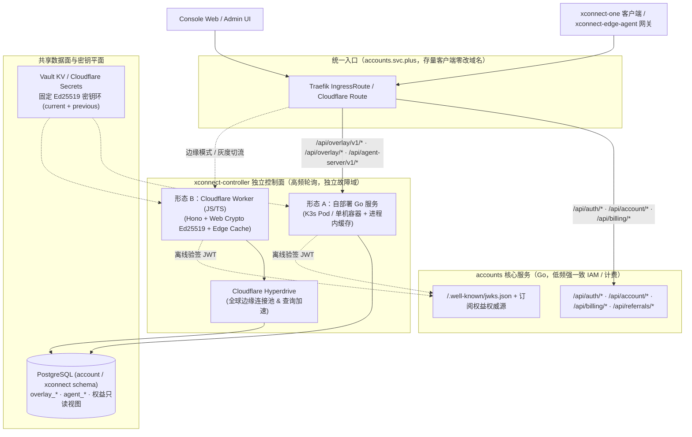

# XConnect 控制面（`xconnect-controller`）与 `accounts` 核心服务按业务域拆分、状态持久化及双形态部署规划

> [!NOTE]
> 本文档为**实施规划（Planning / Target Architecture）**，沉淀 **2026-11-25 ~ 2026-11-26** 在 `prod-k3s-v6`（`152.32.131.48`）、`jp-xconnect-gateway-01.svc.plus` 及多端 `xconnect-one`（macOS / Fedora / SIT）现网排障与优化中暴露的架构边界问题，并给出可分阶段落地的工程任务单。

---

## 一、规划背景与现网已验证基线

### 1.1 现网暴露的 4 个核心痛点

1. **故障域未隔离，高频控制面轮询拖垮核心 IAM 服务（P0）**：
   - `accounts`（低频强一致的登录、OAuth、订阅与计费鉴权服务）与 XConnect Overlay/Agent 高频控制面（4 分钟窗口内 `POST /api/overlay/v1/device/session` 335 次、`POST /api/agent-server/v1/status` 90 次、`GET /api/overlay/v1/gateway/signed-config` 27 次）运行在同一进程内。
   - 此前 `net-jp-xconnect-01` 的一条大 `policy_json`（383 KB）叠加 `256Mi / 100m` 配额导致 `web-saas-accounts-primary` 每 3–4 分钟触发 Cgroup OOMKilled（Exit 137），直接连带 Console 登录与 Billing 鉴权全线 502/503。
2. **控制面重启/滚动发布导致签名密钥轮换、全量存量节点断连（P0）**：
   - `accounts/internal/overlay/service.go`（`ConfigFromEnv()` / `NewService()`）在未配置 `XCONNECT_OVERLAY_SIGNING_PRIVATE_KEY` 时会生成随机临时 Ed25519 密钥对。
   - 每次 Pod 重启或 Flagger 灰度发版后，控制面下发的 `signing_keys` 变化，`xconnect-one` 校验 `signingKeyRingsOverlap` 失败并持续报错 `validate device session: device_session_invalid`，导致 MacOS（`10.67.0.4`）、Fedora（`10.67.0.5`）、SIT（`10.67.0.3`）、PROD（`10.67.0.2`）全量节点被迫重新 `join`。
3. **已绑定 One 节点重新 `login` / `join` / `up` 触发冲突或丢失绑定（P0）**：
   - 现有 One 设备采用严格单次注册语义，已绑定节点再次 `xconnect-one join` 直接返回 `HTTP 409 state_conflict`，被迫清库删除设备；
   - 清库或 `device_id` 漂移（如 macOS 因 `sudo` / 普通用户双状态目录导致 `xconnect-darwin-macos-jp-01` 变为 `xconnect-darwin-haitaodemacbook-pro-4-ac90ad85`）后，原 `policy_json` 中按 `device_id` 绑定的 ACL 规则全部悬空失效，Overlay IP 亦面临重新分配风险。
4. **策略契约三端漂移与节点侧热修复未固化（P1）**：
   - `accounts`、`xconnect-edge-agent`、`xconnect-one` 对规则 `action`（`allow` vs `accept`）与默认 ICMP 放行存在契约差异；
   - 网关节点 `jp-xconnect-gateway-01.svc.plus` 目前存在 3 项临时热修复（`/etc/fluxgate/conf.d/jp-xconnect-gateway-01.conf`、Xray `26.10.10` `finalRules` 放行 `127.0.0.1/32:51820-51821` 的 systemd drop-in、`xconnect-gateway-sync` `20-macos-fedora-allow.conf`），亟需固化到 IaC 与源码。

### 1.2 近期已完成的前置基线优化（避免重复工作）

| 仓库 | PR / 提交 | 已完成内容与实测效果 |
| :--- | :--- | :--- |
| `ai-workspace-services/accounts` | [#340](https://github.com/ai-workspace-services/accounts/pull/340)（`d451cf36`） | 按 `(network_id, config_generation)` 缓存不可变策略、高频查询 `Omit("policy_json")`、HTTP `ETag`/`If-None-Match` `304`；线上 `accounts-primary` 内存稳定在 `~27 MiB` |
| `ai-workspace-services/accounts` | [#341](https://github.com/ai-workspace-services/accounts/pull/341)（`b81b1a54`） | 下调 `SignedConfig` WireGuard `PersistentKeepaliveSeconds` 从 `25s` 至 `12s` |
| `ai-workspace-xstream/xconnect-one` | [#74](https://github.com/ai-workspace-xstream/xconnect-one/pull/74)（`7c64f47`） | Xray `xhttpSettings.xmux.hKeepAlivePeriod: 10`、`sockopt` (`10/5`)、`wgHost.NudgePeer` `0 -> keepalive` 立即触发握手、`NetworkMonitor` 300ms 防抖、`defaultTxStallWait: 12s` |
| `ai-workspace-xstream/xconnect-edge-agent` | `#169` | 支持 `--with-xconnect-gateway` 与 `XCONNECT_GATEWAY_DOMAIN` |
| `ai-workspace-infra/gitops` | [#983](https://github.com/ai-workspace-infra/gitops/pull/983) / [#985](https://github.com/ai-workspace-infra/gitops/pull/985) / [#986](https://github.com/ai-workspace-infra/gitops/pull/986) | `prod-k3s-v6` 调整 `accounts`（`500m/512Mi` + `GOMEMLIMIT=400MiB` + `3s` 探针）与 `traefik`（`500m/256Mi`），并通过 Flagger 完成新镜像灰度发布 |
| `ai-workspace-infra/playbooks` | `#1058`–`#1061` | `jp-xconnect-01` / `jp-xconnect-02` `ansible-pull` 配置收敛 |

---

## 二、目标架构：Go 自部署 + JS/TS Cloudflare Worker 双形态控制面

代码审计表明：`accounts/internal/overlay/` 的边界非常干净，**内部仅依赖 `account/internal/agentproto` 一个包**，外部入口只有 `api/overlay_v1.go`、`api/overlay_admin.go`、`api/overlay.go` 和 `cmd/accountsvc/main.go`。

目标架构放弃高复杂度/大体积的 Go WASM 方案，采用 **Go（自部署版）+ JS/TS（Cloudflare Worker 边缘版）双实现**，两者通过 **Cloudflare Hyperdrive 共享同一套 PostgreSQL Schema 与 Ed25519 签名密钥环**，并以**同一套跨语言 OpenAPI + Golden Test Vectors 契约测试套件**保证逐字节行为一致。

### 双形态架构对比

| 维度 | 形态 A：自部署版（Go：`xconnect-controller`） | 形态 B：边缘版（JS/TS：`xconnect-controller-edge`） |
| :--- | :--- | :--- |
| **适用场景** | K3s 生产集群（`prod-k3s-v6`）、私有化/自托管单机 | 全球低延迟 Serverless 边缘控制面 |
| **技术栈** | 原生 Go（`net/http` / `pgx` / `crypto/ed25519`） | TypeScript + Hono + Workers 原生 Web Crypto API（`Ed25519`、`JWKS`），`<100KB` 打包体积、`~0ms` 冷启动 |
| **数据面连接** | 直连 PostgreSQL | **Cloudflare Hyperdrive → 同一 PostgreSQL**（共享 Schema、强一致 IPAM 分配与 `config_generation` 原子递增） |
| **热读缓存** | 进程内 `(network_id, generation)` 不可变策略缓存 | Cloudflare Cache API / KV 缓存 `policy-artifacts`、`signing-keys`、`JWKS` + `ETag/304` |
| **密钥注入** | Vault KV → ExternalSecret → K8s Secret | Cloudflare Worker Secrets（同步同一套 `current + previous` Ed25519 密钥环） |
| **一致性保证** | CI 强制通过共享 `contracts/xconnect-overlay-v1/` Golden Vectors | 同左（Go 与 TS 产出逐字节等价的 `signingBytes`、签名与摘要） |

---

## 三、按业务域划分的完整 API 归属矩阵

基于对 `ai-workspace-services/accounts` 仓库 `api/api.go`、`api/overlay_v1.go`、`api/overlay_admin.go`、`api/overlay.go` 全量路由的盘点结果：

### 3.1 迁入 `xconnect-controller`（XConnect 组网与节点运行控制面域）

#### 第一批：Overlay 私有组网控制面（纯自治、低耦合、优先切流）
| 路由分组 | 具体接口 | 鉴权方式 | 迁移策略 |
| :--- | :--- | :--- | :--- |
| **设备/网关数据面** `/api/overlay/v1` | `POST /registrations` `POST /registrations/:registrationID/exchange` `POST /join-tokens/exchange` `POST /device/session` `GET /enrollment/signed-config` `GET /gateway/signed-config` `POST /enrollment/signed-config/:generation/ack` `GET /enrollment/policy-artifacts/:generation/:digest` | Device Credential / Registration Token / Enrollment Bearer（100% 自治） | 最高频流量，切流后立即隔离 `accounts` OOM 风险 |
| **用户侧接入** `/api/overlay/v1` | `GET /signing-keys` `GET /gateways` `POST /devices/enroll` `GET /signed-config` `POST /signed-config/:generation/ack` | `accounts` JWT（**JWKS 离线验签**） | 结合 T1.2 支持同 `device_id` 幂等 Re-join |
| **Overlay 管理面** `/api/overlay/v1/admin` | `GET /overview` · `GET /telemetry` `GET /networks` · `DELETE /networks/:networkID` · `PUT /networks/:networkID/mode` · `POST /networks/bootstrap` `GET/POST/DELETE /networks/:networkID/members(/:userID)` `GET/PUT /networks/:networkID/policy` · `POST /networks/:networkID/policy/explain` `GET /devices` · `POST /devices/:deviceID/revoke` `GET/POST /invites` `GET /registrations` · `POST /registrations/:registrationID/approve\|reject` | `accounts` Admin JWT（JWKS 离线验签 + `role`/`permissions` claims） | 审计日志解耦为独立审计表写入或异步回调 |
| **内部控制面 & 可观测** `/api/internal/overlay/*` `/api/internal/nodes/*` `/api/observability/internal/xconnect/*` | `POST /api/internal/overlay/nodes/heartbeat` `POST /api/internal/overlay/networks/bootstrap` `POST /api/internal/overlay/gateways/reconcile-stable-owner` `POST /api/internal/nodes/heartbeat` `POST /api/observability/internal/xconnect/identity` | Internal Service Token / Observability Token | 与 Overlay 拓扑强绑定，随第一批迁出 |
| **Legacy 兼容层** `/api/overlay/*` | `GET /networks` · `POST /devices/register` · `GET /devices` · `GET /config` · `POST /config/ack` | User JWT | 过渡期由 `xconnect-controller` 承接，待旧客户端清零后下线 |

#### 第二批：Agent-Server 节点运行面（高频心跳/配置，紧随第一批迁入）
| 路由分组 | 具体接口 | 跨域数据依赖与解耦方式 |
| :--- | :--- | :--- |
| **节点状态与配置** `/api/agent-server/v1` `/api/agent` | `POST /status`（高频心跳） `GET /managed-config` `GET /nodes` · `GET /api/agent/nodes` `GET /regional-pools` | 纯节点运行面状态与池配置，直接归属 `xconnect-controller` |
| **用户权益消费** `/api/agent-server/v1` | `GET /users` `GET /users/events`（SSE/流式） `GET /subscription` | **跨域边界**：初期通过共享 PostgreSQL 只读视图消费 `accounts` 订阅权益；后续演进为消费 `accounts` 发布的轻量权益投影/事件流，不直连计费核心表 |

### 3.2 保留在 `accounts`（核心 IAM / 订阅 / 计费 / 商业域）
- **身份与认证**：`/api/auth/*`（登录、注册、OAuth、TOTP、Session、Token 签发、**新增 `/.well-known/jwks.json`**）、`/api/users`
- **团队与商业权益授权**：`/api/auth/network-access`、`/api/auth/network-team*`、`/api/auth/admin/agents/grants`、`/api/auth/admin/agents/team-enrollments`、`/api/auth/admin/users/:userId/network-access`
- **账务、用量与内容**：`/api/account/*`、`/api/billing/*`、`/api/referrals/*`、`/api/task-sessions/*`
- **权威身份内部读接口**：`GET /api/internal/network/identities`（由 `accounts` 作为身份与订阅权威源对外提供）

---

## 四、关键专题设计

### 4.1 控制面状态持久化与防重启丢失
1. **Ed25519 签名密钥环持久化与平滑轮换**：
   - 将固定 Ed25519 私钥存入 `vault-prod` KV，通过 ExternalSecret 同步进 K8s Secret（Cloudflare 形态同步进 Worker Secrets），彻底消除随机临时密钥。
   - 控制面启动校验：非开发模式若缺少 `XCONNECT_OVERLAY_SIGNING_PRIVATE_KEY` 必须 **fail-fast 拒绝启动**。
   - 支持 **双公钥环（`current` + `previous`）**：`SigningKeys()` 同时下发当前签名公钥与上一代验证公钥，确保未来计划轮换密钥时所有在线客户端 `signingKeyRingsOverlap` 100% 平滑通过、零掉线。
2. **IPAM、设备身份与策略版本持久化**：
   - 依赖 PostgreSQL 唯一约束与行级锁（`SELECT ... FOR UPDATE`）保障 `wireguard_address` 分配与 `config_generation` 递增的原子性；
   - 增加 `overlay_enrollment_sessions` 过期定时清理（清理过期超过 24h 的记录），避免单设备表无限膨胀（现网曾出现单设备 20,226 行堆积）。

### 4.2 已绑定 One 节点幂等 `login` / `join` / `up` 行为契约

| 场景 | 控制面行为（`accounts` / `xconnect-controller`） | 客户端行为（`xconnect-one`） |
| :--- | :--- | :--- |
| **同 `device_id` + 同归属用户/合法成员重新 `login` / `join` / `up`** | 1. **禁止报 `HTTP 409 state_conflict`**； 2. **原地保留 `device_id`、`wireguard_address`（固定 Overlay IP）及 `policy_json` 中的所有 ACL 引用**； 3. 吊销旧 `device_credential`，签发新凭据、`enrollment_session` 与最新 `signing_keys`； 4. 若 `wireguard_public_key` 变化则原子更新并递增 `config_generation` 通知网关同步 | 自动清理残留 `.operation-lock` 与过期 `policy-state.json`，覆盖更新本地凭据与 `signing_keys`，`up -D` 一键无痛恢复 |
| **`device_id` 真正发生变化**（换机、清理 `/etc/xconnect-one/device-id` 或显式 `--regenerate-device-id`） | 视作新设备执行 **IPAM 新分配 IP + 新建设备绑定**，递增 `config_generation` | 明确统一 `/etc/xconnect-one/device-id` 优先级，避免 macOS/Linux 因 `sudo` 与普通用户切换 `state-dir`（如 `~/.xconnect-one` vs `~/.xconnect-one-user`）意外产生双 `device_id` |
| **跨用户/未授权主体尝试重入他人 `device_id`** | 严格校验 `owner_user_id` / `device.user_id` 与成员权限，拒绝并返回 `403 Forbidden` / `409 Conflict` | 明确报错提示设备已归属其他账号 |

---

## 五、分阶段可执行任务路线图（Phase 1 → Phase 4）

### Phase 1：止血与状态持久化（P0，立即落地）

| 任务 ID | 任务名称 | 涉及仓库 | 交付与验收标准 |
| :--- | :--- | :--- | :--- |
| **T1.1** | 固定 Ed25519 签名密钥持久化与双公钥环轮换 | `accounts`、`gitops` | Vault KV → ExternalSecret 注入固定私钥；支持 `current + previous` 公钥环；生产缺失私钥 fail-fast。验收：`accounts` 连续滚动重启 2 次，存量节点 0 `device_session_invalid`、隧道 0 中断 |
| **T1.2** | 已绑定 One 节点幂等 Re-join / Re-login | `accounts`、`xconnect-one` | 同 `device_id` + 同用户重 `join` 保留 IP 与 ACL 策略、原地轮换凭据/WG 公钥；跨用户拦截 `403/409`；客户端统一 `device-id` 优先级并清理过期锁。验收：单测 + 真实节点连续重 `join`/`up` IP 与策略不变 |
| **T1.3** | 三端策略契约统一与网关热修复固化 | `accounts`、`xconnect-edge-agent`、`playbooks` | 统一 `allow`/`accept` 与默认 ICMP 放行（`deny` 优先）；固化 `jp-xconnect-gateway-01` 的 Fluxgate 路由、Xray `26.10.10` `finalRules` 与 `XCONNECT_ZERO_FWD` 规则生成 |
| **T1.4** | `overlay_enrollment_sessions` 过期回收 | `accounts` | 增加周期清理过期 >24h 会话记录，附带 SQL 索引核查与单测 |

### Phase 2：业务域剥离 & 独立 Go 服务模块（`xconnect-controller`）上线

| 任务 ID | 任务名称 | 涉及仓库 | 交付与验收标准 |
| :--- | :--- | :--- | :--- |
| **T2.1** | JWKS 离线验签解耦 & 跨语言契约库沉淀 | `accounts`、`xconnect-controller` | `accounts` 暴露 `/.well-known/jwks.json`；控制面改用 JWKS 离线验签不查用户表；沉淀 `contracts/xconnect-overlay-v1/`（OpenAPI + Golden Vectors） |
| **T2.2** | 构建独立 Go 服务 `xconnect-controller` | `xconnect-controller`（推荐独立仓） | 迁入全部 Overlay V1 / Admin / Legacy / Internal 路由（第一批）与 Agent-Server 路由（第二批）；独立 `GOMEMLIMIT`、探针与 Flagger Canary |
| **T2.3** | Traefik `PathPrefix` 零感知灰度切流 | `gitops`（`ingress-prod/traefik-routes.yaml`） | 在 `Host(accounts.svc.plus)` 新增高优先级 `PathPrefix` 路由（`/api/overlay/v1`、`/api/overlay`、`/api/internal/overlay`、`/api/observability/internal/xconnect`，随后 `/api/agent-server/v1`、`/api/agent`）。验收：存量客户端/网关不改配置平滑切流，支持秒级回滚 |

### Phase 3：JS/TS Cloudflare Worker 边缘控制面（Hyperdrive + PostgreSQL）

| 任务 ID | 任务名称 | 涉及仓库 | 交付与验收标准 |
| :--- | :--- | :--- | :--- |
| **T3.1** | TS Worker 核心实现（`workers/xconnect-controller-edge`） | `xconnect-controller` | TypeScript + Hono + Web Crypto `Ed25519`/`JWKS` + **Hyperdrive PostgreSQL**；通过 `contracts/xconnect-overlay-v1/` 全部跨语言 Golden Vectors 契约测试 |
| **T3.2** | Hyperdrive 强一致写 + Edge Cache/KV 热读优化 | `xconnect-controller` | IPAM / Re-join / 策略写走 Hyperdrive 事务；`policy-artifacts`、`signing-keys`、`JWKS` 走 Edge Cache/KV，对外严格保留 `Cache-Control: private, no-store` 与 `ETag/304` |
| **T3.3** | Go 自部署 ↔ TS Worker 双形态互切演练 | `xconnect-controller`、`gitops` | 真实 `xconnect-one`（macOS / Fedora / SIT）与 `jp-xconnect-gateway-01` 在 Go 自部署与 Cloudflare Worker 间双向切换，验证 0 `device_session_invalid`、0 丢包、IP/策略一致 |

### Phase 4：收尾清理与完全解耦

| 任务 ID | 任务名称 | 涉及仓库 | 交付与验收标准 |
| :--- | :--- | :--- | :--- |
| **T4.1** | `accounts` 下线旧 Overlay/Agent-Server 路由 | `accounts` | 线上稳定运行 1–2 周后通过 feature flag 关闭并移除旧路由与 `/api/overlay/*` 遗留代码，`accounts` 回归纯 IAM + 订阅 + 计费核心服务 |

---

## 六、执行前确认项

1. **代码仓库组织**：新建独立仓库 `ai-workspace-services/xconnect-controller`（推荐：Go 自部署源码 + `workers/edge` TS Worker + `contracts/` 跨语言契约同仓统一维护），还是先在 `accounts` 仓内建 `cmd/xconnect-controller` 过渡？
2. **执行启动顺序**：确认后立即按 **Phase 1（T1.1 固定 Ed25519 签名私钥持久化 → T1.2 已绑定 One 节点幂等 Re-join → T1.3 策略契约统一与网关热修复固化 → T1.4 过期会话清理）** 依次推进并逐项上线验收。

---

## 七、执行验收记录（Form A 已完成 / Form B 代码就绪）

- **Phase 1（T1.1–T1.4）**：已完成并上线（`accounts#343`、`gitops#989`、`xconnect-gateway#32/#33`、`xconnect-one#75/#76`）。
- **Phase 2（T2.1–T2.3）**：已完成并上线（`accounts#344` 启用 `EdDSA` JWKS、`xconnect-controller#1/#3` 独立 Go 服务与契约库、`gitops#992/#994` 完成 Stage-1/Stage-2 全量切流及 `console` `RUNTIME_XCONNECT_ZERO_URL` 指向 `xconnect-controller`）。
- **Phase 3（T3.1–T3.2，Form B 代码就绪）**：已完成 `workers/xconnect-controller-edge/`（TypeScript + Hono + Cloudflare Hyperdrive + Web Crypto `Ed25519`/JWKS + Golden Vectors 字节级一致性 CI，`xconnect-controller#2`）；**T3.3** 线上部署待私有 PostgreSQL 的 Cloudflare Tunnel / Hyperdrive ID 就绪后执行。
- **Phase 4（T4.1，Form A 域隔离收口）**：`accounts#345` 默认下线 `/api/overlay/*`、`/api/overlay/v1/*` 与 `/api/internal/overlay/*`（保留全部 IAM、团队/网络权益、计费、Task Sessions 与 `GET /api/internal/network/identities`），`accounts` 回归核心业务服务。
